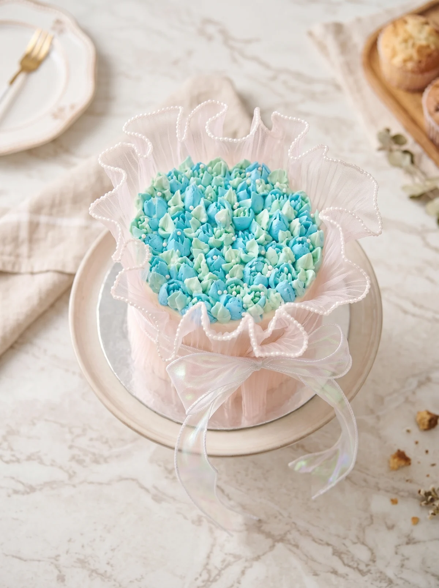

# Prompt: publish the 12 White Cakes journal posts

Paste everything below this line into your site builder or AI coder. The full text of all 12 posts, including their JSON-LD, is at the bottom of this file. The same posts are also in `/workspace/site/blog/` as separate `.md` files if you'd rather upload them.

---

You are updating the static website for **The White Cakes - Cebu** (https://www.thewhitecakes.com). It is a made-to-order luxury cake cloud kitchen in Lahug, Cebu City. There is no storefront or walk-in, pickup is by arrangement, and delivery covers Cebu City, Mandaue and Lapu-Lapu. Keep the existing design system, fonts, colours (ivory, midnight navy, dusty blue, blush, sage) and the "Notes from the bench" journal style. Language: `en-PH`.

**Hard rules**
- **Prices:** the approved launch list is already live (until January 15, 2027). Do not delete those prices or their Product offers. Bouquet cakes stay price on request, with no price in schema. Do not invent any other peso amount, `priceRange`, review, or rating. Samples later in this file that still say "prices are not published" are historical; do not copy that claim onto the live site.
- Do not invent reviews, ratings, awards, years in business, addresses or customer quotes.
- Do not change the wording of the posts, except to convert Markdown to HTML.
- WhatsApp: `https://wa.me/639474382632` (keep the `?text=` prefill given in each post). Messenger: `https://m.me/thewhitecakes`. The visible number is `+63 947 438 2632`.

## Posts to publish in this run

> **POSTS TO PUBLISH IN THIS RUN: 01, 02, 03, 04**
> (Edit this line on later runs, e.g. "05, 06" on 1 Dec. Only touch the posts listed here. Treat all other posts as not yet live.)

| # | Suggested publish date | URL | `<title>` |
|---|---|---|---|
| 01 | 2026-11-17 | `/journal/christmas-cake-delivery-cebu.html` | Christmas Cake Cebu: ₱650 Vintage Special \| White Cakes |
| 02 | 2026-11-20 | `/journal/what-is-a-bento-cake.html` | What Is a Bento Cake? Cebu Guide \| The White Cakes - Cebu |
| 03 | 2026-11-24 | `/journal/how-to-choose-wedding-cake-cebu.html` | Choosing a Wedding Cake in Cebu \| The White Cakes - Cebu |
| 04 | 2026-11-27 | `/journal/cake-delivery-cebu.html` | Metro Cebu Cake Delivery Guide \| The White Cakes - Cebu |
| 05 | 2026-12-01 | `/journal/how-far-ahead-to-order-a-cake-cebu.html` | How Early to Order a Cake in Cebu \| The White Cakes - Cebu |
| 06 | 2026-12-04 | `/journal/bouquet-cake-gift-cebu.html` | Bouquet Cakes as Gifts in Cebu \| The White Cakes - Cebu |
| 07 | 2026-12-08 | `/journal/corporate-office-cakes-cebu.html` | Corporate & Office Cakes in Cebu \| The White Cakes - Cebu |
| 08 | 2026-12-11 | `/journal/debut-cake-cebu.html` | Debut Cakes in Cebu: 18th Birthday \| The White Cakes - Cebu |
| 09 | 2026-12-15 | `/journal/first-birthday-sinulog-cake-cebu.html` | First Birthday & Sinulog Cakes \| The White Cakes - Cebu |
| 10 | 2026-12-22 | `/journal/how-to-brief-a-custom-cake-cebu.html` | How to Brief a Custom Cake in Cebu \| The White Cakes - Cebu |
| 11 | 2027-01-05 | `/journal/christening-cake-cebu.html` | Christening Cakes in Cebu \| The White Cakes - Cebu |
| 12 | 2027-01-15 | `/journal/valentines-bouquet-cake-cebu.html` | Valentine's Bouquet Cakes in Cebu \| The White Cakes - Cebu |

Posts 02 and 03 **replace the existing draft stubs at the same URLs** (`/journal/what-is-a-bento-cake.html` and `/journal/how-to-choose-wedding-cake-cebu.html`). The other 10 are new files.

## 1. Build each post page

For every post in this run, create or overwrite `/journal/<slug>.html` using the template of the existing live posts (for example `/journal/how-to-order.html`: same header, nav, footer, `<article class="article">`, CSS and JS).

From the post's front matter:
- `<title>`: use `title` exactly (60 characters or fewer).
- `<meta name="description">`: use `meta_description` exactly (155 characters or fewer).
- `<link rel="canonical">`: use `url`, written out plainly (`https://www.thewhitecakes.com/journal/...`). **No escaped slashes** (`https:\/\/`).
- `og:type` = `article`, `og:title` = `h1`, `og:description` = `meta_description`, `og:url` = `url`, `og:image` = `https://www.thewhitecakes.com/assets/og.webp`, `og:image:alt` = `og_image_alt`. Add matching Twitter card tags.
- `<meta name="robots" content="index, follow, max-image-preview:large">`. For 02 and 03, **remove `noindex`** and the "Draft · not published" label.
- `<html lang="en-PH">`.

Body:
- Convert the Markdown between the front matter and `<!-- JSONLD -->` to semantic HTML. Use one `<h1>`, `<h2>` for the question headings, `<h3>` for the FAQ questions, and real `<ul>`/`<ol>` lists. Code blocks become `<pre>`.
- Directly under the H1, add a byline: `By White Cakes · Lahug, Cebu City · <time datetime="YYYY-MM-DD">Published D Month YYYY</time>`, using the post's publish date.
- Render the **"Quick answer"** paragraph as a visually distinct lead paragraph (for example, a soft ivory box with a dusty-blue left border). Keep the words "Quick answer:" in it.
- **Photo placeholders** (the `> **Photo placeholder (real photo only):** ...` blocks): **do not show them on the page.** Replace each one with an HTML comment `<!-- PHOTO TODO: <description> | alt="<suggested alt text>" -->`. Do **not** generate or insert AI images. When the owner supplies a real photo later, insert it there as `.webp` with the suggested alt text, width and height, and `loading="lazy"`. Strip all EXIF and other metadata before uploading.
- Make internal links root-relative (`/bento-cakes-cebu/`). If a link points to a journal post that is **not yet live**, render its anchor text as plain text and keep a comment `<!-- LINK WHEN LIVE: /journal/... -->`. Links that already exist on the site must stay live links.
- Show the final "Order..." section as the existing CTA block with the WhatsApp and Messenger buttons.

Structured data:
- Paste the post's `<script type="application/ld+json">` block (under "Structured data") into `<head>` **exactly as given**. It already contains `BlogPosting`, `FAQPage` (matching the visible FAQ word for word) and `BreadcrumbList`.
- Remove the old `Article` or `BreadcrumbList` JSON-LD on 02 and 03 so there is no duplicate.
- If you publish a post on a different day from its suggested date, change `datePublished`, `dateModified` and the visible byline date to the real date.

## 2. Journal index `/journal/`

- Remove the "Coming soon on the bench..." line and any links to draft stubs. Leave no placeholder or draft entries anywhere on the site.
- List **all live posts**, newest first: the new posts published in this run plus the 4 existing ones (`how-to-order.html`, `choosing-a-flavor.html`, `which-cake.html`, `buttercream-in-cebu-heat.html`). Each entry gets its H1 as a link and a one-line summary taken from that post's meta description.
- Update the intro line so it no longer says "Four practical pieces." Describe it generally, for example "Practical notes on ordering, delivery and celebrating with cake in Cebu."
- Set the index `<title>` to `Journal: Cake Guides for Cebu | The White Cakes - Cebu`, and write a unique meta description of 155 characters or fewer.
- Add `BreadcrumbList` JSON-LD (Home > Journal) and a `Blog` JSON-LD with `blogPost` entries (headline, url, datePublished) for every live post.

## 3. Cross-links from product, occasion and area pages

On each page below, add a small section at the bottom of the main content, above the CTA, titled **"From our journal"**. Link 2–4 posts using the post's H1 as descriptive anchor text, and **only posts that are live**. Add more links on later runs as more posts go live.

| Page | Link these posts (when live) |
|---|---|
| `/cake-delivery-cebu-city/` | 04 delivery guide, 01 Christmas, 07 corporate, 09 first birthday & Sinulog |
| `/cake-delivery-mandaue/` | 04 delivery guide, 01 Christmas, 07 corporate |
| `/cake-delivery-lapu-lapu/` | 04 delivery guide, 01 Christmas, 09 first birthday & Sinulog, 12 Valentine's |
| `/birthday-cakes-cebu/` | 08 debut, 09 first birthday, 02 bento, 05 how far ahead |
| `/anniversary-cakes-cebu/` | 06 bouquet gift, 12 Valentine's, 02 bento |
| `/wedding-cakes-cebu/` | 03 wedding, 10 custom brief, 05 how far ahead |
| `/corporate-cake-orders-cebu/` | 07 corporate, 05 how far ahead, 02 bento |
| `/bento-cakes-cebu/` | 02 bento, 07 corporate, 12 Valentine's |
| `/bouquet-cakes-cebu/` | 06 bouquet gift, 12 Valentine's, 01 Christmas |
| `/custom-cakes-cebu/` | 10 custom brief, 11 christening, 08 debut, 03 wedding |
| `/faq/` | 05 how far ahead, 04 delivery guide, 10 custom brief. Put these in a "Related guides" block **below** the FAQ list. Do not edit the FAQ answers, so the FAQPage schema still matches. |
| Home page journal section | The 3 newest live posts |

On 02 (bento), replace the old line "Until this is finished, read our bento cakes in Cebu guide" entirely with the new post. Nothing from the stub stays.

## 4. Sitemap and robots

- Add each newly published post to `/sitemap.xml`: `<loc>` = post URL, `<lastmod>` = its publish date, `<changefreq>monthly</changefreq>`, `<priority>0.7</priority>`.
- Update `<lastmod>` for `/journal/` and for every page where you added cross-links to today's date.
- Unpublished posts and drafts must not appear in the sitemap.
- Keep `robots.txt` allowing everything, including AI search crawlers (`OAI-SearchBot`, `GPTBot`, `PerplexityBot`, `Google-Extended`, `ClaudeBot`, `Bingbot`). Do not add Disallow rules for them.

## 5. Optional: `/llms.txt` for AI search

Create `/llms.txt` (plain Markdown). It should contain:
- a one-paragraph description of the business, using only facts already on the site: cloud kitchen in Lahug, Cebu City; no storefront; three-day minimum notice; Signature Marble (6"), Bouquet Cake and Bento (4"); flavours chocolate, vanilla, ube, mango, red velvet; delivery to Cebu City, Mandaue and Lapu-Lapu; launch prices until January 15, 2027 (bouquet still price on request); WhatsApp +63 947 438 2632;
- links to the product, occasion and area pages, `/faq/`, and every live journal post, each with its meta description.

Update it on each run.

## 6. Checks before you finish

Report back with:
1. Every file changed or added.
2. Confirmation that published prices match the approved launch list, that bouquet cakes have no schema price, and that no other peso amount was invented.
3. Confirmation that every JSON-LD block is valid (Rich Results Test / schema.org validator syntax), that FAQ text matches the visible text, and that there are no escaped slashes in canonical or `og:url`.
4. Confirmation that every internal link returns 200 and no link points to an unpublished post.
5. Confirmation that the sitemap is valid XML and lists only indexable pages.
6. Confirmation that no draft or placeholder text is left anywhere ("Draft", "Placeholder", "Coming soon", `9XX`).

After publishing, the owner will submit the sitemap and request indexing for the new URLs in Google Search Console and Bing Webmaster Tools.

---

# Full text of the 16 posts


<!-- ===== FILE: 01-christmas-cake-delivery-cebu.md ===== -->

---
title: "Christmas Cake Cebu: ₱650 Vintage Special | White Cakes"
meta_description: "Order a 6-inch Christmas vintage cake in Cebu for ₱650 until Dec 25, 2026 (regular ₱1,650). Three days' notice; delivery to Cebu City, Mandaue and Lapu-Lapu."
h1: "Christmas Cake in Cebu: ₱650 Vintage Special and Delivery"
slug: christmas-cake-delivery-cebu
url: https://www.thewhitecakes.com/journal/christmas-cake-delivery-cebu.html
publish_date: 2026-11-17
date_modified: 2026-11-18
order: 1
status: new post
primary_keyword: "Christmas cake Cebu price and delivery"
secondary_keywords: ["Christmas cake delivery Cebu", "Christmas cake price Cebu", "Noche Buena cake Cebu", "Christmas cake Cebu City", "Christmas cake Mandaue Lapu-Lapu"]
internal_links: ["/bouquet-cakes-cebu/", "/bento-cakes-cebu/", "/cake-delivery-cebu-city/", "/cake-delivery-mandaue/", "/cake-delivery-lapu-lapu/", "/journal/buttercream-in-cebu-heat.html", "/faq/"]
og_image_alt: "Ivory and dusty-blue marble cake with a single piped rose, made to order in Cebu for Christmas"
---

# Christmas Cake in Cebu: ₱650 Vintage Special and Delivery

**Quick answer:** White Cakes' 6-inch Christmas vintage cake is ₱650 until December 25, 2026 (regular ₱1,650). To order for delivery in Cebu City, Mandaue or Lapu-Lapu, message at least three days ahead; weekends and holiday dates should be requested earlier. Send the date, flavour and full delivery address for confirmation.

> **Photo placeholder (real photo only):** the Signature Marble cake on a simple table with a little greenery. Suggested alt text: "Ivory buttercream cake with dusty-blue marbling and one piped rose, ready for a Christmas table in Cebu"

Christmas in Cebu runs long. The carols start in September. By December the calendar is full: office parties, barkada exchange gifts, family reunions after Simbang Gabi, Noche Buena on the 24th, and Media Noche to close the year. A cake shows up at almost all of them. This guide explains how to get a hand-finished one from our kitchen without last-minute stress.

We are a cloud kitchen in Lahug, so there is no storefront and no walk-in counter. Every cake is baked for the date you name, finished in buttercream by hand, and then picked up by arrangement or delivered. That model shapes everything below.

## What cakes can you order for Christmas from White Cakes?

Alongside Signature Marble, Bouquet Cake, Bento Cake and custom work, we offer a seasonal 6-inch Christmas vintage cake for ₱650 until December 25, 2026 (regular ₱1,650):

- **Signature Marble.** A 6-inch cake in smooth ivory buttercream with dusty-blue marbling, a shell border and a single rose. It is the centrepiece for a family Noche Buena table or a small reunion dinner. See it on our [custom cakes page](/custom-cakes-cebu/).
- **Bouquet Cake.** Buttercream rosettes finished like a wrapped bouquet. It is the cake we suggest when it is a gift. More on the [bouquet cakes page](/bouquet-cakes-cebu/).
- **Bento Cake.** A 4-inch cake with shells, a blush ribbon and one rose, for two people, a desk, or a small thank-you. See the [bento cakes page](/bento-cakes-cebu/). Launch price through January 15, 2027: ₱449 (regular price ₱599).
- **Christmas vintage cake.** A 6-inch seasonal cake for ₱650 until December 25, 2026 (regular price ₱1,650).

Flavours are chocolate, vanilla, ube, mango and red velvet. Red velvet and chocolate tend to suit a festive table. Ube is the one a Cebuano lola may be happiest to see.

Our look is Korean-inspired and minimalist: ivory, marble and dusty blue, piped by hand. If you want a seasonal touch, such as a short line like "Merry Christmas, Lola" or a deeper accent colour, send it with your order. We will tell you honestly what buttercream can do on your date. We pipe. We don't print edible sheets or sculpt fondant.

## How early should you order a Christmas cake in Cebu?

Our minimum is **three days before your date**, all year. The cake is mixed and baked for your day. It cools, gets its crumb coat, and only then is it piped and given time to set before it travels. That cannot be rushed.

December is different because many people want the same few dates. Here is how the 2026 calendar works with the three-day rule:

- **Christmas Eve (Thursday, 24 December 2026)** for Noche Buena: message us by **Monday, 21 December** at the very latest. We suggest the first or second week of December.
- **Christmas Day (Friday, 25 December):** message us first to confirm the date is open before you plan around it.
- **New Year's Eve (Thursday, 31 December)** for Media Noche: message us by **Monday, 28 December** at the latest.
- **Office parties and exchange-gift days** in early to mid December: message us as soon as HR sets the date.

Three days is a minimum, not a promise that your day is still free. When the bench is full, we say so in our reply instead of taking an order we cannot finish properly. Our guide on [how to order a custom cake in Cebu](/journal/how-to-order.html) explains the full process.

## Which cake makes the best Christmas gift in Cebu?

For a gift that arrives at someone else's door, choose the **Bouquet Cake**. Around Christmas, many people pair a bunch of roses with a mall cake. A bouquet cake is both in one: flowers you can slice. It looks like a present when the door opens, and it is lower than a tall tier, so it travels more calmly.

For colleagues, a ninong or ninang, or a neighbour, a **Bento Cake** works well. It is small, personal and easy to hand over. It also fits a desk at IT Park or a fridge already full of leftover lechon.

For your own family table, the **Signature Marble** is the centrepiece.

If you want to send cakes to several people, list each one with its address and the line on top. Each cake is piped separately, so the same three-day rule applies to every one.

## Can you deliver Christmas cakes to Cebu City, Mandaue and Lapu-Lapu?

Yes. We deliver to all three cities in December, with a few honest notes about holiday traffic:

- **Cebu City** ([delivery details](/cake-delivery-cebu-city/)): Lahug, IT Park, Banilad, Mabolo, Capitol Site and downtown all get heavy traffic near the malls in December, especially on weekends and paydays. We confirm a delivery window, not an exact minute.
- **Mandaue** ([delivery details](/cake-delivery-mandaue/)): routes along A.S. Fortuna, U.N. Avenue and toward the reclamation area slow down in the evenings. Villages with gate passes need your name on the guard's list before the driver arrives.
- **Lapu-Lapu and Mactan** ([delivery details](/cake-delivery-lapu-lapu/)): the bridges to Mactan get congested before the holidays. Resorts need the guest name on the order so security can match it. We build in a buffer, and we will tell you if your ceremony time is not realistic.

Someone must be there to receive the cake. A buttercream cake waiting in a warm vehicle outside a locked gate is exactly what we want to avoid. If your schedule is tight, ask for **pickup in Cebu City** instead. The meeting time and place are confirmed when we accept your order.

## How do you keep a buttercream cake safe until Noche Buena?

Noche Buena is late at night, and Cebu is warm even in December. If the cake arrives in the afternoon:

1. Put it in the fridge, in its closed box, on a shelf away from strong smells like garlic, fish or leftover adobo.
2. Take it out about 20 to 30 minutes before slicing so the crumb softens and the flavour comes back.
3. Never leave it in a parked car, on a sunny counter, or near the stove while the ham is cooking.

Our full guide, [keeping a buttercream cake in Cebu heat](/journal/buttercream-in-cebu-heat.html), covers car rides and timing in detail.

## What should you send when you order?

Save a round of back-and-forth by including these in your first message:

- Your name and a mobile number we can reach
- The date (a calendar day, not "the weekend before Christmas")
- The cake: Signature Marble, Bouquet, Bento or Custom
- The flavour
- The exact words for the top, spelled the way you want them piped
- Pickup, or delivery with a full address, a landmark and the receiver's number
- A reference photo if you want something custom

We reply within 24 hours with a confirmation, a question, or an honest no. Menu prices are on the homepage; custom prices depend on the design, and delivery is quoted for the full address.

## Frequently asked questions

### What is the last day to order a Christmas Eve cake in Cebu?
Our minimum is three days, so for Thursday, 24 December 2026 the latest is Monday, 21 December. December dates fill quickly, though, so message us in early December. We will confirm whether your date is still open.

### Do you have a special Christmas cake menu?
Yes. This season, our 6-inch Christmas vintage cake is ₱650 until December 25, 2026 (regular ₱1,650). You can also order Signature Marble, Bouquet Cake, Bento Cake or custom designs in chocolate, vanilla, ube, mango or red velvet. Send a short seasonal line or a reference photo, and we will confirm the details for your date.

### Can you deliver a Christmas cake as a gift to someone else's house?
Yes, within Cebu City, Mandaue and Lapu-Lapu. Give us the recipient's full address, a landmark and the mobile number of whoever will receive it. If it is a surprise, put the message in the order notes. We text the delivery window to you, not to the recipient.

### Do you deliver on Christmas Day and New Year's Day?
Message us first. Holiday dates depend on the bench schedule, and we will confirm honestly whether your date is available before you plan around it.

### How much is a Christmas cake from White Cakes?
The 6-inch Christmas vintage cake is ₱650 until December 25, 2026 (regular ₱1,650). Other designs use the current menu prices; custom prices depend on the design, and Bouquet Cake is price on request. Send your date and full address so we can confirm availability and delivery cost.

## Order your Christmas cake

Message us on **WhatsApp at [+63 947 438 2632](https://wa.me/639474382632?text=Hi%20White%20Cakes%2C%20I%27d%20like%20to%20order%20a%20Christmas%20cake)** or on **[Messenger](https://m.me/thewhitecakes)** with your date, cake and delivery address. We bake in Lahug and deliver to Cebu City, Mandaue and Lapu-Lapu. Please give us at least three days, and more in December.

<!-- JSONLD -->

## Structured data (paste into <head>)

```html
<script type="application/ld+json">
{"@context":"https://schema.org","@graph":[{"@type":"BlogPosting","@id":"https://www.thewhitecakes.com/journal/christmas-cake-delivery-cebu.html#article","headline":"Christmas Cake in Cebu: ₱650 Vintage Special and Delivery","description":"Order a 6-inch Christmas vintage cake in Cebu for ₱650 until Dec 25, 2026 (regular ₱1,650). Three days' notice; delivery to Cebu City, Mandaue and Lapu-Lapu.","abstract":"White Cakes' 6-inch Christmas vintage cake is ₱650 until December 25, 2026 (regular ₱1,650). To order for delivery in Cebu City, Mandaue or Lapu-Lapu, message at least three days ahead; weekends and holiday dates should be requested earlier. Send the date, flavour and full delivery address for confirmation.","datePublished":"2026-11-17","dateModified":"2026-11-18","inLanguage":"en-PH","mainEntityOfPage":{"@type":"WebPage","@id":"https://www.thewhitecakes.com/journal/christmas-cake-delivery-cebu.html"},"url":"https://www.thewhitecakes.com/journal/christmas-cake-delivery-cebu.html","image":{"@type":"ImageObject","url":"https://www.thewhitecakes.com/assets/og.webp","width":1200,"height":630},"author":{"@type":"Organization","name":"White Cakes","url":"https://www.thewhitecakes.com/"},"publisher":{"@type":"Organization","@id":"https://www.thewhitecakes.com/#organization","name":"The White Cakes - Cebu","alternateName":"White Cakes","url":"https://www.thewhitecakes.com/","logo":{"@type":"ImageObject","url":"https://www.thewhitecakes.com/assets/icon-512.png","width":512,"height":512},"telephone":"+639474382632","areaServed":[{"@type":"City","name":"Cebu City"},{"@type":"City","name":"Mandaue"},{"@type":"City","name":"Lapu-Lapu"}],"sameAs":["https://www.instagram.com/thewhitecakescebu/","https://www.facebook.com/thewhitecakes/"]},"keywords":"Christmas cake delivery Cebu, Christmas cake Cebu, Noche Buena cake Cebu, Christmas gift cake Cebu, cake delivery Mandaue Lapu-Lapu December","spatialCoverage":{"@type":"Place","name":"Metro Cebu, Philippines"},"about":{"@type":"Thing","name":"Christmas cake delivery Cebu"},"isPartOf":{"@type":"Blog","@id":"https://www.thewhitecakes.com/journal/","name":"Journal - Notes from the bench"}},{"@type":"FAQPage","@id":"https://www.thewhitecakes.com/journal/christmas-cake-delivery-cebu.html#faq","mainEntity":[{"@type":"Question","name":"What is the last day to order a Christmas Eve cake in Cebu?","acceptedAnswer":{"@type":"Answer","text":"Our minimum is three days, so for Thursday, 24 December 2026 the latest is Monday, 21 December. December dates fill quickly, though, so message us in early December. We will confirm whether your date is still open."}},{"@type":"Question","name":"Do you have a special Christmas cake menu?","acceptedAnswer":{"@type":"Answer","text":"No. You can order our Signature Marble, Bouquet Cake, Bento Cake or a custom design in chocolate, vanilla, ube, mango or red velvet. Send a short seasonal line or a reference photo, and we will tell you what buttercream can do."}},{"@type":"Question","name":"Can you deliver a Christmas cake as a gift to someone else's house?","acceptedAnswer":{"@type":"Answer","text":"Yes, within Cebu City, Mandaue and Lapu-Lapu. Give us the recipient's full address, a landmark and the mobile number of whoever will receive it. If it is a surprise, put the message in the order notes. We text the delivery window to you, not to the recipient."}},{"@type":"Question","name":"Do you deliver on Christmas Day and New Year's Day?","acceptedAnswer":{"@type":"Answer","text":"Message us first. Holiday dates depend on the bench schedule, and we will confirm honestly whether your date is available before you plan around it."}},{"@type":"Question","name":"How much is a Christmas cake from White Cakes?","acceptedAnswer":{"@type":"Answer","text":"The 6-inch Christmas vintage cake is ₱650 until December 25, 2026 (regular ₱1,650). Other designs use the current menu prices; custom prices depend on the design, and Bouquet Cake is price on request. Send your date and full address so we can confirm availability and delivery cost."}}]},{"@type":"BreadcrumbList","itemListElement":[{"@type":"ListItem","position":1,"name":"White Cakes","item":"https://www.thewhitecakes.com/"},{"@type":"ListItem","position":2,"name":"Journal","item":"https://www.thewhitecakes.com/journal/"},{"@type":"ListItem","position":3,"name":"Christmas Cake in Cebu: ₱650 Vintage Special and Delivery","item":"https://www.thewhitecakes.com/journal/christmas-cake-delivery-cebu.html"}]}]}
</script>

<!-- ===== FILE: 22-mango-cake-cebu.md ===== -->
---
title: "Mango Cake in Cebu | Order a Custom Mango-Flavoured Cake"
meta_description: "Looking for a mango cake in Cebu? Mango is one of White Cakes' custom cake flavours. See what to confirm about size, design, delivery and mango filling before ordering."
url: https://www.thewhitecakes.com/journal/mango-cake-cebu.html
h1: "Mango Cake in Cebu: What to Confirm Before You Order"
publish_date: 2026-11-18
og_image_alt: "Hand-finished celebration cake by White Cakes in Cebu; mango flavour can be requested for a custom order"
---

**Quick answer:** Mango is one of the flavours available for custom cakes at White Cakes in Cebu. Send your date, size, design reference and delivery address when you enquire. If you specifically want fresh mango pieces, mango filling or fruit on top, ask us to confirm that detail for your order; the flavour selection alone does not promise a particular filling or decoration.

## What mango flavour means for your cake

The phrase “mango cake” can mean different things: a cake with mango flavour, one layered with mango filling, or a cake decorated with fresh fruit. At White Cakes, mango is on the custom cake flavour list. The exact crumb, filling and finish should be confirmed in your order enquiry instead of assumed from the flavour name.

Our cakes are hand-finished with buttercream and made to order. If you have a specific mango cake in mind, send one clear reference photo and point out the part that matters most: mango in the cake, a fruit filling, a mango-coloured finish or fruit decoration. We will tell you what can be done for the date and design before you pay a deposit.

For the broader flavour list, see [cake flavours available in Cebu](/journal/choosing-a-flavor.html). If you are still comparing sizes or designs, start with our [custom cakes in Cebu](/custom-cakes-cebu/) page.

## Pick a size for the people sharing it

For one or two people, the 4-inch Bento is a compact option. It is a small cake, so it may not be enough as the only dessert for a family gathering. A larger celebration can start with a 6-inch or 8-inch custom cake; share the guest count and how it will be served so we can confirm a suitable size. We do not publish a fixed serving chart because slice size and the finished design affect how many portions you get.

Choose the cake format before settling on decoration. A short piped message and a simple colour palette keep the top easy to read. If a reference uses fresh mango, elaborate piping or a topper, ask whether those details are available rather than assuming they are included in the base flavour.

The [Cebu cake price guide](/journal/cake-prices-cebu.html) explains current starting prices and custom quotes. Price depends on the size and confirmed design; delivery is quoted separately for the destination.

## Plan pickup or delivery in Metro Cebu

White Cakes takes made-to-order cake enquiries for Cebu City, Mandaue and Lapu-Lapu. Delivery availability, route and fee depend on the complete address and delivery window. Send the barangay, street or building, a nearby landmark, recipient's mobile number and the time the cake needs to arrive. Wait for confirmation of the route and charge before paying the deposit.

Orders need at least three days' notice. A weekend, holiday or detailed design may need more planning, and the minimum notice does not guarantee a slot is open. If timing is important, include the date and serving time in your first message.

## What to include in your enquiry

Send these details together so we can check the order clearly:

1. The date you need the cake.
2. Size or guest count.
3. “Mango” as your flavour choice, plus any specific filling or fruit request.
4. One reference photo and the design details you want us to keep.
5. Exact cake message, including spelling and capitalization.
6. Pickup or delivery; for delivery, send the full address and receiving contact.
7. Allergy information. Our cakes contain gluten and dairy unless agreed otherwise in writing.

We confirm the design and total before a 50% deposit is paid. Once both are agreed and the deposit is received, the order is confirmed.

## Frequently asked questions

### Can I order a mango cake in Cebu from White Cakes?

Yes. Mango is one of the available flavours for custom cakes. Send your date, size, design reference and any details about the filling or topping so we can confirm the exact order.

### Does the mango flavour include fresh mango pieces or mango filling?

The flavour list does not specify a separate filling or fresh-fruit topping. If you want mango pieces inside or fresh mango on top, ask us to confirm that detail for your date before paying a deposit.

### How much does a mango cake cost in Cebu?

The total depends on cake size and the confirmed design. Delivery is quoted separately for your address. See the [current cake price guide](/journal/cake-prices-cebu.html) and request a complete quote.

### How early should I order?

Send your enquiry at least three days before the date. Ask earlier for weekends, holidays or designs with extra details, and wait for availability confirmation before paying.

## Ask about a mango cake

Use the [order form](/order/) or [message White Cakes on WhatsApp](https://wa.me/639474382632?text=Hi%20White%20Cakes%2C%20I%27d%20like%20to%20ask%20about%20a%20mango%20cake%20in%20Cebu). Include your date, size, any filling or fruit request and delivery address so we can confirm what is possible.

<!-- JSONLD -->
<script type="application/ld+json">
{
  "@context": "https://schema.org",
  "@graph": [
    {
      "@type": "BlogPosting",
      "@id": "https://www.thewhitecakes.com/journal/mango-cake-cebu.html#article",
      "headline": "Mango Cake in Cebu: What to Confirm Before You Order",
      "description": "Looking for a mango cake in Cebu? Mango is one of White Cakes' custom cake flavours. See what to confirm about size, design, delivery and mango filling before ordering.",
      "abstract": "Mango is an available flavour for White Cakes' custom cakes in Cebu. This guide explains how to specify size, design and any filling or fresh-fruit request, and how to confirm delivery, price and lead time.",
      "datePublished": "2026-11-18",
      "dateModified": "2026-11-18",
      "inLanguage": "en-PH",
      "mainEntityOfPage": {"@type": "WebPage", "@id": "https://www.thewhitecakes.com/journal/mango-cake-cebu.html"},
      "url": "https://www.thewhitecakes.com/journal/mango-cake-cebu.html",
      "image": {"@type": "ImageObject", "url": "https://www.thewhitecakes.com/assets/og.webp", "width": 1200, "height": 630},
      "author": {"@id": "https://www.thewhitecakes.com/#organization"},
      "publisher": {"@id": "https://www.thewhitecakes.com/#organization"},
      "keywords": "mango cake Cebu, mango cake Cebu City, order mango cake Cebu, mango-flavoured cake Cebu, custom cake Cebu delivery",
      "spatialCoverage": {"@type": "Place", "name": "Metro Cebu, Philippines"},
      "about": {"@type": "Thing", "name": "mango-flavoured cake in Cebu"},
      "isPartOf": {"@type": "Blog", "@id": "https://www.thewhitecakes.com/journal/", "name": "Journal - Notes from the bench", "publisher": {"@id": "https://www.thewhitecakes.com/#organization"}}
    },
    {
      "@type": "FAQPage",
      "@id": "https://www.thewhitecakes.com/journal/mango-cake-cebu.html#faq",
      "mainEntity": [
        {"@type": "Question", "name": "Can I order a mango cake in Cebu from White Cakes?", "acceptedAnswer": {"@type": "Answer", "text": "Yes. Mango is one of the available flavours for custom cakes. Send your date, size, design reference and any details about the filling or topping so we can confirm the exact order."}},
        {"@type": "Question", "name": "Does the mango flavour include fresh mango pieces or mango filling?", "acceptedAnswer": {"@type": "Answer", "text": "The flavour list does not specify a separate filling or fresh-fruit topping. If you want mango pieces inside or fresh mango on top, ask us to confirm that detail for your date before paying a deposit."}},
        {"@type": "Question", "name": "How much does a mango cake cost in Cebu?", "acceptedAnswer": {"@type": "Answer", "text": "The total depends on cake size and the confirmed design. Delivery is quoted separately for your address. See the current cake price guide and request a complete quote."}},
        {"@type": "Question", "name": "How early should I order?", "acceptedAnswer": {"@type": "Answer", "text": "Send your enquiry at least three days before the date. Ask earlier for weekends, holidays or designs with extra details, and wait for availability confirmation before paying."}}
      ]
    },
    {
      "@type": "BreadcrumbList",
      "itemListElement": [
        {"@type": "ListItem", "position": 1, "name": "Home", "item": "https://www.thewhitecakes.com/"},
        {"@type": "ListItem", "position": 2, "name": "Journal", "item": "https://www.thewhitecakes.com/journal/"},
        {"@type": "ListItem", "position": 3, "name": "Mango Cake in Cebu: What to Confirm Before You Order", "item": "https://www.thewhitecakes.com/journal/mango-cake-cebu.html"}
      ]
    }
  ]
}
</script>
```

<!-- ===== FILE: 13-graduation-cakes-cebu.md ===== -->
---
title: "Graduation Cakes in Cebu | The White Cakes - Cebu"
meta_description: "Planning a graduation cake in Cebu? Compare cake sizes, buttercream designs, flavours, delivery details and when to order for a grad celebration."
h1: "Graduation Cakes in Cebu: Designs, Sizes, and When to Order"
url: https://www.thewhitecakes.com/journal/graduation-cakes-cebu.html
publish_date: 2026-11-18
og_image_alt: "Ivory buttercream celebration cake by The White Cakes in Cebu"
---

**Quick answer:** For a graduation cake in Cebu, choose a design that suits the gathering: a small Bento cake for a gift or a custom buttercream cake for the family table. White Cakes makes cakes for a named date with at least three days' notice. Send the date, graduate's name, preferred colours, flavour, and whether the cake is for pickup or delivery.

Graduation days often bring relatives together after the ceremony, but the plan can be as simple as a cake at home or a meal with the family. The cake should fit the gathering, the available time and the table it will sit on. This guide explains the choices White Cakes can make in Cebu, Mandaue and Lapu-Lapu, and what information helps us confirm an order.

## Start with the kind of celebration

For a quiet dinner or a gift for one graduate, a 4-inch **Bento Cake** is a small, hand-finished choice. It is sized for two generous slices or three modest ones after a meal. For a home celebration with more people, consider a 6-inch **Signature Marble** or ask us about a custom size. If the gathering is larger, send the guest count before choosing a tiered cake; the number of people and how it will be served matter more than the word “graduation” on its own.

The [Bento cake page](/bento-cakes-cebu/) shows the small cake, while [custom cakes in Cebu](/custom-cakes-cebu/) lists the current starting sizes and prices.

## Choose a design that reads well in photos

Send the school colours or the party palette, the graduate's name, and a short line such as “Congratulations” or the degree. A name and one simple detail usually stay clearer on buttercream than several long lines. Check spelling before you confirm; lettering is piped from the words you send.

White Cakes works in hand-piped buttercream with details such as shells, roses, marbling and lettering. We do not offer fondant figures, edible photo prints or exact printed school logos. If you have a reference photo, send it and we can tell you what parts translate into buttercream and what may need a simpler version. A colour palette is a useful reference; it does not need to be an exact school crest.

## Pick a flavour for the people at the table

Available flavours are **chocolate, vanilla, ube, mango and red velvet**. If the cake is shared by a mixed-age family, tell us whether you want a familiar choice or a flavour that feels more celebratory to your family. The full [flavour guide](/journal/choosing-a-flavor.html) describes the options. If you want a particular flavour and design combination, include both in your message so we can confirm it for your date.

## Plan delivery around the ceremony

We deliver within Cebu City, Mandaue City and Lapu-Lapu City. A venue delivery needs more than the venue name: send the building or hall, the correct entrance, any gate or lobby instructions, the time someone can receive the cake, and a reachable mobile number. We confirm a delivery window rather than an exact minute. We deliver the cake but do not provide venue setup or cutting service.

For a home party, make sure someone can receive the cake and keep it cool until serving. Read the guide to [cake delivery across Metro Cebu](/journal/cake-delivery-cebu.html) and the [Cebu City delivery details](/cake-delivery-cebu-city/).

## When should you order?

The minimum lead time is **three days**. For a graduation date when many family members are celebrating, message earlier so we can confirm that the date and size fit the bench schedule. Ceremony dates can differ by school and year, so wait for the date from your institution before sending a deposit. Our guide explains [how far ahead to order a cake in Cebu](/journal/how-far-ahead-to-order-a-cake-cebu.html).

When you are ready, use the [order form](/order/) or message us on [WhatsApp](https://wa.me/639474382632). Include the date, size or guest count, flavour, words on top, reference colours, and pickup or delivery details. We reply within 24 hours with availability or a question.

## Frequently asked questions

### Can you make a graduation cake in school colours?

Yes, share the colours or a reference and we can confirm a buttercream design. We make hand-finished buttercream cakes, not printed school logos or edible photo cakes.

### How much is a graduation cake in Cebu?

Custom cake prices depend on size and design. Current starting prices are on the [custom cakes page](/custom-cakes-cebu/); the Bento price is on the [Bento page](/bento-cakes-cebu/). Delivery is quoted separately for the full address.

### Can you deliver to a graduation venue?

We deliver to Cebu City, Mandaue and Lapu-Lapu. Send the venue name, exact entrance, a contact person and the time someone can receive the cake. We do not set up the cake at the venue.

### How early should I order?

Three days is the minimum. For a large gathering or a busy graduation weekend, message earlier so we can confirm the schedule.

## Order a graduation cake

Send the date, graduate's name, flavour, design reference and guest count through the [order form](/order/) or [WhatsApp](https://wa.me/639474382632?text=Hi%20White%20Cakes%2C%20I%27d%20like%20to%20ask%20about%20a%20graduation%20cake).

<!-- JSONLD -->

## Structured data

```html
<script type="application/ld+json">
{"@context":"https://schema.org","@graph":[{"@type":"BlogPosting","@id":"https://www.thewhitecakes.com/journal/graduation-cakes-cebu.html#article","headline":"Graduation Cakes in Cebu: Designs, Sizes, and When to Order","description":"Planning a graduation cake in Cebu? Compare cake sizes, buttercream designs, flavours, delivery details and when to order for a grad celebration.","datePublished":"2026-11-18","dateModified":"2026-11-18","inLanguage":"en-PH","mainEntityOfPage":{"@type":"WebPage","@id":"https://www.thewhitecakes.com/journal/graduation-cakes-cebu.html"},"url":"https://www.thewhitecakes.com/journal/graduation-cakes-cebu.html","image":{"@type":"ImageObject","url":"https://www.thewhitecakes.com/assets/hero-celebration-cake-cebu.webp"},"author":{"@id":"https://www.thewhitecakes.com/#organization"},"publisher":{"@id":"https://www.thewhitecakes.com/#organization"},"keywords":"graduation cake Cebu, graduation cakes Cebu City, graduation cake delivery Cebu, custom graduation cake Cebu","spatialCoverage":{"@type":"Place","name":"Metro Cebu, Philippines"},"about":{"@type":"Thing","name":"graduation cakes in Cebu"},"isPartOf":{"@type":"Blog","@id":"https://www.thewhitecakes.com/journal/","name":"Journal - Notes from the bench","publisher":{"@id":"https://www.thewhitecakes.com/#organization"}}},{"@type":"FAQPage","@id":"https://www.thewhitecakes.com/journal/graduation-cakes-cebu.html#faq","mainEntity":[{"@type":"Question","name":"Can you make a graduation cake in school colours?","acceptedAnswer":{"@type":"Answer","text":"Yes, share the colours or a reference and we can confirm a buttercream design. We make hand-finished buttercream cakes, not printed school logos or edible photo cakes."}},{"@type":"Question","name":"How much is a graduation cake in Cebu?","acceptedAnswer":{"@type":"Answer","text":"Custom cake prices depend on size and design. Current starting prices are on the custom cakes page; the Bento price is on the Bento page. Delivery is quoted separately for the full address."}},{"@type":"Question","name":"Can you deliver to a graduation venue?","acceptedAnswer":{"@type":"Answer","text":"We deliver to Cebu City, Mandaue and Lapu-Lapu. Send the venue name, exact entrance, a contact person and the time someone can receive the cake. We do not set up the cake at the venue."}},{"@type":"Question","name":"How early should I order?","acceptedAnswer":{"@type":"Answer","text":"Three days is the minimum. For a large gathering or a busy graduation weekend, message earlier so we can confirm the schedule."}}]},{"@type":"BreadcrumbList","itemListElement":[{"@type":"ListItem","position":1,"name":"Home","item":"https://www.thewhitecakes.com/"},{"@type":"ListItem","position":2,"name":"Journal","item":"https://www.thewhitecakes.com/journal/"},{"@type":"ListItem","position":3,"name":"Graduation Cakes in Cebu: Designs, Sizes, and When to Order","item":"https://www.thewhitecakes.com/journal/graduation-cakes-cebu.html"}]}]}
</script>
```

<!-- ===== FILE: 14-cake-prices-cebu.md ===== -->
---
title: "Cake Prices in Cebu: Sizes & Menu | The White Cakes"
meta_description: "See current cake prices in Cebu by size, learn what custom cake starting prices include, and how delivery charges and deposits are confirmed."
h1: "Cake Prices in Cebu: Sizes, Custom Designs, and Delivery"
url: https://www.thewhitecakes.com/journal/cake-prices-cebu.html
publish_date: 2026-11-18
og_image_alt: "Signature Marble buttercream cake by The White Cakes in Cebu"
---

**Quick answer:** The White Cakes menu lists Bento, 6-inch, 8-inch and 2-tier cake prices. Custom cake prices are starting prices; the final design price is confirmed before a deposit. Delivery charges are quoted for the address, not set at one flat rate. A 50% deposit confirms an order.

If you are comparing cake prices in Cebu, check the size, design and delivery separately. A small Bento cake, a custom cake for a family table and a multi-tier cake are different orders. Here is how The White Cakes prices its current menu and what to send for a confirmed quote.

## Current menu prices

The following launch prices apply through **January 15, 2027 inclusive**. Regular prices apply from January 16. The live [cake menu and prices](/#pricing) should be checked before you order in case a promotion has changed.

| Cake | Launch price | Regular price after January 15, 2027 | Notes |
|---|---:|---:|---|
| Bento cake, 4 inch | ₱449 | ₱599 | Small cake for two generous slices or three modest slices after a meal |
| Custom cake, 6 inch | Starting at ₱1,399 | Starting at ₱1,799 | Final price depends on the design |
| Custom cake, 8 inch | Starting at ₱1,999 | Starting at ₱2,599 | Final price depends on the design |
| Custom cake, 2 tier | Starting at ₱3,399 | Starting at ₱4,299 | Confirm size, design and date before ordering |
| Bouquet Cake | Price on request | Price on request | Send the date and design for a quote |

A 6-inch or 8-inch cake is a starting size, not a promise that every design costs the starting price. Hand-piped details, a more complex reference or a larger cake can change the quote. The current [custom cake page](/custom-cakes-cebu/) explains the available sizes. If you need a small cake for two, compare the [Bento cake](/bento-cakes-cebu/) instead of comparing its price to a celebration-size cake.

## Does cake delivery cost extra?

Delivery charges are **not one flat rate** on the menu. Send the complete address, a landmark and the receiving person's mobile number. We confirm the delivery charge with your quote before you pay a deposit. Delivery is available in Cebu City, Mandaue City and Lapu-Lapu City; the [delivery pages](/cake-delivery-cebu-city/) explain what address details help the driver.

We agree on a delivery window rather than an exact minute. We deliver the cake but do not include venue setup, cake cutting or a staffed dessert table. Pickup in Cebu City can be arranged after your order is confirmed.

## What does “starting at” mean?

The 6-inch, 8-inch and 2-tier entries are starting prices for custom cakes. They let you compare sizes, but the final amount depends on what can be made for the date and the design you request. A photo reference helps us see whether the idea fits hand-piped buttercream. We will confirm the exact price before you send a deposit.

The price does not automatically include delivery. Bouquet Cakes do not have a published price; they are quoted after we know the date and design. For a complete quote, tell us the cake, flavour, size, inscription, date, delivery or pickup choice, and your delivery address if applicable.

## How do you confirm the order?

Orders need at least three days' notice. Send the date and cake details through the [order form](/order/) or [WhatsApp](https://wa.me/639474382632). We reply within 24 hours with availability, a question, or a quote. A **50% deposit** confirms the order after the design, price and delivery details are agreed.

## Frequently asked questions

### What is the cheapest cake on the menu?

During the launch promotion through January 15, 2027, the 4-inch Bento is ₱449 (regular price ₱599). It is a small cake for two generous or three modest slices, so choose a larger size if the cake is for a family table.

### Is delivery included in the cake price?

No flat delivery price is listed. We quote the charge for the full address and confirm it before the deposit.

### Why do custom cakes say “starting at”?

The final price depends on the design. The starting prices are for the listed sizes; White Cakes confirms the exact quote after reviewing the reference and date.

### How much deposit do I need?

A 50% deposit confirms the order after the final price and details are agreed.

### How early should I place an order?

At least three days before the date. A busy weekend, larger cake or more involved design may need earlier notice; ask as soon as you know the date.

## Get a confirmed cake quote

Send the size, design reference, flavour, date and delivery address through the [order form](/order/) or [WhatsApp](https://wa.me/639474382632?text=Hi%20White%20Cakes%2C%20could%20I%20get%20a%20cake%20quote%3F). We will confirm the exact total before the deposit.

<!-- JSONLD -->

## Structured data

```html
<script type="application/ld+json">
{"@context":"https://schema.org","@graph":[{"@type":"BlogPosting","@id":"https://www.thewhitecakes.com/journal/cake-prices-cebu.html#article","headline":"Cake Prices in Cebu: Sizes, Custom Designs, and Delivery","description":"See current cake prices in Cebu by size, learn what custom cake starting prices include, and how delivery charges and deposits are confirmed.","datePublished":"2026-11-18","dateModified":"2026-11-18","inLanguage":"en-PH","mainEntityOfPage":{"@type":"WebPage","@id":"https://www.thewhitecakes.com/journal/cake-prices-cebu.html"},"url":"https://www.thewhitecakes.com/journal/cake-prices-cebu.html","image":{"@type":"ImageObject","url":"https://www.thewhitecakes.com/assets/signature-marble-cake-cebu.webp"},"author":{"@id":"https://www.thewhitecakes.com/#organization"},"publisher":{"@id":"https://www.thewhitecakes.com/#organization"},"keywords":"cake prices Cebu, cake price Cebu City, custom cake price Cebu, Bento cake price Cebu, cake delivery charge Cebu","spatialCoverage":{"@type":"Place","name":"Metro Cebu, Philippines"},"about":{"@type":"Thing","name":"cake prices in Cebu"},"isPartOf":{"@type":"Blog","@id":"https://www.thewhitecakes.com/journal/","name":"Journal - Notes from the bench","publisher":{"@id":"https://www.thewhitecakes.com/#organization"}}},{"@type":"FAQPage","@id":"https://www.thewhitecakes.com/journal/cake-prices-cebu.html#faq","mainEntity":[{"@type":"Question","name":"What is the cheapest cake on the menu?","acceptedAnswer":{"@type":"Answer","text":"During the launch promotion through January 15, 2027, the 4-inch Bento is ₱449 (regular price ₱599). It is a small cake for two generous or three modest slices, so choose a larger size if the cake is for a family table."}},{"@type":"Question","name":"Is delivery included in the cake price?","acceptedAnswer":{"@type":"Answer","text":"No flat delivery price is listed. We quote the charge for the full address and confirm it before the deposit."}},{"@type":"Question","name":"Why do custom cakes say “starting at”?","acceptedAnswer":{"@type":"Answer","text":"The final price depends on the design. The starting prices are for the listed sizes; White Cakes confirms the exact quote after reviewing the reference and date."}},{"@type":"Question","name":"How much deposit do I need?","acceptedAnswer":{"@type":"Answer","text":"A 50% deposit confirms the order after the final price and details are agreed."}},{"@type":"Question","name":"How early should I place an order?","acceptedAnswer":{"@type":"Answer","text":"At least three days before the date. A busy weekend, larger cake or more involved design may need earlier notice; ask as soon as you know the date."}}]},{"@type":"BreadcrumbList","itemListElement":[{"@type":"ListItem","position":1,"name":"Home","item":"https://www.thewhitecakes.com/"},{"@type":"ListItem","position":2,"name":"Journal","item":"https://www.thewhitecakes.com/journal/"},{"@type":"ListItem","position":3,"name":"Cake Prices in Cebu: Sizes, Custom Designs, and Delivery","item":"https://www.thewhitecakes.com/journal/cake-prices-cebu.html"}]}]}
</script>
```

<!-- ===== FILE: 15-ube-cake-cebu.md ===== -->
---
title: "Ube Cake in Cebu: Ordering Guide | The White Cakes"
meta_description: "Order an ube cake in Cebu from White Cakes. See how to choose a size, request a hand-piped buttercream design, and arrange pickup or delivery."
h1: "Ube Cake in Cebu: How to Order a Custom Ube Cake"
url: https://www.thewhitecakes.com/journal/ube-cake-cebu.html
publish_date: 2026-11-18
og_image_alt: "Hand-finished buttercream cake from The White Cakes in Cebu"
---

**Quick answer:** Ube is one of the flavours offered by The White Cakes in Cebu. Choose a cake size and buttercream design, then include “ube” in your order request so we can confirm it for your date. Orders need at least three days' notice, with pickup arranged after confirmation or delivery in Metro Cebu.

When you search for ube cake in Cebu, you may be looking for a familiar Filipino flavour, a small cake to share, or a custom celebration cake. At White Cakes, ube is available alongside chocolate, vanilla, mango and red velvet. The cake is made to order and hand-finished in buttercream; this page explains what to send so we can confirm the design and date.

## Choose the cake size first

A 4-inch Bento cake is the small option for two generous slices or three modest slices after a meal. It can suit a quiet celebration or a gift. For a family table, see the 6-inch and 8-inch options on the [custom cakes page](/custom-cakes-cebu/). A larger or tiered order depends on the date and design, so include the number of guests and how you plan to serve it.

## Tell us which details matter most

“Ube cake” tells us the flavour, but a clear order also describes the date, size and finish. If you have a reference photo, share it and point out the parts you care about: the colour palette, piping, border, inscription or overall mood. Our style is hand-piped buttercream, with details such as shells, roses and marbling. We do not offer fondant figures or edible photo prints.

Tell us if the cake is for a birthday, graduation, anniversary or another occasion. We can then discuss a design that fits the event rather than assuming a generic purple cake. If you need a specific filling or preparation, ask first; we will confirm what is available for that order instead of guessing from the flavour name.

## How does ube compare with the other flavours?

White Cakes offers chocolate, vanilla, ube, mango and red velvet. If your guests have different preferences, mention that when you ask; we can confirm the available choice for your cake. The [cake flavour guide](/journal/choosing-a-flavor.html) is a quick overview, and the [custom cake ordering guide](/journal/how-to-order.html) lists the details needed for a complete request.

## Check price and lead time

The 4-inch Bento and custom cake pages show current menu prices. The custom cake prices are starting prices; the final price depends on the design and is confirmed before payment. Delivery charges are quoted separately for the address. A 50% deposit confirms an order after the design and total are agreed. See the current [cake prices in Cebu](/journal/cake-prices-cebu.html) for the menu and quote details.

The minimum lead time is **three days**. Message earlier for a busy date, a larger cake or a detailed design. We reply within 24 hours with availability or a question.

## Pickup and delivery around Cebu

Pickup is arranged in Cebu City after the order is confirmed. Delivery is available in Cebu City, Mandaue City and Lapu-Lapu City. Send the complete address, a landmark and a mobile number for whoever will receive the cake. We agree a delivery window, not an exact minute. Keep the cake in a cool place until serving; the article on [buttercream in Cebu heat](/journal/buttercream-in-cebu-heat.html) has practical handling notes.

## Frequently asked questions

### Do you offer ube cake in Cebu?

Yes. Ube is one of the flavours offered by The White Cakes. Include it in your request so we can confirm it for your date and design.

### Can I order a custom design with ube flavour?

Send the size, date, reference photo and flavour. White Cakes makes hand-piped buttercream cakes and will confirm which parts of the reference can be done for the order.

### How much is an ube cake?

Prices depend on the size and design. See the [Bento menu](/bento-cakes-cebu/) or [custom cake menu](/custom-cakes-cebu/) for current starting prices. Delivery is quoted separately for the address.

### How early should I order an ube cake?

At least three days before the date. Ask earlier for a busy weekend, a larger cake or a more detailed design.

### Can you deliver an ube cake in Cebu?

Delivery is available in Cebu City, Mandaue and Lapu-Lapu. Send a full address, a landmark and the receiver's mobile number so the delivery charge and window can be confirmed.

## Order an ube cake

Use the [order form](/order/) or message us on [WhatsApp](https://wa.me/639474382632?text=Hi%20White%20Cakes%2C%20I%27d%20like%20to%20ask%20about%20an%20ube%20cake). Include the date, size, ube flavour, design reference, inscription and pickup or delivery details.

<!-- JSONLD -->

## Structured data

```html
<script type="application/ld+json">
{"@context":"https://schema.org","@graph":[{"@type":"BlogPosting","@id":"https://www.thewhitecakes.com/journal/ube-cake-cebu.html#article","headline":"Ube Cake in Cebu: How to Order a Custom Ube Cake","description":"Order an ube cake in Cebu from White Cakes. See how to choose a size, request a hand-piped buttercream design, and arrange pickup or delivery.","datePublished":"2026-11-18","dateModified":"2026-11-18","inLanguage":"en-PH","mainEntityOfPage":{"@type":"WebPage","@id":"https://www.thewhitecakes.com/journal/ube-cake-cebu.html"},"url":"https://www.thewhitecakes.com/journal/ube-cake-cebu.html","image":{"@type":"ImageObject","url":"https://www.thewhitecakes.com/assets/cake-slice-cebu.webp"},"author":{"@id":"https://www.thewhitecakes.com/#organization"},"publisher":{"@id":"https://www.thewhitecakes.com/#organization"},"keywords":"ube cake Cebu, ube cake Cebu City, order ube cake Cebu, custom ube cake Cebu, ube cake delivery Cebu","spatialCoverage":{"@type":"Place","name":"Metro Cebu, Philippines"},"about":{"@type":"Thing","name":"ube cake in Cebu"},"isPartOf":{"@type":"Blog","@id":"https://www.thewhitecakes.com/journal/","name":"Journal - Notes from the bench","publisher":{"@id":"https://www.thewhitecakes.com/#organization"}}},{"@type":"FAQPage","@id":"https://www.thewhitecakes.com/journal/ube-cake-cebu.html#faq","mainEntity":[{"@type":"Question","name":"Do you offer ube cake in Cebu?","acceptedAnswer":{"@type":"Answer","text":"Yes. Ube is one of the flavours offered by The White Cakes. Include it in your request so we can confirm it for your date and design."}},{"@type":"Question","name":"Can I order a custom design with ube flavour?","acceptedAnswer":{"@type":"Answer","text":"Send the size, date, reference photo and flavour. White Cakes makes hand-piped buttercream cakes and will confirm which parts of the reference can be done for the order."}},{"@type":"Question","name":"How much is an ube cake?","acceptedAnswer":{"@type":"Answer","text":"Prices depend on the size and design. See the Bento menu or custom cake menu for current starting prices. Delivery is quoted separately for the address."}},{"@type":"Question","name":"How early should I order an ube cake?","acceptedAnswer":{"@type":"Answer","text":"At least three days before the date. Ask earlier for a busy weekend, a larger cake or a more detailed design."}},{"@type":"Question","name":"Can you deliver an ube cake in Cebu?","acceptedAnswer":{"@type":"Answer","text":"Delivery is available in Cebu City, Mandaue and Lapu-Lapu. Send a full address, a landmark and the receiver's mobile number so the delivery charge and window can be confirmed."}}]},{"@type":"BreadcrumbList","itemListElement":[{"@type":"ListItem","position":1,"name":"Home","item":"https://www.thewhitecakes.com/"},{"@type":"ListItem","position":2,"name":"Journal","item":"https://www.thewhitecakes.com/journal/"},{"@type":"ListItem","position":3,"name":"Ube Cake in Cebu: How to Order a Custom Ube Cake","item":"https://www.thewhitecakes.com/journal/ube-cake-cebu.html"}]}]}
</script>
```


<!-- ===== FILE: 02-what-is-a-bento-cake.md ===== -->

---
title: "What Is a Bento Cake? Cebu Guide | The White Cakes - Cebu"
meta_description: "A bento cake is a small 4-inch cake for one or two people. What it is, who it suits, and how to order a hand-piped bento cake in Cebu."
h1: "What Is a Bento Cake? A Small-Cake Guide for Cebu"
slug: what-is-a-bento-cake
url: https://www.thewhitecakes.com/journal/what-is-a-bento-cake.html
publish_date: 2026-11-20
date_modified: 2026-11-20
order: 2
status: replaces existing noindex draft (same URL). Remove noindex, add to sitemap.
primary_keyword: "what is a bento cake"
secondary_keywords: ["bento cake Cebu", "bento cake delivery Cebu", "mini cake Cebu", "Korean bento cake Cebu"]
internal_links: ["/bento-cakes-cebu/", "/birthday-cakes-cebu/", "/journal/which-cake.html", "/journal/how-to-order.html", "/cake-delivery-cebu-city/"]
og_image_alt: "4-inch ivory bento cake with piped shells, a blush ribbon and one rose, made in Cebu"
---

# What Is a Bento Cake? A Small-Cake Guide for Cebu

**Quick answer:** A bento cake is a small cake, usually about four inches across, made for one to three people and packed in a compact box. At White Cakes in Cebu, our bento is a 4-inch round in ivory buttercream with piped shells, a blush ribbon and one rose. It is baked to order with at least three days' notice.

> **Photo placeholder (real photo only):** a bento cake from directly above, showing the shells and the single rose. Suggested alt text: "Top view of a 4-inch ivory bento cake with piped shells and a single buttercream rose"

If you have scrolled through Cebu food pages recently, you have seen bento cakes: little round cakes in small boxes, often with a short message on top. This guide explains what the term means, who the cake is really for, and how ours differs from the rush versions you may have seen.

## What does "bento" mean on a cake?

The name comes from the Japanese *bento*, a single-portion boxed meal. A bento cake borrows the idea: one small cake, sized for one sitting and packed in a compact box you can carry in one hand. The style spread through Korean cafés and social media. That is why many people in the Philippines call it a "Korean bento cake" or a "lunchbox cake."

There is no official size, but most bento cakes are around four inches in diameter and low in height. Many are minimalist, with a smooth pastel coat, a simple piped border and a short phrase on top. That minimalism is part of why the style suits our kitchen. Our whole collection follows a quiet Korean-inspired look in ivory, marble, blush and dusty blue.

## How big is a bento cake, and who is it for?

Our bento is a **4-inch round**. In practice that means two generous slices, or three modest ones after a meal. It works best for:

- **Two people at one table:** a monthsary, a quiet anniversary, or a "we survived the week" Friday.
- **A desk celebration:** a colleague's birthday at an IT Park office where a tall cake would be awkward.
- **Someone celebrating alone:** a student in a Lahug or Talamban boarding house, or a family member working far from home.
- **A small gift you carry yourself:** a thank-you for a teacher, a ninang, or a friend who helped you move.

A bento is **not** a party centrepiece. If you are feeding a family table, the 6-inch Signature Marble is the better start (see [birthday cakes in Cebu](/birthday-cakes-cebu/)). If you are not sure which cake fits, our guide [Marble, bouquet, or bento](/journal/which-cake.html) walks through the choice.

## Why does a bento cake suit Cebu so well?

Two reasons: traffic and heat.

A low, small cake travels more safely than a tall tier. Think of a ride from Mabolo to Mactan in afternoon traffic, or along A.S. Fortuna into Mandaue at rush hour. A bento fits flat on a car seat. If you mention a motorcycle, it is the cake we will point you to, because it sits in a top box far better than a 6-inch centrepiece.

Buttercream also softens in Cebu warmth. A smaller cake goes from our hands to your table, and from your table into the fridge, more quickly. It is easier to keep cool and easier to finish before it sits out too long.

There is a third, quieter reason. Cebu celebrates a lot: birthdays, monthsaries, promotions, passing the board exam. Not every one of those needs a party. A bento lets you mark the day without making it an event.

## What flavours and messages can you get on a bento cake?

Our bento comes in the same five flavours as the rest of the collection: **chocolate, vanilla, ube, mango and red velvet**. A 4-inch bento is one flavour per cake.

The top has room for a **short line**. "Happy Birthday, Ate," "Congrats, RN," or a name and a date fit comfortably. Send the words exactly as you want them piped, spelling included. If your message is long, tell us and we will say whether it fits a 4-inch top or suggest a shorter version.

Our finish is always hand-piped buttercream: shells around the edge, a blush ribbon and one rose. We do not use printed toppers or edible photo sheets.

## How is a hand-finished bento different from a same-day one?

Same-day bento cakes are easy to find in Cebu. They come from mall counters, marketplace sellers and delivery apps. They are a different product, built for speed: pre-made bases, printed toppers and rush slots.

Ours is built for a named date. We mix and bake for your day, let the cake cool, crumb-coat it, and then pipe the shells, ribbon and rose by hand. That is why we ask for **at least three days**. If you need a cake tonight, we are honestly not the right kitchen. If you want a small cake that looks finished, with your words on it, on a day three or more days away, start here.

## How do you order a bento cake from White Cakes?

1. Choose your date, at least three days out.
2. Choose a flavour and write the line for the top.
3. Decide on pickup in Cebu City (arranged when we confirm) or delivery to Cebu City, Mandaue or Lapu-Lapu.
4. Message us on WhatsApp or Messenger, or use the order form with "Bento" selected.

For delivery, include a full address, a landmark and the mobile number of the person receiving it. Condos near IT Park and Cebu Business Park need lobby instructions. Villages in Banilad or Talamban need a gate note. Our [Cebu City delivery page](/cake-delivery-cebu-city/) has more detail. For the full checklist, read [how to order a custom cake in Cebu](/journal/how-to-order.html).

We reply within 24 hours. Because we are still preparing for launch, prices are not published. Every order gets a personalized quote.

## How should you keep a bento cake before eating it?

Keep it in its box, upright and out of the sun. If you collect it in the morning for an evening celebration, refrigerate it and take it out 20 to 30 minutes before slicing. Do not leave it in a parked car, even briefly. Because it is small, a bento warms up faster than a big cake, so the clock matters more, not less.

## Frequently asked questions

### How many people does a bento cake serve?
Our 4-inch bento serves two people generously, or three after a meal. For a family table, choose the 6-inch Signature Marble or message us with your guest count.

### Why is it called a bento cake?
The name borrows from the Japanese bento, a single-portion boxed meal, because the cake is small and packed in a compact box. The style became popular through Korean cafés and social media, which is why it is often called a Korean bento cake.

### Can I order a bento cake for tomorrow in Cebu?
Not from us. We need at least three days so the cake can be baked, cooled, crumb-coated and hand-piped for your date. Same-day sellers work on a different model.

### Can you write a message on a bento cake?
Yes. A short line fits on the 4-inch top, such as a name, "Happy Birthday" or a short congratulations. Send the exact spelling. If the message is long, we will tell you whether it fits.

### Do you deliver bento cakes in Cebu?
Yes, to Cebu City, Mandaue and Lapu-Lapu, with a full address, a landmark and someone to receive it. Pickup in Cebu City is also arranged when we confirm your order.

## Order a bento cake

Message us on **WhatsApp at [+63 947 438 2632](https://wa.me/639474382632?text=Hi%20White%20Cakes%2C%20I%27d%20like%20to%20order%20a%20bento%20cake)** or on **[Messenger](https://m.me/thewhitecakes)** with your date, flavour and the line for the top. See the full [bento cakes page](/bento-cakes-cebu/) for details.

<!-- JSONLD -->

## Structured data (paste into <head>)

```html
<script type="application/ld+json">
{"@context":"https://schema.org","@graph":[{"@type":"BlogPosting","@id":"https://www.thewhitecakes.com/journal/what-is-a-bento-cake.html#article","headline":"What Is a Bento Cake? A Small-Cake Guide for Cebu","description":"A bento cake is a small 4-inch cake for one or two people. What it is, who it suits, and how to order a hand-piped bento cake in Cebu.","abstract":"A bento cake is a small cake, usually about four inches across, made for one to three people and packed in a compact box. At White Cakes in Cebu, our bento is a 4-inch round in ivory buttercream with piped shells, a blush ribbon and one rose. It is baked to order with at least three days' notice.","datePublished":"2026-11-20","dateModified":"2026-11-20","inLanguage":"en-PH","mainEntityOfPage":{"@type":"WebPage","@id":"https://www.thewhitecakes.com/journal/what-is-a-bento-cake.html"},"url":"https://www.thewhitecakes.com/journal/what-is-a-bento-cake.html","image":{"@type":"ImageObject","url":"https://www.thewhitecakes.com/assets/og.webp","width":1200,"height":630},"author":{"@type":"Organization","name":"White Cakes","url":"https://www.thewhitecakes.com/"},"publisher":{"@type":"Organization","@id":"https://www.thewhitecakes.com/#organization","name":"The White Cakes - Cebu","alternateName":"White Cakes","url":"https://www.thewhitecakes.com/","logo":{"@type":"ImageObject","url":"https://www.thewhitecakes.com/assets/icon-512.png","width":512,"height":512},"telephone":"+639474382632","areaServed":[{"@type":"City","name":"Cebu City"},{"@type":"City","name":"Mandaue"},{"@type":"City","name":"Lapu-Lapu"}],"sameAs":["https://www.instagram.com/thewhitecakescebu/","https://www.facebook.com/thewhitecakes/"]},"keywords":"what is a bento cake, bento cake Cebu, bento cake delivery Cebu, mini cake Cebu, Korean bento cake Cebu","spatialCoverage":{"@type":"Place","name":"Metro Cebu, Philippines"},"about":{"@type":"Thing","name":"what is a bento cake"},"isPartOf":{"@type":"Blog","@id":"https://www.thewhitecakes.com/journal/","name":"Journal - Notes from the bench"}},{"@type":"FAQPage","@id":"https://www.thewhitecakes.com/journal/what-is-a-bento-cake.html#faq","mainEntity":[{"@type":"Question","name":"How many people does a bento cake serve?","acceptedAnswer":{"@type":"Answer","text":"Our 4-inch bento serves two people generously, or three after a meal. For a family table, choose the 6-inch Signature Marble or message us with your guest count."}},{"@type":"Question","name":"Why is it called a bento cake?","acceptedAnswer":{"@type":"Answer","text":"The name borrows from the Japanese bento, a single-portion boxed meal, because the cake is small and packed in a compact box. The style became popular through Korean cafés and social media, which is why it is often called a Korean bento cake."}},{"@type":"Question","name":"Can I order a bento cake for tomorrow in Cebu?","acceptedAnswer":{"@type":"Answer","text":"Not from us. We need at least three days so the cake can be baked, cooled, crumb-coated and hand-piped for your date. Same-day sellers work on a different model."}},{"@type":"Question","name":"Can you write a message on a bento cake?","acceptedAnswer":{"@type":"Answer","text":"Yes. A short line fits on the 4-inch top, such as a name, \"Happy Birthday\" or a short congratulations. Send the exact spelling. If the message is long, we will tell you whether it fits."}},{"@type":"Question","name":"Do you deliver bento cakes in Cebu?","acceptedAnswer":{"@type":"Answer","text":"Yes, to Cebu City, Mandaue and Lapu-Lapu, with a full address, a landmark and someone to receive it. Pickup in Cebu City is also arranged when we confirm your order."}}]},{"@type":"BreadcrumbList","itemListElement":[{"@type":"ListItem","position":1,"name":"White Cakes","item":"https://www.thewhitecakes.com/"},{"@type":"ListItem","position":2,"name":"Journal","item":"https://www.thewhitecakes.com/journal/"},{"@type":"ListItem","position":3,"name":"What Is a Bento Cake? A Small-Cake Guide for Cebu","item":"https://www.thewhitecakes.com/journal/what-is-a-bento-cake.html"}]}]}
</script>
```


<!-- ===== FILE: 03-how-to-choose-wedding-cake-cebu.md ===== -->

---
title: "Choosing a Wedding Cake in Cebu | The White Cakes - Cebu"
meta_description: "How to choose a wedding cake in Cebu: guest count, venue heat, buttercream vs fondant, delivery, and what to send for a quote. No guesswork."
h1: "How to Choose a Wedding Cake in Cebu"
slug: how-to-choose-wedding-cake-cebu
url: https://www.thewhitecakes.com/journal/how-to-choose-wedding-cake-cebu.html
publish_date: 2026-11-24
date_modified: 2026-11-24
order: 3
status: replaces existing noindex draft (same URL). Remove noindex, add to sitemap.
primary_keyword: "wedding cake Cebu"
secondary_keywords: ["how to choose a wedding cake Cebu", "wedding cake Cebu price", "intimate wedding cake Cebu", "buttercream wedding cake Cebu", "Mactan beach wedding cake"]
internal_links: ["/wedding-cakes-cebu/", "/custom-cakes-cebu/", "/anniversary-cakes-cebu/", "/journal/buttercream-in-cebu-heat.html", "/journal/choosing-a-flavor.html", "/faq/"]
og_image_alt: "Ivory buttercream wedding cake with dusty-blue marbling and piped roses for an intimate Cebu wedding"
---

# How to Choose a Wedding Cake in Cebu

**Quick answer:** To choose a wedding cake in Cebu, start with your real guest count, your venue (air-conditioned hall or open-air garden or beach) and the time the cake will be cut. Then pick a finish that survives that setting. White Cakes makes hand-piped buttercream cakes for intimate weddings and quotes from your brief.

> **Photo placeholder (real photo only):** the Signature Marble or a custom ivory cake on a simple cake stand with soft natural light. Suggested alt text: "Ivory buttercream wedding cake with dusty-blue marbling on a cake stand in Cebu"

Cebu has no shortage of wedding settings. Couples choose heritage churches downtown, garden venues up in the Busay and Talamban hills, hotel ballrooms around Cebu Business Park, and beach resorts on Mactan. Each setting asks something different of a cake. This guide walks through the decisions in the order that actually matters.

A note on who we are: White Cakes is a made-to-order cloud kitchen in Lahug, not a hotel pastry shop with display tiers. Our sweet spot is **intimate weddings, civil ceremonies, engagement dinners and rehearsal nights**. These are cakes finished by hand in ivory, blush, dusty blue and sage. If your plan is a towering five-tier for 400 guests, we will tell you honestly whether our bench can do it.

## How many guests does your wedding cake need to serve?

Start with a realistic number, not the invitation list. Then ask how the cake will be served:

- **As dessert after dinner.** Everyone gets a slice, so size matters most.
- **During cocktails or alongside a dessert table.** Smaller slices, and not every guest takes one.
- **Mostly for the cake-cutting photo and the couple's first slice.** Many Cebu couples keep the display cake modest and serve guests something else.

Tell us which one it is. A 6-inch cake is right for a civil wedding lunch with immediate family. A larger or tiered cake needs more bench time and earlier planning. We don't publish tier diagrams. We reply with the size and finish we can do for your date.

## Is buttercream or fondant better for a wedding in Cebu?

Both exist for good reasons, but we only work in **buttercream**. It tastes like cake rather than sugar paste, and it gives the soft, piped, minimalist finish of our collection: smooth ivory sides, marbling, shells and roses.

The honest trade-off is heat. Buttercream softens in warm air. Fondant holds up better outdoors, which is why many outdoor weddings use it. If you choose buttercream, plan around it:

- **Air-conditioned venues** (hotel function rooms, restaurants, indoor reception halls) are the easiest.
- **Open-air gardens and beachfronts** need the cake kept inside or in the shade until it is cut, and set out as close to the cutting as possible.
- **Afternoon photo sessions** with the cake outdoors are the riskiest moment. Schedule them quickly, or shoot indoors.

Our note on [keeping a buttercream cake in Cebu heat](/journal/buttercream-in-cebu-heat.html) explains what happens to piped cream in a warm room. Tell us the time the cake will be **cut**, not only when it is delivered.

## Intimate wedding or hotel tier: which is right for you?

If you are planning a civil wedding, a small church wedding followed by lunch, or a garden ceremony for fifty, a single beautiful cake usually looks more intentional than a tall stack. Our [Signature Marble](/custom-cakes-cebu/) (ivory, dusty-blue marble, a shell border and one rose) is a natural fit, and so is a custom design built on the same palette.

If your reception is a large ballroom event with a coordinated programme, a hotel package or a specialist wedding cake supplier with an on-site team may suit you better. We say so plainly because we would rather point you in the right direction than overpromise.

For engagement parties, pamamanhikan dinners and anniversaries after the wedding, see our [anniversary cakes page](/anniversary-cakes-cebu/). Many couples come back to the same palette for their first year.

## Which flavour should you choose for a wedding cake?

We bake **chocolate, vanilla, ube, mango and red velvet**. Some quick guidance:

- **Vanilla** lets the design lead and suits mixed-age tables.
- **Chocolate** is the safest crowd-pleaser.
- **Ube** feels Filipino and celebratory, and older relatives often love it.
- **Mango** is bright but softer in heat, so serve it indoors.
- **Red velvet** works with a bolder palette.

Read [choosing a flavor](/journal/choosing-a-flavor.html) for the longer version. For a larger cake, ask whether a second flavour is possible.

## How much does a wedding cake cost in Cebu?

This is one of the most searched questions, and the honest answer is that it depends on size, number of tiers, finish, date and delivery distance. That is true at every cake maker. We have **not published prices** because we are preparing for launch. Send us your brief and we will reply within 24 hours with what we can make and a personalized quote.

What to include in your message:

1. Wedding date and the time the cake will be cut
2. Venue name and city (Cebu City, Mandaue, Lapu-Lapu/Mactan)
3. Indoor air-conditioned, or open air
4. Realistic guest count and how the cake will be served
5. Palette (ivory, blush, dusty blue, sage, or your own) and one to three reference photos
6. Flavour preference
7. Any words, initials or a date for the cake

Our [wedding cakes page](/wedding-cakes-cebu/) has the same checklist.

## What happens on the wedding day: delivery and setup?

We deliver within Cebu City, Mandaue and Lapu-Lapu. Please plan for these points:

- **Someone at the venue must receive the cake.** Usually that is your coordinator or a venue staff member whose name and number you give us.
- **Resorts on Mactan** need the guest or event name on the order so security at the gate can match it.
- **We do not provide on-site cutting or a setup crew.** The cake arrives finished, and the venue or coordinator places it.
- **Ask your venue** about outside-cake policies and any corkage. That is between you and the venue, and we do not negotiate it.

Delivery is confirmed as a **window**, not an exact minute, because bridge traffic to Mactan and city traffic around wedding hours can shift. Allow a buffer before the programme.

## When should you start talking to a cake maker?

As soon as your date and venue are fixed. Our minimum for any cake is three days, but weddings should come much earlier, especially for multi-tier enquiries or dates in December, around Valentine's, or during Sinulog week in January, when the whole city is busy. Early contact lets us block the bench for your date and tell you honestly what is possible.

## Frequently asked questions

### How far ahead should I order a wedding cake in Cebu?
Message us as soon as your date and venue are set. Three days is our minimum for any cake, but multi-tier wedding cakes need much more lead time. Busy seasons like December and Valentine's fill early.

### Do you make fondant wedding cakes?
No. We work only in hand-piped buttercream: smooth ivory, marbling, shells and roses. We do not sculpt fondant or use printed edible sheets.

### Will a buttercream cake survive an outdoor wedding in Cebu?
It can, with planning. Keep the cake indoors or in the shade until it is cut, set it out as late as possible, and avoid long outdoor photo sessions with it. Tell us the cutting time when you send your brief.

### Do you deliver wedding cakes to resorts in Mactan?
Yes, we deliver to Lapu-Lapu and Mactan. Give us the venue, the guest or event name for the gate, and the name and number of the person receiving the cake. We confirm a delivery window with a buffer for bridge traffic.

### Do you set up or cut the wedding cake at the venue?
No. We deliver the finished cake to the person you name at the venue. Placement and cutting are handled by your coordinator or the venue staff.

### How much is a wedding cake from White Cakes?
Prices are not published yet while we prepare for launch. Send your date, venue, guest count and reference photos, and we will reply within 24 hours with a personalized quote.

## Start your wedding cake brief

Send your date, venue and guest count on **WhatsApp at [+63 947 438 2632](https://wa.me/639474382632?text=Hi%20White%20Cakes%2C%20I%27d%20like%20to%20ask%20about%20a%20wedding%20cake)** or **[Messenger](https://m.me/thewhitecakes)**. More answers are in our [FAQ](/faq/).

<!-- JSONLD -->

## Structured data (paste into <head>)

```html
<script type="application/ld+json">
{"@context":"https://schema.org","@graph":[{"@type":"BlogPosting","@id":"https://www.thewhitecakes.com/journal/how-to-choose-wedding-cake-cebu.html#article","headline":"How to Choose a Wedding Cake in Cebu","description":"How to choose a wedding cake in Cebu: guest count, venue heat, buttercream vs fondant, delivery, and what to send for a quote. No guesswork.","abstract":"To choose a wedding cake in Cebu, start with your real guest count, your venue (air-conditioned hall or open-air garden or beach) and the time the cake will be cut. Then pick a finish that survives that setting. White Cakes makes hand-piped buttercream cakes for intimate weddings and quotes from your brief.","datePublished":"2026-11-24","dateModified":"2026-11-24","inLanguage":"en-PH","mainEntityOfPage":{"@type":"WebPage","@id":"https://www.thewhitecakes.com/journal/how-to-choose-wedding-cake-cebu.html"},"url":"https://www.thewhitecakes.com/journal/how-to-choose-wedding-cake-cebu.html","image":{"@type":"ImageObject","url":"https://www.thewhitecakes.com/assets/og.webp","width":1200,"height":630},"author":{"@type":"Organization","name":"White Cakes","url":"https://www.thewhitecakes.com/"},"publisher":{"@type":"Organization","@id":"https://www.thewhitecakes.com/#organization","name":"The White Cakes - Cebu","alternateName":"White Cakes","url":"https://www.thewhitecakes.com/","logo":{"@type":"ImageObject","url":"https://www.thewhitecakes.com/assets/icon-512.png","width":512,"height":512},"telephone":"+639474382632","areaServed":[{"@type":"City","name":"Cebu City"},{"@type":"City","name":"Mandaue"},{"@type":"City","name":"Lapu-Lapu"}],"sameAs":["https://www.instagram.com/thewhitecakescebu/","https://www.facebook.com/thewhitecakes/"]},"keywords":"wedding cake Cebu, how to choose a wedding cake Cebu, wedding cake Cebu price, intimate wedding cake Cebu, buttercream wedding cake Cebu, Mactan beach wedding cake","spatialCoverage":{"@type":"Place","name":"Metro Cebu, Philippines"},"about":{"@type":"Thing","name":"wedding cake Cebu"},"isPartOf":{"@type":"Blog","@id":"https://www.thewhitecakes.com/journal/","name":"Journal - Notes from the bench"}},{"@type":"FAQPage","@id":"https://www.thewhitecakes.com/journal/how-to-choose-wedding-cake-cebu.html#faq","mainEntity":[{"@type":"Question","name":"How far ahead should I order a wedding cake in Cebu?","acceptedAnswer":{"@type":"Answer","text":"Message us as soon as your date and venue are set. Three days is our minimum for any cake, but multi-tier wedding cakes need much more lead time. Busy seasons like December and Valentine's fill early."}},{"@type":"Question","name":"Do you make fondant wedding cakes?","acceptedAnswer":{"@type":"Answer","text":"No. We work only in hand-piped buttercream: smooth ivory, marbling, shells and roses. We do not sculpt fondant or use printed edible sheets."}},{"@type":"Question","name":"Will a buttercream cake survive an outdoor wedding in Cebu?","acceptedAnswer":{"@type":"Answer","text":"It can, with planning. Keep the cake indoors or in the shade until it is cut, set it out as late as possible, and avoid long outdoor photo sessions with it. Tell us the cutting time when you send your brief."}},{"@type":"Question","name":"Do you deliver wedding cakes to resorts in Mactan?","acceptedAnswer":{"@type":"Answer","text":"Yes, we deliver to Lapu-Lapu and Mactan. Give us the venue, the guest or event name for the gate, and the name and number of the person receiving the cake. We confirm a delivery window with a buffer for bridge traffic."}},{"@type":"Question","name":"Do you set up or cut the wedding cake at the venue?","acceptedAnswer":{"@type":"Answer","text":"No. We deliver the finished cake to the person you name at the venue. Placement and cutting are handled by your coordinator or the venue staff."}},{"@type":"Question","name":"How much is a wedding cake from White Cakes?","acceptedAnswer":{"@type":"Answer","text":"Prices are not published yet while we prepare for launch. Send your date, venue, guest count and reference photos, and we will reply within 24 hours with a personalized quote."}}]},{"@type":"BreadcrumbList","itemListElement":[{"@type":"ListItem","position":1,"name":"White Cakes","item":"https://www.thewhitecakes.com/"},{"@type":"ListItem","position":2,"name":"Journal","item":"https://www.thewhitecakes.com/journal/"},{"@type":"ListItem","position":3,"name":"How to Choose a Wedding Cake in Cebu","item":"https://www.thewhitecakes.com/journal/how-to-choose-wedding-cake-cebu.html"}]}]}
</script>
```


<!-- ===== FILE: 04-cake-delivery-cebu.md ===== -->

---
title: "Metro Cebu Cake Delivery Guide | The White Cakes - Cebu"
meta_description: "Where we deliver cakes in Metro Cebu: Cebu City, Mandaue and Lapu-Lapu. What to send, delivery windows, bridge traffic, and when pickup is better."
h1: "Cake Delivery in Metro Cebu: Where We Deliver and How It Works"
slug: cake-delivery-cebu
url: https://www.thewhitecakes.com/journal/cake-delivery-cebu.html
publish_date: 2026-11-27
date_modified: 2026-11-27
order: 4
status: new post
primary_keyword: "cake delivery Cebu"
secondary_keywords: ["cake delivery Cebu City", "cake delivery Mandaue", "cake delivery Lapu-Lapu", "cake delivery Mactan", "cake delivery IT Park"]
internal_links: ["/cake-delivery-cebu-city/", "/cake-delivery-mandaue/", "/cake-delivery-lapu-lapu/", "/faq/", "/journal/buttercream-in-cebu-heat.html", "/journal/how-to-order.html"]
og_image_alt: "Boxed buttercream cake ready for delivery from a Lahug cloud kitchen to Metro Cebu"
---

# Cake Delivery in Metro Cebu: Where We Deliver and How It Works

**Quick answer:** White Cakes delivers hand-finished buttercream cakes from our Lahug cloud kitchen to Cebu City, Mandaue and Lapu-Lapu (including Mactan). Order at least three days ahead, and send a full address, a landmark and the receiver's mobile number. We confirm a delivery window, not an exact minute. Pickup in Cebu City is also available by arrangement.

> **Photo placeholder (real photo only):** a closed cake box being handed over at a door or condo lobby. Suggested alt text: "White Cakes cake box handed to a customer at a condo lobby in Cebu City"

"Cake delivery Cebu" can mean very different things. Some shops promise a cake within hours. Others pair a bouquet of roses with a mall cake. We are neither. We are a made-to-order kitchen in Lahug, with no storefront and no walk-in counter. We bake each cake for a named date and bring it to you. This guide explains exactly where we deliver, what we need, and what to expect on the day.

## Where does White Cakes deliver in Metro Cebu?

We deliver to three cities:

- **[Cebu City](/cake-delivery-cebu-city/):** Lahug, IT Park, Banilad, Mabolo, Capitol Site, the Ayala and Cebu Business Park area, Talamban, Sambag, downtown and the barangays along the main corridors.
- **[Mandaue](/cake-delivery-mandaue/):** A.S. Fortuna, U.N. Avenue, Subangdaku, the North Reclamation Area, and subdivisions along the coastal road toward Consolacion.
- **[Lapu-Lapu and Mactan](/cake-delivery-lapu-lapu/):** Pusok, Maribago, Mactan Newtown, the Punta Engaño road, and resorts and villages across the island.

**Where we don't currently list delivery:** towns outside those three cities, such as Talisay, Consolacion, Liloan or Cordova. If your address is near a boundary, send the pin and a landmark and we will tell you honestly whether we can reach it. If we can't, pickup in Cebu City may still work for you.

## How does delivery work in Cebu City?

Cebu City is our home base. From Lahug, IT Park, Banilad and Mabolo are close, while downtown, the port area and the uphill barangays take longer at peak hours.

- **Condos and offices** (IT Park, Cebu Business Park, Banilad towers) need lobby instructions, the floor and unit number if allowed, and the name of whoever will come down. Guards usually cannot accept a cake on your behalf, and buttercream should not wait in a warm guardhouse.
- **Villages in Banilad, Talamban and Maria Luisa** often have gate passes. Put your name on the guest list and tell us the phase and block, not only the subdivision name.
- **Schools and hospitals** need the exact building and a reachable number.

## What should you know about delivery to Mandaue?

Mandaue is right next to Cebu City, but routes along A.S. Fortuna, M.C. Briones (the national highway) and U.N. Avenue slow down at rush hour. Some factory gates in the reclamation area require visitor passes. Arrange the pass before the driver arrives and write the details in your order. A low bento travels more comfortably than a tall cake on a long, warm ride.

## How do deliveries to Lapu-Lapu and Mactan work?

Mactan Island is reached by bridge: the original Mactan–Mandaue Bridge and the Marcelo Fernan Bridge from Mandaue, or the Cebu–Cordova Link Expressway (CCLEX) from Cebu City's South Road Properties. Bridge traffic is unpredictable, especially in the late afternoon, during the December holidays and around Sinulog in January. We build in a buffer.

**Resorts and short-term rentals** along the Punta Engaño road and in Maribago check deliveries at the gate. Put the guest name from the booking on the order, or the driver may be turned away. If the cake must arrive before a fixed time, like a proposal dinner or a ceremony, tell us. We will say honestly whether that window is realistic.

## What do you need to include in a delivery order?

Copy this into your message:

1. **Date of delivery** (a calendar date, at least three days out)
2. **Full address:** street, building or village, phase/block/lot, barangay, city
3. **Landmark** visible from the road (a church, a school, a sari-sari store, a gas station)
4. **Receiver's name and mobile number**, if it is not you
5. **Gate, lobby or pass instructions**
6. **Your preferred time range** and the time the cake will be served

If the cake is a surprise, tell us. We text the delivery window to you, not to the recipient, unless you ask otherwise.

## Why do you give a delivery window and not an exact time?

Because Metro Cebu traffic moves in blocks. A flyover closure, a school dismissal on Gorordo Avenue, a fiesta procession or a jam on the bridge can add half an hour without warning. We agree a realistic window when we confirm your order, and we text you when the cake leaves the kitchen.

**Someone must be there to receive it.** A buttercream cake in a parked vehicle outside a locked gate is the situation we work hardest to avoid. Once it arrives, follow our guide on [keeping a buttercream cake in Cebu heat](/journal/buttercream-in-cebu-heat.html). Refrigerate it if the party is hours away.

## Can I order a cake for same-day delivery in Cebu?

Not from us. Every cake needs **at least three days**: it is baked for your date, cooled, crumb-coated and then piped by hand. Same-day cake delivery services in Cebu work on a different model, with ready bases, printed toppers and rush slots. If your date is inside three days, tell us plainly and we will tell you plainly whether anything is possible. Usually the honest answer is no.

## When is pickup better than delivery?

Pickup in Cebu City is arranged when we confirm your order. We don't publish a street address, and the meeting point and time come in our reply. Pickup makes sense when:

- your schedule is tight and you can't guarantee someone at the door,
- you're heading to a venue outside our delivery cities, or
- you'd rather carry the cake yourself, flat on a seat with the air-conditioning on.

The full ordering checklist is in [how to order a custom cake in Cebu](/journal/how-to-order.html).

## Frequently asked questions

### Which areas in Cebu do you deliver cakes to?
We deliver to Cebu City, Mandaue and Lapu-Lapu, including Mactan. That covers areas like Lahug, IT Park, Banilad, Mabolo, Talamban, A.S. Fortuna, the North Reclamation Area, Pusok, Maribago and the Punta Engaño road. Send a pin if you are unsure.

### Do you deliver to Talisay, Consolacion or Cordova?
They are not in our current delivery list. Send your pin and a landmark and we will confirm honestly. If we can't deliver, pickup in Cebu City may work.

### Do you offer same-day cake delivery in Cebu?
No. Each cake is baked and hand-piped for your date, so we need at least three days' notice.

### Can you deliver a cake as a surprise?
Yes. Give us the recipient's address, landmark and number, and put the message in the order notes. We send the delivery window to you, not to the recipient, unless you ask.

### What if nobody is home when the cake arrives?
Please make sure someone can receive it. A buttercream cake cannot safely wait in a warm vehicle. If your schedule is uncertain, choose pickup in Cebu City instead.

## Order a cake for delivery

Message us on **WhatsApp at [+63 947 438 2632](https://wa.me/639474382632?text=Hi%20White%20Cakes%2C%20I%27d%20like%20to%20order%20a%20cake%20for%20delivery)** or **[Messenger](https://m.me/thewhitecakes)** with your date, address and cake. Prices aren't published yet, so you'll get a personalized quote within 24 hours. More answers are in our [FAQ](/faq/).

<!-- JSONLD -->

## Structured data (paste into <head>)

```html
<script type="application/ld+json">
{"@context":"https://schema.org","@graph":[{"@type":"BlogPosting","@id":"https://www.thewhitecakes.com/journal/cake-delivery-cebu.html#article","headline":"Cake Delivery in Metro Cebu: Where We Deliver and How It Works","description":"Where we deliver cakes in Metro Cebu: Cebu City, Mandaue and Lapu-Lapu. What to send, delivery windows, bridge traffic, and when pickup is better.","abstract":"White Cakes delivers hand-finished buttercream cakes from our Lahug cloud kitchen to Cebu City, Mandaue and Lapu-Lapu (including Mactan). Order at least three days ahead, and send a full address, a landmark and the receiver's mobile number. We confirm a delivery window, not an exact minute. Pickup in Cebu City is also available by arrangement.","datePublished":"2026-11-27","dateModified":"2026-11-27","inLanguage":"en-PH","mainEntityOfPage":{"@type":"WebPage","@id":"https://www.thewhitecakes.com/journal/cake-delivery-cebu.html"},"url":"https://www.thewhitecakes.com/journal/cake-delivery-cebu.html","image":{"@type":"ImageObject","url":"https://www.thewhitecakes.com/assets/og.webp","width":1200,"height":630},"author":{"@type":"Organization","name":"White Cakes","url":"https://www.thewhitecakes.com/"},"publisher":{"@type":"Organization","@id":"https://www.thewhitecakes.com/#organization","name":"The White Cakes - Cebu","alternateName":"White Cakes","url":"https://www.thewhitecakes.com/","logo":{"@type":"ImageObject","url":"https://www.thewhitecakes.com/assets/icon-512.png","width":512,"height":512},"telephone":"+639474382632","areaServed":[{"@type":"City","name":"Cebu City"},{"@type":"City","name":"Mandaue"},{"@type":"City","name":"Lapu-Lapu"}],"sameAs":["https://www.instagram.com/thewhitecakescebu/","https://www.facebook.com/thewhitecakes/"]},"keywords":"cake delivery Cebu, cake delivery Cebu City, cake delivery Mandaue, cake delivery Lapu-Lapu, cake delivery Mactan, cake delivery IT Park","spatialCoverage":{"@type":"Place","name":"Metro Cebu, Philippines"},"about":{"@type":"Thing","name":"cake delivery Cebu"},"isPartOf":{"@type":"Blog","@id":"https://www.thewhitecakes.com/journal/","name":"Journal - Notes from the bench"}},{"@type":"FAQPage","@id":"https://www.thewhitecakes.com/journal/cake-delivery-cebu.html#faq","mainEntity":[{"@type":"Question","name":"Which areas in Cebu do you deliver cakes to?","acceptedAnswer":{"@type":"Answer","text":"We deliver to Cebu City, Mandaue and Lapu-Lapu, including Mactan. That covers areas like Lahug, IT Park, Banilad, Mabolo, Talamban, A.S. Fortuna, the North Reclamation Area, Pusok, Maribago and the Punta Engaño road. Send a pin if you are unsure."}},{"@type":"Question","name":"Do you deliver to Talisay, Consolacion or Cordova?","acceptedAnswer":{"@type":"Answer","text":"They are not in our current delivery list. Send your pin and a landmark and we will confirm honestly. If we can't deliver, pickup in Cebu City may work."}},{"@type":"Question","name":"Do you offer same-day cake delivery in Cebu?","acceptedAnswer":{"@type":"Answer","text":"No. Each cake is baked and hand-piped for your date, so we need at least three days' notice."}},{"@type":"Question","name":"Can you deliver a cake as a surprise?","acceptedAnswer":{"@type":"Answer","text":"Yes. Give us the recipient's address, landmark and number, and put the message in the order notes. We send the delivery window to you, not to the recipient, unless you ask."}},{"@type":"Question","name":"What if nobody is home when the cake arrives?","acceptedAnswer":{"@type":"Answer","text":"Please make sure someone can receive it. A buttercream cake cannot safely wait in a warm vehicle. If your schedule is uncertain, choose pickup in Cebu City instead."}}]},{"@type":"BreadcrumbList","itemListElement":[{"@type":"ListItem","position":1,"name":"White Cakes","item":"https://www.thewhitecakes.com/"},{"@type":"ListItem","position":2,"name":"Journal","item":"https://www.thewhitecakes.com/journal/"},{"@type":"ListItem","position":3,"name":"Cake Delivery in Metro Cebu: Where We Deliver and How It Works","item":"https://www.thewhitecakes.com/journal/cake-delivery-cebu.html"}]}]}
</script>
```


<!-- ===== FILE: 05-how-far-ahead-to-order-a-cake-cebu.md ===== -->

---
title: "How Early to Order a Cake in Cebu | The White Cakes - Cebu"
meta_description: "How many days before should you order a cake in Cebu? Why we ask for three days, when to message earlier, and how to get a quick yes."
h1: "How Far Ahead Should You Order a Cake in Cebu?"
slug: how-far-ahead-to-order-a-cake-cebu
url: https://www.thewhitecakes.com/journal/how-far-ahead-to-order-a-cake-cebu.html
publish_date: 2026-12-01
date_modified: 2026-12-01
order: 5
status: new post
primary_keyword: "how many days before to order a cake Cebu"
secondary_keywords: ["cake order lead time Cebu", "advance cake order Cebu", "custom cake how many days", "order cake in advance Cebu City"]
internal_links: ["/journal/how-to-order.html", "/faq/", "/wedding-cakes-cebu/", "/corporate-cake-orders-cebu/", "/custom-cakes-cebu/"]
og_image_alt: "Hands piping buttercream shells on an ivory cake in a Cebu kitchen"
---

# How Far Ahead Should You Order a Cake in Cebu?

**Quick answer:** For a hand-finished custom cake in Cebu, order at least three days before your date. At White Cakes, that is our firm minimum. Weddings, multiple cakes, large debuts and busy dates like Christmas, Valentine's and Sinulog week should be booked one to several weeks earlier. Same-day and next-day orders aren't possible on our bench.

> **Photo placeholder (real photo only):** close-up of hands piping shells or a rose on an ivory cake. Suggested alt text: "Buttercream shell border being piped by hand on an ivory cake in Cebu"

It's the question we get most often, usually phrased as "Pwede pa for Saturday?" The honest answer depends on what is being made and when. This guide explains our three-day rule, what those days are actually for, and when you should message even earlier.

## Why does White Cakes ask for three days' notice?

Because every cake is made for your date, not pulled from a display case. We are a cloud kitchen in Lahug with no counter of ready cakes. When your order comes in, nothing exists yet. The three days protect the parts of the process that cannot be rushed without the finish suffering.

This isn't a negotiating number that bends on a quiet Tuesday. It is the minimum for every cake we make: the 4-inch bento, the Bouquet Cake, the 6-inch Signature Marble and custom work.

## What actually happens during those three days?

Roughly, the work looks like this:

1. **Confirming the order.** We reply within 24 hours with a yes, a question, or an honest no. Details like spelling, flavour, pickup or delivery, and payment are settled here.
2. **Baking for your date.** The cake is mixed and baked so it is fresh for the day you named, not days before.
3. **Cooling and crumb coat.** A warm cake can't be coated. Once it cools, a thin first layer of buttercream seals the crumb and needs time to firm up, especially in Cebu's warmth.
4. **Final coat and piping.** The smooth ivory coat, the dusty-blue marble, the shells, ribbon and roses are all piped by hand.
5. **Setting before travel.** Piped buttercream needs a little time to set before the cake can ride through traffic to Mandaue or across the bridge to Mactan.

Take any step away and you see it on the cake: soft edges, smudged shells, a rose that slides.

## When should you order a cake even earlier?

Three days is the floor. Message us **earlier** if any of these apply:

- **Weddings and engagement dinners.** Contact us as soon as your date and venue are set. Multi-tier cakes take far more bench time than a single 6-inch. See [wedding cakes in Cebu](/wedding-cakes-cebu/).
- **Several cakes on one date.** Office birthdays, client gifts or a family ordering for three households: each cake is piped separately. See [corporate cake orders](/corporate-cake-orders-cebu/).
- **Debuts and large receptions.** A bigger cake for a hotel or function hall needs extra planning.
- **Custom designs** with a reference photo, where we may need to suggest changes for buttercream. See [custom cakes](/custom-cakes-cebu/).
- **Busy dates in Cebu:** Christmas Eve and New Year's Eve, Valentine's Day, Sinulog week in January, Mother's Day in May, and graduation season, when everyone wants the same weekend.

For these, a week or more of notice is kinder to everyone, and for weddings, much more. The earlier we know, the more likely your date is still open.

## Can you make a cake for tomorrow or today?

No, and we would rather say so clearly. If your date is inside three days, tell us plainly and we will answer plainly. We don't offer a rush fee to jump the queue, because the limit isn't the price. It is the time the cake needs.

If you truly need a cake today, look for same-day sellers. Several in Cebu are built for that, with ready bases and quick toppers. They are simply a different kind of cake from ours.

## What's the best day to send your order?

As soon as you know the date. A few Cebu-specific tips:

- **Weekend parties:** for a Saturday celebration, message us by Wednesday at the absolute latest, and earlier in the week is better.
- **Monthsaries and anniversaries:** these dates come around every month or year, so book ahead and stop worrying.
- **Office celebrations at IT Park or Cebu Business Park:** send the order as soon as HR or your team lead confirms the date, along with lobby and pass details.
- **Fiesta and family reunions:** Mandaue, Lapu-Lapu and the barangays across Cebu each have fiesta days. If yours falls on a busy weekend, book early.

## How do you send an order so we can say yes quickly?

The fastest orders contain everything in the first message:

- Your name and mobile number
- The date (a calendar day) and the time the cake will be served
- The cake: Signature Marble, Bouquet, Bento or Custom
- The flavour: chocolate, vanilla, ube, mango or red velvet
- The words for the top, spelled exactly
- Pickup in Cebu City, or delivery with a full address, a landmark and the receiver's number
- A reference photo, if custom

Our step-by-step guide is [how to order a custom cake in Cebu](/journal/how-to-order.html), and short answers are on the [FAQ](/faq/). Prices aren't published yet while we prepare for launch, so we send a personalized quote with our reply.

## Frequently asked questions

### How many days before should I order a cake in Cebu?
At least three days before your date for any White Cakes order. For weddings, several cakes, large events or busy holidays, message us one to several weeks earlier.

### Can I order a cake for tomorrow?
Not from us. Each cake is baked, cooled, crumb-coated and hand-piped for your date, which takes at least three days.

### Do you charge a rush fee for urgent cakes?
No. We don't take rush orders, so there is no rush fee. If your date is inside three days, we will tell you honestly that we can't make it.

### How far ahead should I order a wedding cake?
As soon as your date and venue are fixed. Multi-tier cakes need much more time than our three-day minimum, and popular dates fill early.

### What if I need to change the date after ordering?
Message us as soon as possible. Whether we can move it depends on the bench schedule, and we will tell you honestly in our reply.

## Book your date

Message us on **WhatsApp at [+63 947 438 2632](https://wa.me/639474382632?text=Hi%20White%20Cakes%2C%20I%27d%20like%20to%20book%20a%20cake%20date)** or **[Messenger](https://m.me/thewhitecakes)** with your date and cake. We reply within 24 hours.

<!-- JSONLD -->

## Structured data (paste into <head>)

```html
<script type="application/ld+json">
{"@context":"https://schema.org","@graph":[{"@type":"BlogPosting","@id":"https://www.thewhitecakes.com/journal/how-far-ahead-to-order-a-cake-cebu.html#article","headline":"How Far Ahead Should You Order a Cake in Cebu?","description":"How many days before should you order a cake in Cebu? Why we ask for three days, when to message earlier, and how to get a quick yes.","abstract":"For a hand-finished custom cake in Cebu, order at least three days before your date. At White Cakes, that is our firm minimum. Weddings, multiple cakes, large debuts and busy dates like Christmas, Valentine's and Sinulog week should be booked one to several weeks earlier. Same-day and next-day orders aren't possible on our bench.","datePublished":"2026-12-01","dateModified":"2026-12-01","inLanguage":"en-PH","mainEntityOfPage":{"@type":"WebPage","@id":"https://www.thewhitecakes.com/journal/how-far-ahead-to-order-a-cake-cebu.html"},"url":"https://www.thewhitecakes.com/journal/how-far-ahead-to-order-a-cake-cebu.html","image":{"@type":"ImageObject","url":"https://www.thewhitecakes.com/assets/og.webp","width":1200,"height":630},"author":{"@type":"Organization","name":"White Cakes","url":"https://www.thewhitecakes.com/"},"publisher":{"@type":"Organization","@id":"https://www.thewhitecakes.com/#organization","name":"The White Cakes - Cebu","alternateName":"White Cakes","url":"https://www.thewhitecakes.com/","logo":{"@type":"ImageObject","url":"https://www.thewhitecakes.com/assets/icon-512.png","width":512,"height":512},"telephone":"+639474382632","areaServed":[{"@type":"City","name":"Cebu City"},{"@type":"City","name":"Mandaue"},{"@type":"City","name":"Lapu-Lapu"}],"sameAs":["https://www.instagram.com/thewhitecakescebu/","https://www.facebook.com/thewhitecakes/"]},"keywords":"how many days before to order a cake Cebu, cake order lead time Cebu, advance cake order Cebu, custom cake how many days, order cake in advance Cebu City","spatialCoverage":{"@type":"Place","name":"Metro Cebu, Philippines"},"about":{"@type":"Thing","name":"how many days before to order a cake Cebu"},"isPartOf":{"@type":"Blog","@id":"https://www.thewhitecakes.com/journal/","name":"Journal - Notes from the bench"}},{"@type":"FAQPage","@id":"https://www.thewhitecakes.com/journal/how-far-ahead-to-order-a-cake-cebu.html#faq","mainEntity":[{"@type":"Question","name":"How many days before should I order a cake in Cebu?","acceptedAnswer":{"@type":"Answer","text":"At least three days before your date for any White Cakes order. For weddings, several cakes, large events or busy holidays, message us one to several weeks earlier."}},{"@type":"Question","name":"Can I order a cake for tomorrow?","acceptedAnswer":{"@type":"Answer","text":"Not from us. Each cake is baked, cooled, crumb-coated and hand-piped for your date, which takes at least three days."}},{"@type":"Question","name":"Do you charge a rush fee for urgent cakes?","acceptedAnswer":{"@type":"Answer","text":"No. We don't take rush orders, so there is no rush fee. If your date is inside three days, we will tell you honestly that we can't make it."}},{"@type":"Question","name":"How far ahead should I order a wedding cake?","acceptedAnswer":{"@type":"Answer","text":"As soon as your date and venue are fixed. Multi-tier cakes need much more time than our three-day minimum, and popular dates fill early."}},{"@type":"Question","name":"What if I need to change the date after ordering?","acceptedAnswer":{"@type":"Answer","text":"Message us as soon as possible. Whether we can move it depends on the bench schedule, and we will tell you honestly in our reply."}}]},{"@type":"BreadcrumbList","itemListElement":[{"@type":"ListItem","position":1,"name":"White Cakes","item":"https://www.thewhitecakes.com/"},{"@type":"ListItem","position":2,"name":"Journal","item":"https://www.thewhitecakes.com/journal/"},{"@type":"ListItem","position":3,"name":"How Far Ahead Should You Order a Cake in Cebu?","item":"https://www.thewhitecakes.com/journal/how-far-ahead-to-order-a-cake-cebu.html"}]}]}
</script>
```


<!-- ===== FILE: 06-bouquet-cake-gift-cebu.md ===== -->

---
title: "Bouquet Cakes as Gifts in Cebu | The White Cakes - Cebu"
meta_description: "A bouquet cake is flowers you can slice. When to send one in Cebu, what to tell us, and how delivery works in Cebu City, Mandaue and Lapu-Lapu."
h1: "Bouquet Cakes as a Gift in Cebu: Flowers You Can Slice"
slug: bouquet-cake-gift-cebu
url: https://www.thewhitecakes.com/journal/bouquet-cake-gift-cebu.html
publish_date: 2026-12-04
date_modified: 2026-12-04
order: 6
status: new post
primary_keyword: "bouquet cake Cebu"
secondary_keywords: ["cake bouquet delivery Cebu", "flower cake gift Cebu", "anniversary cake delivery Cebu", "thank you cake Cebu"]
internal_links: ["/bouquet-cakes-cebu/", "/anniversary-cakes-cebu/", "/cake-delivery-cebu-city/", "/journal/which-cake.html", "/journal/how-to-order.html"]
og_image_alt: "Buttercream bouquet cake with piped rosettes, a tissue-style wrap and a bow, made in Cebu"
---

# Bouquet Cakes as a Gift in Cebu: Flowers You Can Slice

**Quick answer:** A bouquet cake is a buttercream cake piped with rosettes and finished like a wrapped bouquet, so it looks like flowers and tastes like cake. In Cebu, it is a thoughtful gift for anniversaries, thank-yous and get-well wishes. White Cakes bakes each one to order with three days' notice and delivers to Cebu City, Mandaue and Lapu-Lapu.

> **Photo placeholder (real photo only):** the Bouquet Cake from a slight angle, showing the rosettes, pleated collar and bow. Suggested alt text: "Bouquet cake with piped buttercream rosettes, a pleated tissue-style collar and a bow"

In Cebu, a gift often comes in two parts: a bunch of roses from a flower shop and a cake from the mall. A bouquet cake puts both in one box. This guide explains what ours is, when it is the right gift, and how to send one so it arrives looking the way it should.

## What exactly is a bouquet cake?

Our [Bouquet Cake](/bouquet-cakes-cebu/) is buttercream piped into rosettes, with sage leaves tucked between them. The collar is pleated like tissue wrapping, pearls run along the edge, and a bow sits at the waist. It reads as a bouquet on arrival and becomes dessert once someone picks up a knife.

It is lower and softer than our Signature Marble. "Bouquet" describes the finish, not one fixed size. Tell us the table or the number of people and we confirm the scale when we reply. All five flavours are available: chocolate, vanilla, ube, mango and red velvet.

Every rosette is piped by hand. We don't use printed sheets, wafer-paper flowers or artificial stems.

## When is a bouquet cake the right gift?

Choose a bouquet cake when the person would rather be given flowers than a tall birthday cake with candles:

- **Anniversaries and monthsaries.** Soft, romantic and sized for a dinner for two or a small family table. See [anniversary cakes](/anniversary-cakes-cebu/).
- **Thank-you gifts.** For a ninang who helped with the wedding, a doctor or nurse after a hospital stay, or a teacher at the end of the school year.
- **Mother's Day and lola's birthday.** For the woman in the family who always says "Ayaw na, sayang ra" when you buy flowers. See our [Mother's Day cake guide for Cebu](/journal/mothers-day-cakes-cebu.html) for date, design and delivery planning.
- **Congratulations.** A new job, passing the boards, a new home in Talamban or a first condo near IT Park.
- **A table that wants colour more than height,** like a merienda, a small lunch or a despedida.

Planning an anniversary inscription? Our [short anniversary cake message guide](/journal/anniversary-cake-message-ideas-cebu.html) has wording ideas that fit on the cake.

If children are waiting to see their name on a cake with candles, choose the Signature Marble instead. Our guide [Marble, bouquet, or bento](/journal/which-cake.html) explains the difference.

## Why send a bouquet cake instead of flowers and a cake?

Practically, it is one delivery instead of two, one box to receive instead of two, and nothing to throw away a few days later. A bouquet cake doesn't wilt on the dining table, and everyone at home gets a slice.

It also says something different. A grocery cake plus roses is familiar. A hand-piped bouquet in ivory, blush and dusty blue shows that someone planned ahead, at least three days ahead in fact.

## What should you tell us when sending a bouquet cake as a gift?

Gifts go wrong when the delivery details are thin. Include:

1. **Who it is for,** with their name for the order notes.
2. **The line on the cake,** spelled exactly ("Happy Anniversary, Mahal," "Salamat, Doc," "Happy 70th, Lola").
3. **The date,** at least three days out.
4. **The full delivery address**: street, building or village, unit or block and lot, barangay and city.
5. **A landmark** visible from the road.
6. **The receiver's mobile number,** or the person who will open the door.
7. **Surprise or not.** If it is a surprise, we text the delivery window to you, not to them.

Our full checklist is in [how to order a custom cake in Cebu](/journal/how-to-order.html).

## How does a bouquet cake arrive looking like a bouquet?

The finish is the gift, so we plan around protecting it:

- We confirm a **delivery window** that suits the recipient, not just the sender.
- **Someone must receive it.** Guards at condo lobbies around Cebu Business Park and IT Park usually can't hold a cake, and a buttercream bouquet shouldn't wait in a warm guardhouse.
- For **villages in Banilad, Talamban or Mandaue**, put the recipient's name on the gate list.
- For **Mactan resorts and homes**, give the guest name for gate checks and allow for bridge traffic.

Delivery details for each city are on the [Cebu City](/cake-delivery-cebu-city/), Mandaue and Lapu-Lapu pages.

## How should the recipient keep a bouquet cake?

A short note for whoever receives it:

- Keep it upright, in its box, out of the sun.
- If it will be served later that day, refrigerate it in the closed box, away from strong-smelling food.
- Take it out 20 to 30 minutes before slicing.
- Don't leave it in a car or by a sunny window. Cebu afternoons soften piped flowers quickly.

You might even forward these lines to the recipient with your message.

## Frequently asked questions

### What is a bouquet cake?
It is a buttercream cake piped with rosettes and sage leaves and finished like a wrapped bouquet, with a pleated collar, pearls and a bow. It looks like flowers and is sliced like a cake.

### Can I send a bouquet cake to someone in Cebu as a surprise?
Yes. We deliver to Cebu City, Mandaue and Lapu-Lapu. Give us the recipient's address, landmark and number, and mark it as a surprise. We text the delivery window to you only.

### How big is your bouquet cake?
Bouquet describes the finish rather than a single size. Tell us the number of people or the table, and we confirm the scale in our reply.

### Are the flowers on the bouquet cake real?
No. Every flower is piped by hand in buttercream. We don't put fresh or artificial flowers on the cake. Ask us if you want to know which parts of the finish are edible.

### How far ahead should I order a bouquet cake?
At least three days before the date. For Valentine's, Mother's Day and December, message us earlier because those dates fill quickly.

## Send a bouquet cake

Message us on **WhatsApp at [+63 947 438 2632](https://wa.me/639474382632?text=Hi%20White%20Cakes%2C%20I%27d%20like%20to%20send%20a%20bouquet%20cake)** or **[Messenger](https://m.me/thewhitecakes)** with the date, the recipient's address and the line for the top. Prices aren't published yet, so we will send you a personalized quote.

<!-- JSONLD -->

## Structured data (paste into <head>)

```html
<script type="application/ld+json">
{"@context":"https://schema.org","@graph":[{"@type":"BlogPosting","@id":"https://www.thewhitecakes.com/journal/bouquet-cake-gift-cebu.html#article","headline":"Bouquet Cakes as a Gift in Cebu: Flowers You Can Slice","description":"A bouquet cake is flowers you can slice. When to send one in Cebu, what to tell us, and how delivery works in Cebu City, Mandaue and Lapu-Lapu.","abstract":"A bouquet cake is a buttercream cake piped with rosettes and finished like a wrapped bouquet, so it looks like flowers and tastes like cake. In Cebu, it is a thoughtful gift for anniversaries, thank-yous and get-well wishes. White Cakes bakes each one to order with three days' notice and delivers to Cebu City, Mandaue and Lapu-Lapu.","datePublished":"2026-12-04","dateModified":"2026-12-04","inLanguage":"en-PH","mainEntityOfPage":{"@type":"WebPage","@id":"https://www.thewhitecakes.com/journal/bouquet-cake-gift-cebu.html"},"url":"https://www.thewhitecakes.com/journal/bouquet-cake-gift-cebu.html","image":{"@type":"ImageObject","url":"https://www.thewhitecakes.com/assets/og.webp","width":1200,"height":630},"author":{"@type":"Organization","name":"White Cakes","url":"https://www.thewhitecakes.com/"},"publisher":{"@type":"Organization","@id":"https://www.thewhitecakes.com/#organization","name":"The White Cakes - Cebu","alternateName":"White Cakes","url":"https://www.thewhitecakes.com/","logo":{"@type":"ImageObject","url":"https://www.thewhitecakes.com/assets/icon-512.png","width":512,"height":512},"telephone":"+639474382632","areaServed":[{"@type":"City","name":"Cebu City"},{"@type":"City","name":"Mandaue"},{"@type":"City","name":"Lapu-Lapu"}],"sameAs":["https://www.instagram.com/thewhitecakescebu/","https://www.facebook.com/thewhitecakes/"]},"keywords":"bouquet cake Cebu, cake bouquet delivery Cebu, flower cake gift Cebu, anniversary cake delivery Cebu, thank you cake Cebu","spatialCoverage":{"@type":"Place","name":"Metro Cebu, Philippines"},"about":{"@type":"Thing","name":"bouquet cake Cebu"},"isPartOf":{"@type":"Blog","@id":"https://www.thewhitecakes.com/journal/","name":"Journal - Notes from the bench"}},{"@type":"FAQPage","@id":"https://www.thewhitecakes.com/journal/bouquet-cake-gift-cebu.html#faq","mainEntity":[{"@type":"Question","name":"What is a bouquet cake?","acceptedAnswer":{"@type":"Answer","text":"It is a buttercream cake piped with rosettes and sage leaves and finished like a wrapped bouquet, with a pleated collar, pearls and a bow. It looks like flowers and is sliced like a cake."}},{"@type":"Question","name":"Can I send a bouquet cake to someone in Cebu as a surprise?","acceptedAnswer":{"@type":"Answer","text":"Yes. We deliver to Cebu City, Mandaue and Lapu-Lapu. Give us the recipient's address, landmark and number, and mark it as a surprise. We text the delivery window to you only."}},{"@type":"Question","name":"How big is your bouquet cake?","acceptedAnswer":{"@type":"Answer","text":"Bouquet describes the finish rather than a single size. Tell us the number of people or the table, and we confirm the scale in our reply."}},{"@type":"Question","name":"Are the flowers on the bouquet cake real?","acceptedAnswer":{"@type":"Answer","text":"No. Every flower is piped by hand in buttercream. We don't put fresh or artificial flowers on the cake. Ask us if you want to know which parts of the finish are edible."}},{"@type":"Question","name":"How far ahead should I order a bouquet cake?","acceptedAnswer":{"@type":"Answer","text":"At least three days before the date. For Valentine's, Mother's Day and December, message us earlier because those dates fill quickly."}}]},{"@type":"BreadcrumbList","itemListElement":[{"@type":"ListItem","position":1,"name":"White Cakes","item":"https://www.thewhitecakes.com/"},{"@type":"ListItem","position":2,"name":"Journal","item":"https://www.thewhitecakes.com/journal/"},{"@type":"ListItem","position":3,"name":"Bouquet Cakes as a Gift in Cebu: Flowers You Can Slice","item":"https://www.thewhitecakes.com/journal/bouquet-cake-gift-cebu.html"}]}]}
</script>
```


<!-- ===== FILE: 07-corporate-office-cakes-cebu.md ===== -->

---
title: "Corporate & Office Cakes in Cebu | The White Cakes - Cebu"
meta_description: "Ordering cakes for an office in Cebu? Bento sets for teams, client gifts, IT Park and Mactan delivery, lobby passes and lead times explained."
h1: "Corporate and Office Cakes in Cebu: A Practical Guide for Teams"
slug: corporate-office-cakes-cebu
url: https://www.thewhitecakes.com/journal/corporate-office-cakes-cebu.html
publish_date: 2026-12-08
date_modified: 2026-12-08
order: 7
status: new post
primary_keyword: "corporate cake Cebu"
secondary_keywords: ["office birthday cake Cebu", "IT Park cake delivery", "client gift cake Cebu", "bento cakes for office Cebu", "company cake order Mandaue"]
internal_links: ["/corporate-cake-orders-cebu/", "/bento-cakes-cebu/", "/custom-cakes-cebu/", "/cake-delivery-cebu-city/", "/cake-delivery-mandaue/", "/faq/"]
og_image_alt: "Several 4-inch bento cakes lined up for an office celebration in Cebu"
---

# Corporate and Office Cakes in Cebu: A Practical Guide for Teams

**Quick answer:** For office cakes in Cebu, order one shared cake for a team table or several 4-inch bento cakes for individual desks or client gifts. White Cakes delivers to offices in Cebu City (including IT Park and Cebu Business Park), Mandaue and Lapu-Lapu. Order at least three days ahead with the company name, lobby instructions and a receiving contact.

> **Photo placeholder (real photo only):** a row of bento cakes on a clean office table. Suggested alt text: "Row of ivory bento cakes with blush ribbons for a team celebration at a Cebu office"

Cebu runs on offices. There are BPO towers at Cebu IT Park, headquarters in Cebu Business Park, warehouses and showrooms in Mandaue, and factories in the Mactan Economic Zone. All of them celebrate: birthdays every month, promotions, anniversaries, Christmas parties, client visits. This guide is for the admin, HR lead or team captain who has been asked to "handle the cake."

## What do offices usually order: one big cake or several small ones?

There are two common approaches, and the right one depends on how your team actually gathers.

**One shared cake.** For a team huddle around a pantry table or a boardroom celebration, a 6-inch [Signature Marble](/custom-cakes-cebu/) or a Bouquet Cake makes a clear centrepiece. Ask us about a larger size if your team is big. We confirm what the bench can do for your date.

**Several bento cakes.** For hybrid teams, night-shift and day-shift splits, or client gifts, 4-inch [bento cakes](/bento-cakes-cebu/) work better. Each person gets a finished cake with their name, and nobody fights over the last slice at 3 a.m. Each bento is piped separately, so send a list with names and flavours if they differ.

Flavours for both are chocolate, vanilla, ube, mango and red velvet. Chocolate is the safest for a mixed office. Ube makes the Filipino teammates happy.

## Can you put our company logo on a cake?

We don't print logos. We pipe in buttercream and don't use edible photo sheets. What we can do is take **your brand colours** as the palette for a custom cake, and pipe a short line like the company name, "Happy 5th Anniversary, Team" or "Welcome to Cebu." Send reference images and we will tell you honestly what translates to buttercream. See our [corporate cake orders page](/corporate-cake-orders-cebu/).

## How does delivery work for offices at IT Park, downtown, Mandaue and Mactan?

We deliver to offices across our three cities:

- **Cebu IT Park and Lahug:** close to our kitchen, but the towers have strict lobbies. [Cebu City delivery details](/cake-delivery-cebu-city/).
- **Cebu Business Park and the Ayala area:** heavy traffic at lunch and after 5 p.m. Plan the window early in the day.
- **Downtown and the port area:** allow extra time.
- **Mandaue:** offices along A.S. Fortuna, the North Reclamation Area and U.N. Avenue. Factory gates often need passes. [Mandaue delivery details](/cake-delivery-mandaue/).
- **Lapu-Lapu and Mactan:** economic zone gates and bridge traffic. Arrange the gate pass in advance and expect a wider window.

We always agree a **delivery window**, not an exact minute, because Metro Cebu traffic moves in blocks.

## What should you include on a corporate cake order?

A complete first message saves a day of back-and-forth:

1. **Company name** and the name of the person ordering
2. **Contact mobile number** (one that is answered during the delivery window)
3. **Delivery address:** tower, floor, unit, street and city, plus a landmark
4. **Lobby or gate instructions:** visitor pass, loading bay, which entrance
5. **Receiving person:** name and number of whoever will come down
6. **Date and time range,** at least three days ahead
7. **Quantity, cake type and flavours**, with a list of names if each cake is personalised
8. **Words for each cake,** spelled exactly

**Important:** security guards usually can't accept or hold a cake for you, and buttercream shouldn't sit in a warm guardhouse. Have someone ready to receive it.

## How much lead time and what about billing?

**Lead time:** at least three days per order, even for many bentos, because every cake is piped by hand. For monthly team birthdays, send all the dates for the month in one message. For Christmas parties in December, message us as soon as the date is set, since December fills quickly.

**Billing:** the payment method is confirmed when we reply to your order. If your procurement team needs a formal quotation, ask on WhatsApp. We will tell you exactly what we can provide. We don't publish prices yet because we are preparing for launch, so every order gets a personalized quote.

## Are cakes good client gifts in Cebu?

They can be, if they travel well. A **bento cake** is easy to hand over at a client lunch. A **Bouquet Cake** works for a client anniversary or a thank-you to a partner company, delivered with their name on top. For gifts that go to a client's home or office, give us the recipient's details and mark it a surprise. We text the window to you, not to them.

For Christmas client gifting, start early. A dozen hand-piped bentos for the same December week needs real bench time.

## Frequently asked questions

### Do you deliver cakes to IT Park offices?
Yes. Cebu IT Park is close to our Lahug kitchen. Send the tower, floor, lobby instructions and the name and number of the person who will receive the cake.

### Can you print our company logo on a cake?
No. We don't use edible print sheets. We can use your brand colours as the palette and pipe the company name or a short message in buttercream.

### Can we order several bento cakes for a team?
Yes. Send the quantity, flavours and a list of names if each cake is personalised. Each one is piped separately, and we need at least three days' notice.

### Can you provide a quotation for our procurement team?
Ask us on WhatsApp with your order details. Prices aren't published yet, and we will tell you exactly what quotation and payment details we can provide for your order.

### Do you deliver to offices in Mactan and Mandaue?
Yes, we deliver to Mandaue and Lapu-Lapu, including Mactan. Arrange gate passes in advance and allow for a wider delivery window because of bridge traffic.

## Order cakes for your office

Message us on **WhatsApp at [+63 947 438 2632](https://wa.me/639474382632?text=Hi%20White%20Cakes%2C%20I%27d%20like%20to%20order%20cakes%20for%20our%20office)** or **[Messenger](https://m.me/thewhitecakes)** with your company name, date, quantity and address. More answers are in our [FAQ](/faq/).

<!-- JSONLD -->

## Structured data (paste into <head>)

```html
<script type="application/ld+json">
{"@context":"https://schema.org","@graph":[{"@type":"BlogPosting","@id":"https://www.thewhitecakes.com/journal/corporate-office-cakes-cebu.html#article","headline":"Corporate and Office Cakes in Cebu: A Practical Guide for Teams","description":"Ordering cakes for an office in Cebu? Bento sets for teams, client gifts, IT Park and Mactan delivery, lobby passes and lead times explained.","abstract":"For office cakes in Cebu, order one shared cake for a team table or several 4-inch bento cakes for individual desks or client gifts. White Cakes delivers to offices in Cebu City (including IT Park and Cebu Business Park), Mandaue and Lapu-Lapu. Order at least three days ahead with the company name, lobby instructions and a receiving contact.","datePublished":"2026-12-08","dateModified":"2026-12-08","inLanguage":"en-PH","mainEntityOfPage":{"@type":"WebPage","@id":"https://www.thewhitecakes.com/journal/corporate-office-cakes-cebu.html"},"url":"https://www.thewhitecakes.com/journal/corporate-office-cakes-cebu.html","image":{"@type":"ImageObject","url":"https://www.thewhitecakes.com/assets/og.webp","width":1200,"height":630},"author":{"@type":"Organization","name":"White Cakes","url":"https://www.thewhitecakes.com/"},"publisher":{"@type":"Organization","@id":"https://www.thewhitecakes.com/#organization","name":"The White Cakes - Cebu","alternateName":"White Cakes","url":"https://www.thewhitecakes.com/","logo":{"@type":"ImageObject","url":"https://www.thewhitecakes.com/assets/icon-512.png","width":512,"height":512},"telephone":"+639474382632","areaServed":[{"@type":"City","name":"Cebu City"},{"@type":"City","name":"Mandaue"},{"@type":"City","name":"Lapu-Lapu"}],"sameAs":["https://www.instagram.com/thewhitecakescebu/","https://www.facebook.com/thewhitecakes/"]},"keywords":"corporate cake Cebu, office birthday cake Cebu, IT Park cake delivery, client gift cake Cebu, bento cakes for office Cebu, company cake order Mandaue","spatialCoverage":{"@type":"Place","name":"Metro Cebu, Philippines"},"about":{"@type":"Thing","name":"corporate cake Cebu"},"isPartOf":{"@type":"Blog","@id":"https://www.thewhitecakes.com/journal/","name":"Journal - Notes from the bench"}},{"@type":"FAQPage","@id":"https://www.thewhitecakes.com/journal/corporate-office-cakes-cebu.html#faq","mainEntity":[{"@type":"Question","name":"Do you deliver cakes to IT Park offices?","acceptedAnswer":{"@type":"Answer","text":"Yes. Cebu IT Park is close to our Lahug kitchen. Send the tower, floor, lobby instructions and the name and number of the person who will receive the cake."}},{"@type":"Question","name":"Can you print our company logo on a cake?","acceptedAnswer":{"@type":"Answer","text":"No. We don't use edible print sheets. We can use your brand colours as the palette and pipe the company name or a short message in buttercream."}},{"@type":"Question","name":"Can we order several bento cakes for a team?","acceptedAnswer":{"@type":"Answer","text":"Yes. Send the quantity, flavours and a list of names if each cake is personalised. Each one is piped separately, and we need at least three days' notice."}},{"@type":"Question","name":"Can you provide a quotation for our procurement team?","acceptedAnswer":{"@type":"Answer","text":"Ask us on WhatsApp with your order details. Prices aren't published yet, and we will tell you exactly what quotation and payment details we can provide for your order."}},{"@type":"Question","name":"Do you deliver to offices in Mactan and Mandaue?","acceptedAnswer":{"@type":"Answer","text":"Yes, we deliver to Mandaue and Lapu-Lapu, including Mactan. Arrange gate passes in advance and allow for a wider delivery window because of bridge traffic."}}]},{"@type":"BreadcrumbList","itemListElement":[{"@type":"ListItem","position":1,"name":"White Cakes","item":"https://www.thewhitecakes.com/"},{"@type":"ListItem","position":2,"name":"Journal","item":"https://www.thewhitecakes.com/journal/"},{"@type":"ListItem","position":3,"name":"Corporate and Office Cakes in Cebu: A Practical Guide for Teams","item":"https://www.thewhitecakes.com/journal/corporate-office-cakes-cebu.html"}]}]}
</script>
```


<!-- ===== FILE: 08-debut-cake-cebu.md ===== -->

---
title: "Debut Cakes in Cebu: 18th Birthday | The White Cakes - Cebu"
meta_description: "Planning a debut in Cebu? What an 18th birthday cake needs to do, sizing, colour and motif, lead time, venue delivery and how to brief us."
h1: "Debut Cakes in Cebu: Choosing an 18th Birthday Cake"
slug: debut-cake-cebu
url: https://www.thewhitecakes.com/journal/debut-cake-cebu.html
publish_date: 2026-12-11
date_modified: 2026-12-11
order: 8
status: new post
primary_keyword: "debut cake Cebu"
secondary_keywords: ["18th birthday cake Cebu", "debutante cake Cebu", "debut cake delivery Cebu City", "elegant debut cake"]
internal_links: ["/birthday-cakes-cebu/", "/custom-cakes-cebu/", "/wedding-cakes-cebu/", "/journal/how-to-order.html", "/cake-delivery-cebu-city/"]
og_image_alt: "Ivory and dusty-blue buttercream cake with piped roses and the number 18 for a debut in Cebu"
---

# Debut Cakes in Cebu: Choosing an 18th Birthday Cake

**Quick answer:** A debut cake in Cebu should match the reception's palette, survive the venue's temperature and look beautiful in photos at the cake-cutting. Choose one generous centrepiece for a hall or a smaller family cake for an intimate party. Order from White Cakes at least three days ahead, and much earlier for large receptions.

> **Photo placeholder (real photo only):** an ivory cake with piped roses and a simple "18" or name on top. Suggested alt text: "Elegant ivory buttercream debut cake with piped roses and a name on top, Cebu"

The debut is one of the biggest celebrations in a Filipina's life. It marks her 18th birthday, often with a formal reception, a cotillion, the 18 roses dance, 18 candles and 18 treasures from the people closest to her. In Cebu, debuts take place in hotel function rooms, restaurants, garden venues, clubhouses in Banilad and Talamban villages, and family homes. The cake sits in the middle of it all. This guide is for the debutante, her parents, or the titas who were given the job.

## What does a debut cake need to do at a Cebu reception?

A debut cake has three jobs:

1. **Look right in photos.** The cake is in the cake-cutting shot, behind the debutante for the candle ceremony, and in a hundred phone pictures.
2. **Match the theme.** Debut themes are often colour-led: dusty blue, blush, sage, ivory, champagne. A cake in the same palette ties the stage together.
3. **Taste good and serve the guests you plan to serve.** Some families slice it for everyone. Others treat it as a display cake and serve another dessert.

Our style is Korean-inspired minimalist: hand-piped buttercream, smooth ivory, marbling, shells and roses. For a debut that leans elegant rather than cartoonish, it fits naturally.

## What size debut cake should you choose?

It depends on the reception:

- **Intimate family debut** (dinner at home or at a restaurant with close family and friends): our 6-inch [Signature Marble](/custom-cakes-cebu/) or a Bouquet Cake can be enough as a centrepiece.
- **Mid-size reception** (a clubhouse or function room with friends and relatives): tell us the guest count. A larger single cake may be possible depending on your date.
- **Large hotel debut** with a full programme and many guests: tell us early. Bigger and taller cakes need much more bench time. If what you need is beyond what our bench can finish properly, we will say so honestly instead of overpromising.

Also tell us **how the cake will be served**: sliced for every guest, or mainly for the ceremony and photos.

## Can you put "18" or her name on a debut cake?

Yes. Hand-piped lettering suits a debut well: her name, "18," "Happy 18th," or a short line in the theme. Send the words spelled exactly. Double-check the spelling of names with an unusual letter or an "h" (Jhanelle, Kristine with a K).

For colour and motif, send the invitation, a mood board or two or three reference photos. We pipe buttercream, so roses, shells, marbling and soft colour work very well. Fondant figures, sculpted crowns and edible photo prints are **not** what we do. If a reference relies on them, we will suggest a buttercream version or tell you plainly.

For more birthday ideas across ages, see [birthday cakes in Cebu](/birthday-cakes-cebu/).

## Which flavour works best for a debut crowd?

We bake **chocolate, vanilla, ube, mango and red velvet**:

- **Chocolate** is the crowd-pleaser for teenagers and titos alike.
- **Red velvet** suits blush or deep-rose themes.
- **Ube** is the Filipino favourite, and grandparents tend to love it.
- **Vanilla** works for a pastel theme where the design leads.
- **Mango** is bright and summery, but best for air-conditioned venues.

## How early should you order a debut cake, and can you deliver to the venue?

Our minimum is **three days**, but debuts are planned months ahead. Message us as soon as you have the date and venue, especially for larger cakes, December or summer-season dates, or dates near Sinulog in January.

We deliver to venues in **Cebu City, Mandaue and Lapu-Lapu**. For hotels and function halls, give us:

- the venue name, the room or hall, and the loading entrance,
- the coordinator's or venue contact's name and number,
- the time the cake should arrive and the time it will be cut.

We don't provide on-site setup or cutting, so the venue or coordinator places the cake. Delivery is confirmed as a window. For Mactan resorts, add the event name for gate clearance. Details for the city are on our [Cebu City delivery page](/cake-delivery-cebu-city/).

**Heat note:** if the reception is outdoors, keep the cake in an air-conditioned room until the programme reaches it.

## How do you brief us for a debut cake?

Copy this into your message:

1. Debut date, venue and city
2. Indoor (AC) or outdoor
3. Guest count and how the cake will be served
4. Theme colours and two or three reference photos
5. Words on the cake (name, "18")
6. Flavour
7. Coordinator's name and number

Our guide [how to order a custom cake in Cebu](/journal/how-to-order.html) has the full checklist. For formal palettes, our [wedding cakes page](/wedding-cakes-cebu/) shows how we think about large-event briefs.

## Frequently asked questions

### How far ahead should I order a debut cake in Cebu?
At least three days is our minimum. Debuts with large receptions should message us as soon as the date and venue are set so we can confirm what the bench can do.

### Can you make a multi-tier debut cake?
Possibly, depending on the size and your date. Tall cakes need much more bench time, so message us early with the guest count. If it is beyond what we can finish properly, we will tell you honestly.

### Do you make fondant debut cakes with figurines?
No. We work in hand-piped buttercream with roses, shells, marbling and lettering. We will suggest a buttercream version of your reference or tell you plainly if it isn't possible.

### Can you deliver the debut cake to a hotel in Cebu?
Yes, within Cebu City, Mandaue and Lapu-Lapu. Give us the venue, the hall, the coordinator's contact, and the arrival and cutting times. We deliver but don't set up on site.

### How much is a debut cake?
Prices aren't published yet while we prepare for launch. Send your date, guest count and theme, and we will reply within 24 hours with a personalized quote.

## Plan her debut cake

Message us on **WhatsApp at [+63 947 438 2632](https://wa.me/639474382632?text=Hi%20White%20Cakes%2C%20I%27d%20like%20to%20ask%20about%20a%20debut%20cake)** or **[Messenger](https://m.me/thewhitecakes)** with the date, venue and theme.

<!-- JSONLD -->

## Structured data (paste into <head>)

```html
<script type="application/ld+json">
{"@context":"https://schema.org","@graph":[{"@type":"BlogPosting","@id":"https://www.thewhitecakes.com/journal/debut-cake-cebu.html#article","headline":"Debut Cakes in Cebu: Choosing an 18th Birthday Cake","description":"Planning a debut in Cebu? What an 18th birthday cake needs to do, sizing, colour and motif, lead time, venue delivery and how to brief us.","abstract":"A debut cake in Cebu should match the reception's palette, survive the venue's temperature and look beautiful in photos at the cake-cutting. Choose one generous centrepiece for a hall or a smaller family cake for an intimate party. Order from White Cakes at least three days ahead, and much earlier for large receptions.","datePublished":"2026-12-11","dateModified":"2026-12-11","inLanguage":"en-PH","mainEntityOfPage":{"@type":"WebPage","@id":"https://www.thewhitecakes.com/journal/debut-cake-cebu.html"},"url":"https://www.thewhitecakes.com/journal/debut-cake-cebu.html","image":{"@type":"ImageObject","url":"https://www.thewhitecakes.com/assets/og.webp","width":1200,"height":630},"author":{"@type":"Organization","name":"White Cakes","url":"https://www.thewhitecakes.com/"},"publisher":{"@type":"Organization","@id":"https://www.thewhitecakes.com/#organization","name":"The White Cakes - Cebu","alternateName":"White Cakes","url":"https://www.thewhitecakes.com/","logo":{"@type":"ImageObject","url":"https://www.thewhitecakes.com/assets/icon-512.png","width":512,"height":512},"telephone":"+639474382632","areaServed":[{"@type":"City","name":"Cebu City"},{"@type":"City","name":"Mandaue"},{"@type":"City","name":"Lapu-Lapu"}],"sameAs":["https://www.instagram.com/thewhitecakescebu/","https://www.facebook.com/thewhitecakes/"]},"keywords":"debut cake Cebu, 18th birthday cake Cebu, debutante cake Cebu, debut cake delivery Cebu City, elegant debut cake","spatialCoverage":{"@type":"Place","name":"Metro Cebu, Philippines"},"about":{"@type":"Thing","name":"debut cake Cebu"},"isPartOf":{"@type":"Blog","@id":"https://www.thewhitecakes.com/journal/","name":"Journal - Notes from the bench"}},{"@type":"FAQPage","@id":"https://www.thewhitecakes.com/journal/debut-cake-cebu.html#faq","mainEntity":[{"@type":"Question","name":"How far ahead should I order a debut cake in Cebu?","acceptedAnswer":{"@type":"Answer","text":"At least three days is our minimum. Debuts with large receptions should message us as soon as the date and venue are set so we can confirm what the bench can do."}},{"@type":"Question","name":"Can you make a multi-tier debut cake?","acceptedAnswer":{"@type":"Answer","text":"Possibly, depending on the size and your date. Tall cakes need much more bench time, so message us early with the guest count. If it is beyond what we can finish properly, we will tell you honestly."}},{"@type":"Question","name":"Do you make fondant debut cakes with figurines?","acceptedAnswer":{"@type":"Answer","text":"No. We work in hand-piped buttercream with roses, shells, marbling and lettering. We will suggest a buttercream version of your reference or tell you plainly if it isn't possible."}},{"@type":"Question","name":"Can you deliver the debut cake to a hotel in Cebu?","acceptedAnswer":{"@type":"Answer","text":"Yes, within Cebu City, Mandaue and Lapu-Lapu. Give us the venue, the hall, the coordinator's contact, and the arrival and cutting times. We deliver but don't set up on site."}},{"@type":"Question","name":"How much is a debut cake?","acceptedAnswer":{"@type":"Answer","text":"Prices aren't published yet while we prepare for launch. Send your date, guest count and theme, and we will reply within 24 hours with a personalized quote."}}]},{"@type":"BreadcrumbList","itemListElement":[{"@type":"ListItem","position":1,"name":"White Cakes","item":"https://www.thewhitecakes.com/"},{"@type":"ListItem","position":2,"name":"Journal","item":"https://www.thewhitecakes.com/journal/"},{"@type":"ListItem","position":3,"name":"Debut Cakes in Cebu: Choosing an 18th Birthday Cake","item":"https://www.thewhitecakes.com/journal/debut-cake-cebu.html"}]}]}
</script>
```


<!-- ===== FILE: 09-first-birthday-sinulog-cake-cebu.md ===== -->

---
title: "First Birthday & Sinulog Cakes | The White Cakes - Cebu"
meta_description: "Planning a first birthday in Cebu around Sinulog? When to order, festival traffic and delivery windows, and soft-palette cakes for a baby's party."
h1: "First Birthday Cakes in Cebu, and Ordering Around Sinulog Week"
slug: first-birthday-sinulog-cake-cebu
url: https://www.thewhitecakes.com/journal/first-birthday-sinulog-cake-cebu.html
publish_date: 2026-12-15
date_modified: 2026-12-15
order: 9
status: new post (seasonal, publish mid-December for January)
primary_keyword: "first birthday cake Cebu"
secondary_keywords: ["Sinulog cake Cebu", "1st birthday cake Cebu City", "baby birthday cake Cebu", "cake delivery during Sinulog"]
internal_links: ["/birthday-cakes-cebu/", "/custom-cakes-cebu/", "/cake-delivery-cebu-city/", "/cake-delivery-lapu-lapu/", "/journal/how-far-ahead-to-order-a-cake-cebu.html"]
og_image_alt: "Soft blush and ivory buttercream cake with a piped number 1 for a first birthday in Cebu"
---

# First Birthday Cakes in Cebu, and Ordering Around Sinulog Week

**Quick answer:** For a first birthday cake in Cebu, choose a soft-palette centrepiece like our 6-inch Signature Marble, plus an optional small bento. Order at least three days ahead. If your date falls during Sinulog activities, ask us to confirm that date and route before paying a deposit; festival schedules and road access can affect delivery.

> **Photo placeholder (real photo only):** a soft blush or dusty-blue cake with a piped "1" next to a small bento. Suggested alt text: "First birthday buttercream cake with a piped number one and a small bento cake beside it"

In Filipino families, a baby's first birthday is a big day, often bigger than any birthday that follows for years. Relatives come from the province, ninongs and ninangs arrive with gifts, and the handaan fills the house or the function room. In Cebu, many of those parties land in January, right around Sinulog, when the city is at its busiest. This guide covers both: the cake, and the calendar.

## What makes a good first birthday cake?

A first birthday cake is mostly for the parents, the lolas and the photos. Baby will mostly be curious about the candle. That means:

- **It should photograph well** next to the baby, the backdrop and the balloons.
- **It should carry the name and the "1"** clearly.
- **It should feed the adults** you are actually serving it to.

For short wording that fits beside the number one, see our [birthday cake message ideas](/journal/birthday-cake-message-ideas-cebu.html).

Our [Signature Marble](/custom-cakes-cebu/) (6-inch ivory buttercream with dusty-blue marbling, a shell border and a single rose) is a calm, elegant centrepiece for a family table. For a girl's party, many parents prefer a blush palette. For a boy, dusty blue or sage. All of it is hand-piped buttercream. See [birthday cakes in Cebu](/birthday-cakes-cebu/) for more.

## Can you make a first birthday cake without a cartoon character?

Yes, and that is our style. Many first birthday parties in Cebu follow a character theme. If you want something softer and more timeless, we can use **colour and motif** instead of a costume cake:

- the theme colours from the invitation,
- the baby's name and a piped "1",
- roses, shells or marbling in a soft Korean-inspired minimalist look.

We don't make fondant figures, sculpted characters or edible photo prints. If your theme depends on a character, we can echo its colours in buttercream and leave the character to the toppers, backdrop and giveaways.

Some parents add a **4-inch bento** as the baby's own cake for the candle, the first taste, or a gentle "smash" photo, while the main cake stays intact for guests. Flavours are chocolate, vanilla, ube, mango and red velvet. Vanilla is a gentle choice for a baby's first taste. Ask your paediatrician if you have any concerns about ingredients. Our cakes contain gluten and dairy.

## When is Sinulog, and how does it affect cake orders?

Sinulog is Cebu City's festival in honour of the Santo Niño. Activities span multiple days in January, and schedules and road access can change. The [official Sinulog 2027 schedule](https://www.sinulogfestival.com/) lists activities across the festival period; check it and local road advisories for the specific date and route you are planning.

For cake orders, that means:

- **Book early.** Our minimum is three days, but for the week leading up to Sinulog, message us one to two weeks ahead. See [how far ahead to order a cake in Cebu](/journal/how-far-ahead-to-order-a-cake-cebu.html).
- **Ask us to check the date and route.** Delivery on a festival date is not guaranteed until we confirm availability, access and a workable delivery window for your full address.
- **Consider a different day** for the party if it can move. A date away from the main festival days is likely to be easier on the roads.

We don't list a Santo Niño-themed cake, and we don't sculpt figures. For a Sinulog-week celebration, ask about a cheerful palette and a short line in buttercream.

## Can a cake be delivered during Sinulog?

Our regular delivery area is **Cebu City, Mandaue and Lapu-Lapu**, but festival-date delivery depends on the specific date, address and road access. Do not assume a route or delivery window is available just because the address is normally in our service area. Send the full address and requested date, and wait for us to confirm before paying a deposit.

- **Cebu City:** Check whether the address is near a procession, parade or road closure. Use the [Cebu City delivery page](/cake-delivery-cebu-city/) for normal service details.
- **Mandaue:** Ask us to check the route for your date and full address.
- **Lapu-Lapu and Mactan:** Ask us to confirm bridge-route access and the delivery window; see the [Lapu-Lapu delivery page](/cake-delivery-lapu-lapu/) for normal service details.

Tell us when the cake will be cut, not just when the party starts. If delivery cannot be confirmed, another date or **pickup in Cebu City by arrangement** may work; confirm the pickup date and time with us first.

## What about a smaller cake when the party is at home?

Not every first birthday is a hall party. If you are celebrating at home with grandparents and godparents, tell us the guest count and how the cake will be served before choosing between a 6-inch cake and a bento. Keep the cake refrigerated until about 20 to 30 minutes before serving, and out of the sun and warm cars.

## Frequently asked questions

### When is Sinulog 2027?
Sinulog has activities across multiple dates in January. Check the [official 2027 schedule](https://www.sinulogfestival.com/) and current Cebu City road advisories for the event and route relevant to your celebration.

### How early should I order a first birthday cake for a January party?
Our minimum is three days. For parties during Sinulog activities, message us earlier and ask us to confirm the date and delivery route before you pay a deposit.

### Do you make cartoon-character first birthday cakes?
We don't make fondant figures or printed characters. We can match your theme colours in hand-piped buttercream with the baby's name and a piped "1."

### Can I order a small cake just for the baby?
Yes. A 4-inch bento works well as the baby's own cake for the candle or a first taste, alongside a larger cake for guests. Our cakes contain gluten and dairy.

### Can you deliver a cake during Sinulog?
Festival-date delivery is not guaranteed. Send the date and full address so we can check availability, route access and a workable delivery window before you pay a deposit. Pickup may be an option if we confirm the time and meeting details.

## Order a first birthday cake

Message us on **WhatsApp at [+63 947 438 2632](https://wa.me/639474382632?text=Hi%20White%20Cakes%2C%20I%27d%20like%20to%20order%20a%20first%20birthday%20cake)** or **[Messenger](https://m.me/thewhitecakes)** with the date, the baby's name, the theme colours and the address. Prices aren't published yet, so we will send a personalized quote.

<!-- JSONLD -->

## Structured data (paste into <head>)

```html
<script type="application/ld+json">
{"@context":"https://schema.org","@graph":[{"@type":"BlogPosting","@id":"https://www.thewhitecakes.com/journal/first-birthday-sinulog-cake-cebu.html#article","headline":"First Birthday Cakes in Cebu, and Ordering Around Sinulog Week","description":"Planning a first birthday in Cebu around Sinulog? When to order, festival traffic and delivery windows, and soft-palette cakes for a baby's party.","abstract":"For a first birthday cake in Cebu, choose a soft-palette centrepiece like our 6-inch Signature Marble, plus an optional small bento. Order at least three days ahead. If your date falls during Sinulog activities, ask us to confirm that date and route before paying a deposit; festival schedules and road access can affect delivery.","datePublished":"2026-12-15","dateModified":"2026-12-15","inLanguage":"en-PH","mainEntityOfPage":{"@type":"WebPage","@id":"https://www.thewhitecakes.com/journal/first-birthday-sinulog-cake-cebu.html"},"url":"https://www.thewhitecakes.com/journal/first-birthday-sinulog-cake-cebu.html","image":{"@type":"ImageObject","url":"https://www.thewhitecakes.com/assets/og.webp","width":1200,"height":630},"author":{"@type":"Organization","name":"White Cakes","url":"https://www.thewhitecakes.com/"},"publisher":{"@type":"Organization","@id":"https://www.thewhitecakes.com/#organization","name":"The White Cakes - Cebu","alternateName":"White Cakes","url":"https://www.thewhitecakes.com/","logo":{"@type":"ImageObject","url":"https://www.thewhitecakes.com/assets/icon-512.png","width":512,"height":512},"telephone":"+639474382632","areaServed":[{"@type":"City","name":"Cebu City"},{"@type":"City","name":"Mandaue"},{"@type":"City","name":"Lapu-Lapu"}],"sameAs":["https://www.instagram.com/thewhitecakescebu/","https://www.facebook.com/thewhitecakes/"]},"keywords":"first birthday cake Cebu, Sinulog cake Cebu, 1st birthday cake Cebu City, baby birthday cake Cebu, cake delivery during Sinulog","spatialCoverage":{"@type":"Place","name":"Metro Cebu, Philippines"},"about":{"@type":"Thing","name":"first birthday cake Cebu"},"isPartOf":{"@type":"Blog","@id":"https://www.thewhitecakes.com/journal/","name":"Journal - Notes from the bench"}},{"@type":"FAQPage","@id":"https://www.thewhitecakes.com/journal/first-birthday-sinulog-cake-cebu.html#faq","mainEntity":[{"@type":"Question","name":"When is Sinulog 2027?","acceptedAnswer":{"@type":"Answer","text":"Sinulog has activities across multiple dates in January. Check the official 2027 schedule and current Cebu City road advisories for the event and route relevant to your celebration."}},{"@type":"Question","name":"How early should I order a first birthday cake for a January party?","acceptedAnswer":{"@type":"Answer","text":"Our minimum is three days. For parties during Sinulog activities, message us earlier and ask us to confirm the date and delivery route before you pay a deposit."}},{"@type":"Question","name":"Do you make cartoon-character first birthday cakes?","acceptedAnswer":{"@type":"Answer","text":"We don't make fondant figures or printed characters. We can match your theme colours in hand-piped buttercream with the baby's name and a piped \"1.\""}},{"@type":"Question","name":"Can I order a small cake just for the baby?","acceptedAnswer":{"@type":"Answer","text":"Yes. A 4-inch bento works well as the baby's own cake for the candle or a first taste, alongside a larger cake for guests. Our cakes contain gluten and dairy."}},{"@type":"Question","name":"Can you deliver a cake during Sinulog?","acceptedAnswer":{"@type":"Answer","text":"Festival-date delivery is not guaranteed. Send the date and full address so we can check availability, route access and a workable delivery window before you pay a deposit. Pickup may be an option if we confirm the time and meeting details."}}]},{"@type":"BreadcrumbList","itemListElement":[{"@type":"ListItem","position":1,"name":"White Cakes","item":"https://www.thewhitecakes.com/"},{"@type":"ListItem","position":2,"name":"Journal","item":"https://www.thewhitecakes.com/journal/"},{"@type":"ListItem","position":3,"name":"First Birthday Cakes in Cebu, and Ordering Around Sinulog Week","item":"https://www.thewhitecakes.com/journal/first-birthday-sinulog-cake-cebu.html"}]}]}
</script>
```


<!-- ===== FILE: 10-how-to-brief-a-custom-cake-cebu.md ===== -->

---
title: "How to Brief a Custom Cake in Cebu | The White Cakes - Cebu"
meta_description: "Ordering a custom cake in Cebu? What a useful reference photo shows, what buttercream can and can't do, and what to send for a fast, clear reply."
h1: "How to Brief a Custom Cake in Cebu (Reference Photos That Actually Help)"
slug: how-to-brief-a-custom-cake-cebu
url: https://www.thewhitecakes.com/journal/how-to-brief-a-custom-cake-cebu.html
publish_date: 2026-12-22
date_modified: 2026-12-22
order: 10
status: new post
primary_keyword: "custom cake Cebu"
secondary_keywords: ["how to order a custom cake in Cebu", "custom cake reference photo", "buttercream custom cake Cebu", "personalized cake Cebu"]
internal_links: ["/custom-cakes-cebu/", "/journal/how-to-order.html", "/journal/which-cake.html", "/wedding-cakes-cebu/", "/faq/"]
og_image_alt: "Reference photo and colour swatches beside an ivory buttercream cake being piped in Cebu"
---

# How to Brief a Custom Cake in Cebu (Reference Photos That Actually Help)

**Quick answer:** To brief a custom cake in Cebu, send the date, guest count, venue (indoor or outdoor), palette, the exact words for the top, one to three reference photos, and pickup or delivery details. At White Cakes we pipe by hand in buttercream, so tell us which part of each photo you love. We reply within 24 hours.

> **Photo placeholder (real photo only):** a phone showing a reference photo next to the finished cake it inspired. Suggested alt text: "Customer reference photo on a phone beside the finished hand-piped buttercream cake"

"Just send a peg" is how most custom cakes start in Cebu. Then the screenshot arrives: a five-tier cake from a Pinterest board, photographed in perfect light, made in a different country, with fondant and gold leaf. Somewhere between that photo and your table, expectations need to meet reality. This guide shows you how to brief a custom cake so the cake you get is the cake you pictured.

For the order checklist itself, see [how to order a custom cake in Cebu](/journal/how-to-order.html). This post focuses on the creative brief.

## What does a useful reference photo show?

A good reference isn't the most beautiful cake you can find. It is the one closest to what you want, with a clear note about **why** you chose it. When you send a photo, add one line:

- "I love the colour of this one."
- "This piping style, but on a smaller cake."
- "Exactly this, but in dusty blue instead of pink."
- "Just the roses on top. Ignore the gold."

Two or three photos with notes are better than ten without. If the photos disagree (one all-white, one bright rainbow), tell us which one wins.

Also helpful: a photo of the **invitation, venue or outfit**, so the cake belongs in the room.

## What can buttercream do, and what can't it?

We work only in **hand-piped buttercream**. It is the signature of our Korean-inspired minimalist style, and it tastes like cake rather than sugar paste.

**Buttercream does beautifully:**
- smooth ivory and pastel coats
- marbling (our dusty-blue marble is the signature)
- shells, borders, ruffles and pearls
- piped roses, rosettes and leaves
- hand-piped lettering
- soft palettes: ivory, blush, dusty blue, sage

**Buttercream doesn't do (and we don't offer):**
- sculpted fondant figures and characters
- edible photo prints or logos printed from a file
- perfectly sharp, hard edges in hot outdoor settings
- gravity-defying structures and very tall tiers on short notice

If your reference relies on something in the second list, we will suggest a buttercream version or tell you honestly that it isn't our bench. We would rather say no than deliver something we can't finish properly.

## How should you describe colours and words on the cake?

**Colour:** screens lie. A "dusty blue" on your phone may be grey or teal on ours. Name the colour in words, send a photo of the actual object if you can (a ribbon, a dress, a napkin), and accept that buttercream colours look slightly softer than print. If a requested shade is outside what we can pipe on your date, we say so in our reply.

**Words:** type them exactly as they should appear: capital letters, punctuation and the correct spelling of names. Cebuano and Filipino nicknames are often spelled several ways ("Inday," "Ynday"), so pick one. Keep it short. A 4-inch bento holds a short line. A 6-inch cake holds a name and a few words.

## How do guest count and our three cakes help your brief?

Custom doesn't mean starting from nothing. Most custom orders begin from one of our three cakes and change the colour, flowers or words. See [Marble, bouquet, or bento](/journal/which-cake.html):

- **Signature Marble (6-inch):** a small family table. Tell us your guest count and we confirm whether it is enough.
- **Bouquet Cake:** a gift or a soft, floral table, with the scale confirmed in our reply.
- **Bento (4-inch):** two people or a small gift.

For anything bigger, such as weddings, debuts or large corporate events, give us the realistic guest count and how the cake will be served. See [wedding cakes](/wedding-cakes-cebu/) and [custom cakes](/custom-cakes-cebu/).

## What should a complete custom cake brief include?

Copy this template into WhatsApp or Messenger:

```
Date:
Occasion:
Guest count / how it will be served:
Venue + indoor (AC) or outdoor:
Starting cake (Marble / Bouquet / Bento / Custom):
Flavour (chocolate / vanilla / ube / mango / red velvet):
Palette:
Words on top (exact spelling):
Reference photos + one line on what you like in each:
Pickup in Cebu City, or delivery address + landmark + receiver number:
```

Our minimum lead time is **three days**. For complex custom work, give us more.

## What happens after you send the brief?

We reply **within 24 hours** with one of three things:

1. **A yes**, with any small adjustments for buttercream and a personalized quote (prices aren't published yet while we prepare for launch).
2. **A question**, if a detail is unclear, such as size, colour or spelling.
3. **An honest no**, if the design or date is beyond what we can finish properly, often with a suggestion that would work.

Once confirmed, the payment method is settled in our reply, and your cake goes on the bench for your date. More answers are in our [FAQ](/faq/).

## Frequently asked questions

### How many reference photos should I send for a custom cake?
One to three photos are ideal. Add a short note for each on what you like, whether it is the colour, the piping or the shape, so we know which details matter.

### Can you copy a cake from Pinterest exactly?
We use references as inspiration and pipe everything by hand in buttercream. If a photo relies on fondant, edible prints or very tall structures, we will suggest a buttercream version or tell you honestly.

### Can you match my exact colour?
We try to get close. Name the colour, send a photo of a real object in that shade if you can, and expect buttercream to look slightly softer than a screen. We tell you in our reply if a shade isn't possible.

### How long a message can you write on a cake?
A 4-inch bento holds a short line. A 6-inch cake holds a name and a few words. Send the exact text and we will say whether it fits.

### How far ahead should I send a custom cake brief?
At least three days before your date. For complex designs, weddings or busy seasons, message us earlier.

## Send your brief

Paste the template above into **WhatsApp at [+63 947 438 2632](https://wa.me/639474382632?text=Hi%20White%20Cakes%2C%20here%27s%20my%20custom%20cake%20brief)** or **[Messenger](https://m.me/thewhitecakes)**, with your photos attached. We bake in Lahug and deliver to Cebu City, Mandaue and Lapu-Lapu.

<!-- JSONLD -->

## Structured data (paste into <head>)

```html
<script type="application/ld+json">
{"@context":"https://schema.org","@graph":[{"@type":"BlogPosting","@id":"https://www.thewhitecakes.com/journal/how-to-brief-a-custom-cake-cebu.html#article","headline":"How to Brief a Custom Cake in Cebu (Reference Photos That Actually Help)","description":"Ordering a custom cake in Cebu? What a useful reference photo shows, what buttercream can and can't do, and what to send for a fast, clear reply.","abstract":"To brief a custom cake in Cebu, send the date, guest count, venue (indoor or outdoor), palette, the exact words for the top, one to three reference photos, and pickup or delivery details. At White Cakes we pipe by hand in buttercream, so tell us which part of each photo you love. We reply within 24 hours.","datePublished":"2026-12-22","dateModified":"2026-12-22","inLanguage":"en-PH","mainEntityOfPage":{"@type":"WebPage","@id":"https://www.thewhitecakes.com/journal/how-to-brief-a-custom-cake-cebu.html"},"url":"https://www.thewhitecakes.com/journal/how-to-brief-a-custom-cake-cebu.html","image":{"@type":"ImageObject","url":"https://www.thewhitecakes.com/assets/og.webp","width":1200,"height":630},"author":{"@type":"Organization","name":"White Cakes","url":"https://www.thewhitecakes.com/"},"publisher":{"@type":"Organization","@id":"https://www.thewhitecakes.com/#organization","name":"The White Cakes - Cebu","alternateName":"White Cakes","url":"https://www.thewhitecakes.com/","logo":{"@type":"ImageObject","url":"https://www.thewhitecakes.com/assets/icon-512.png","width":512,"height":512},"telephone":"+639474382632","areaServed":[{"@type":"City","name":"Cebu City"},{"@type":"City","name":"Mandaue"},{"@type":"City","name":"Lapu-Lapu"}],"sameAs":["https://www.instagram.com/thewhitecakescebu/","https://www.facebook.com/thewhitecakes/"]},"keywords":"custom cake Cebu, how to order a custom cake in Cebu, custom cake reference photo, buttercream custom cake Cebu, personalized cake Cebu","spatialCoverage":{"@type":"Place","name":"Metro Cebu, Philippines"},"about":{"@type":"Thing","name":"custom cake Cebu"},"isPartOf":{"@type":"Blog","@id":"https://www.thewhitecakes.com/journal/","name":"Journal - Notes from the bench"}},{"@type":"FAQPage","@id":"https://www.thewhitecakes.com/journal/how-to-brief-a-custom-cake-cebu.html#faq","mainEntity":[{"@type":"Question","name":"How many reference photos should I send for a custom cake?","acceptedAnswer":{"@type":"Answer","text":"One to three photos are ideal. Add a short note for each on what you like, whether it is the colour, the piping or the shape, so we know which details matter."}},{"@type":"Question","name":"Can you copy a cake from Pinterest exactly?","acceptedAnswer":{"@type":"Answer","text":"We use references as inspiration and pipe everything by hand in buttercream. If a photo relies on fondant, edible prints or very tall structures, we will suggest a buttercream version or tell you honestly."}},{"@type":"Question","name":"Can you match my exact colour?","acceptedAnswer":{"@type":"Answer","text":"We try to get close. Name the colour, send a photo of a real object in that shade if you can, and expect buttercream to look slightly softer than a screen. We tell you in our reply if a shade isn't possible."}},{"@type":"Question","name":"How long a message can you write on a cake?","acceptedAnswer":{"@type":"Answer","text":"A 4-inch bento holds a short line. A 6-inch cake holds a name and a few words. Send the exact text and we will say whether it fits."}},{"@type":"Question","name":"How far ahead should I send a custom cake brief?","acceptedAnswer":{"@type":"Answer","text":"At least three days before your date. For complex designs, weddings or busy seasons, message us earlier."}}]},{"@type":"BreadcrumbList","itemListElement":[{"@type":"ListItem","position":1,"name":"White Cakes","item":"https://www.thewhitecakes.com/"},{"@type":"ListItem","position":2,"name":"Journal","item":"https://www.thewhitecakes.com/journal/"},{"@type":"ListItem","position":3,"name":"How to Brief a Custom Cake in Cebu (Reference Photos That Actually Help)","item":"https://www.thewhitecakes.com/journal/how-to-brief-a-custom-cake-cebu.html"}]}]}
</script>
```


<!-- ===== FILE: 11-christening-cake-cebu.md ===== -->

---
title: "Christening Cakes in Cebu | The White Cakes - Cebu"
meta_description: "Christening or baptism cake in Cebu: a calm design for the family table, names and blessing lines, flavours, timing around church, and delivery."
h1: "Christening and Baptism Cakes in Cebu"
slug: christening-cake-cebu
url: https://www.thewhitecakes.com/journal/christening-cake-cebu.html
publish_date: 2027-01-05
date_modified: 2027-01-05
order: 11
status: new post
primary_keyword: "christening cake Cebu"
secondary_keywords: ["baptism cake Cebu", "binyag cake Cebu", "christening cake delivery Cebu City", "dedication cake Cebu"]
internal_links: ["/custom-cakes-cebu/", "/birthday-cakes-cebu/", "/journal/choosing-a-flavor.html", "/journal/buttercream-in-cebu-heat.html", "/cake-delivery-cebu-city/", "/cake-delivery-mandaue/"]
og_image_alt: "Ivory buttercream christening cake with a single piped rose and a baby's name, Cebu"
---

# Christening and Baptism Cakes in Cebu

**Quick answer:** A christening cake in Cebu works best when it is calm and elegant: ivory or soft blue or blush buttercream, the baby's name, and a short blessing line. Choose a 6-inch Signature Marble for a family table. Order from White Cakes at least three days ahead, and time delivery for after the church ceremony.

> **Photo placeholder (real photo only):** an ivory cake with a single rose and a piped name, on a simple white tablecloth. Suggested alt text: "Ivory christening cake with a piped name and a single rose on a family table in Cebu"

In Cebu, a baby's christening (*bunyag*) is a family milestone. There is the ceremony at the parish, the ninongs and ninangs, the photos at the baptismal font, and then a lunch at home, at a restaurant or in a function room. The cake comes out at that gathering. This guide covers how to choose one that suits the day, and how to time it around the church.

Planning for an older child's First Communion? See our [First Communion cake guide for Cebu](/journal/first-communion-cake-cebu.html) for design, inscription and ceremony timing.

## What kind of cake suits a christening?

A christening table is usually quieter than a birthday party. A calm cake fits it: soft colour, clean lines and one meaningful detail. That is exactly our style, a Korean-inspired minimalist look in hand-piped buttercream.

Good starting points:

- **[Signature Marble](/custom-cakes-cebu/):** a 6-inch cake in smooth ivory with dusty-blue marbling, a shell border and a single rose. It suits a family lunch for both boys and girls.
- **Bouquet Cake:** piped rosettes in blush, ivory or sage for a softer, floral table.
- **Custom:** your colours, from the invitation or the baby's outfit, piped in buttercream.

For a large reception, tell us the guest count and we will say what size the bench can do on your date.

## What can you write on a christening cake?

Most families choose the baby's name with a short line. Some examples families often use:

- "Welcome to the family, [Name]"
- "God bless, [Name]"
- "[Name]'s Christening" with the date
- simply the full name

Send the words **exactly as you want them**, including the baby's full name and the spelling of any second name. Double-check it with the parents. Fixing a misspelled name after piping isn't possible.

We pipe text and soft decoration in buttercream. We don't make fondant figures or printed images. If you'd like a small cross or a dove motif, ask, and we will tell you honestly whether it can be done neatly in buttercream on your date.

## Which flavours do families choose for christenings?

We bake **chocolate, vanilla, ube, mango and red velvet**:

- **Vanilla** keeps the cake light and suits mixed-age tables, from lolos to small cousins.
- **Chocolate** is the crowd favourite.
- **Ube** is a Filipino classic that older relatives often look for.
- **Mango** is bright and fresh, and best for indoor, air-conditioned gatherings.
- **Red velvet** suits a modern table.

Read [choosing a flavor](/journal/choosing-a-flavor.html) for more. Our cakes contain gluten and dairy. Message us about any allergies.

## How should you time the cake around the church ceremony?

This is where families most often run into trouble. Christening ceremonies are scheduled by the parish, and the party usually starts right after. Plan it like this:

1. **Confirm the ceremony time** with the parish first.
2. **Have the cake delivered to the reception venue or home**, not to the church, with someone there to receive it.
3. **Allow a buffer** between the delivery window and the party start. We confirm a window, not an exact minute.
4. **Refrigerate** the cake if the party starts more than an hour after delivery.

If everyone will be at the church during the delivery window, pick a later window or choose **pickup in Cebu City** at a confirmed time on your way to the reception.

Our minimum lead time is **three days**. For busy months like December, or if the reception is large, message us a week or two earlier.

## Can you deliver a christening cake to my home or venue?

Yes, within **Cebu City, Mandaue and Lapu-Lapu**:

- **Cebu City** ([delivery details](/cake-delivery-cebu-city/)): homes and restaurants in Lahug, Banilad, Mabolo, Talamban, Capitol Site and downtown.
- **Mandaue** ([delivery details](/cake-delivery-mandaue/)): villages along A.S. Fortuna and the coastal road. Put your name on the gate list.
- **Lapu-Lapu and Mactan:** homes, resorts and function rooms. For resorts, give the event name for the gate.

Include the full address, a landmark and the name and number of the person receiving the cake.

## How do you keep the cake until it is served?

After the ceremony, the house fills with people and the kitchen gets hot. Keep the cake in its closed box in the fridge, away from strong-smelling food like lechon, pancit or garlic rice. Take it out 20 to 30 minutes before serving. Never leave it in the car while you finish photos at church. Our guide on [buttercream in Cebu heat](/journal/buttercream-in-cebu-heat.html) explains why.

## Frequently asked questions

### What should I write on a christening cake?
Most families use the baby's full name with a short line such as "God bless," "Welcome to the family" or "[Name]'s Christening" with the date. Send the exact spelling and we pipe it in buttercream.

### How far ahead should I order a christening cake in Cebu?
At least three days before the date. For large receptions or busy months like December, message us one to two weeks earlier.

### Should the christening cake be delivered to the church?
We recommend delivering to the reception venue or home, where someone can receive it and keep it cool. A buttercream cake shouldn't wait in a car during the ceremony.

### Can you add a cross or dove to the cake?
Ask us with a reference photo. We work only in hand-piped buttercream and will tell you honestly whether the motif can be done neatly on your date.

### How much is a christening cake?
Prices aren't published yet while we prepare for launch. Send the date, guest count and the words for the cake, and we will reply within 24 hours with a personalized quote.

## Order a christening cake

Message us on **WhatsApp at [+63 947 438 2632](https://wa.me/639474382632?text=Hi%20White%20Cakes%2C%20I%27d%20like%20to%20order%20a%20christening%20cake)** or **[Messenger](https://m.me/thewhitecakes)** with the date, the baby's name and the address. For a celebration later in the year, see [birthday cakes in Cebu](/birthday-cakes-cebu/).

<!-- JSONLD -->

## Structured data (paste into <head>)

```html
<script type="application/ld+json">
{"@context":"https://schema.org","@graph":[{"@type":"BlogPosting","@id":"https://www.thewhitecakes.com/journal/christening-cake-cebu.html#article","headline":"Christening and Baptism Cakes in Cebu","description":"Christening or baptism cake in Cebu: a calm design for the family table, names and blessing lines, flavours, timing around church, and delivery.","abstract":"A christening cake in Cebu works best when it is calm and elegant: ivory or soft blue or blush buttercream, the baby's name, and a short blessing line. Choose a 6-inch Signature Marble for a family table. Order from White Cakes at least three days ahead, and time delivery for after the church ceremony.","datePublished":"2027-01-05","dateModified":"2027-01-05","inLanguage":"en-PH","mainEntityOfPage":{"@type":"WebPage","@id":"https://www.thewhitecakes.com/journal/christening-cake-cebu.html"},"url":"https://www.thewhitecakes.com/journal/christening-cake-cebu.html","image":{"@type":"ImageObject","url":"https://www.thewhitecakes.com/assets/og.webp","width":1200,"height":630},"author":{"@type":"Organization","name":"White Cakes","url":"https://www.thewhitecakes.com/"},"publisher":{"@type":"Organization","@id":"https://www.thewhitecakes.com/#organization","name":"The White Cakes - Cebu","alternateName":"White Cakes","url":"https://www.thewhitecakes.com/","logo":{"@type":"ImageObject","url":"https://www.thewhitecakes.com/assets/icon-512.png","width":512,"height":512},"telephone":"+639474382632","areaServed":[{"@type":"City","name":"Cebu City"},{"@type":"City","name":"Mandaue"},{"@type":"City","name":"Lapu-Lapu"}],"sameAs":["https://www.instagram.com/thewhitecakescebu/","https://www.facebook.com/thewhitecakes/"]},"keywords":"christening cake Cebu, baptism cake Cebu, binyag cake Cebu, christening cake delivery Cebu City, dedication cake Cebu","spatialCoverage":{"@type":"Place","name":"Metro Cebu, Philippines"},"about":{"@type":"Thing","name":"christening cake Cebu"},"isPartOf":{"@type":"Blog","@id":"https://www.thewhitecakes.com/journal/","name":"Journal - Notes from the bench"}},{"@type":"FAQPage","@id":"https://www.thewhitecakes.com/journal/christening-cake-cebu.html#faq","mainEntity":[{"@type":"Question","name":"What should I write on a christening cake?","acceptedAnswer":{"@type":"Answer","text":"Most families use the baby's full name with a short line such as \"God bless,\" \"Welcome to the family\" or \"[Name]'s Christening\" with the date. Send the exact spelling and we pipe it in buttercream."}},{"@type":"Question","name":"How far ahead should I order a christening cake in Cebu?","acceptedAnswer":{"@type":"Answer","text":"At least three days before the date. For large receptions or busy months like December, message us one to two weeks earlier."}},{"@type":"Question","name":"Should the christening cake be delivered to the church?","acceptedAnswer":{"@type":"Answer","text":"We recommend delivering to the reception venue or home, where someone can receive it and keep it cool. A buttercream cake shouldn't wait in a car during the ceremony."}},{"@type":"Question","name":"Can you add a cross or dove to the cake?","acceptedAnswer":{"@type":"Answer","text":"Ask us with a reference photo. We work only in hand-piped buttercream and will tell you honestly whether the motif can be done neatly on your date."}},{"@type":"Question","name":"How much is a christening cake?","acceptedAnswer":{"@type":"Answer","text":"Prices aren't published yet while we prepare for launch. Send the date, guest count and the words for the cake, and we will reply within 24 hours with a personalized quote."}}]},{"@type":"BreadcrumbList","itemListElement":[{"@type":"ListItem","position":1,"name":"White Cakes","item":"https://www.thewhitecakes.com/"},{"@type":"ListItem","position":2,"name":"Journal","item":"https://www.thewhitecakes.com/journal/"},{"@type":"ListItem","position":3,"name":"Christening and Baptism Cakes in Cebu","item":"https://www.thewhitecakes.com/journal/christening-cake-cebu.html"}]}]}
</script>
```


<!-- ===== FILE: 12-valentines-bouquet-cake-cebu.md ===== -->

---
title: "Valentine's Bouquet Cakes in Cebu | The White Cakes - Cebu"
meta_description: "Valentine's 2027 in Cebu falls on a Sunday. When to order a bouquet or bento cake, what to write, and delivery to Cebu City, Mandaue and Mactan."
h1: "Valentine's Day in Cebu: Send a Bouquet Cake"
slug: valentines-bouquet-cake-cebu
url: https://www.thewhitecakes.com/journal/valentines-bouquet-cake-cebu.html
publish_date: 2027-01-15
date_modified: 2027-01-15
order: 12
status: new post (seasonal, publish mid-January 2027)
primary_keyword: "Valentine's cake delivery Cebu"
secondary_keywords: ["Valentine's bouquet cake Cebu", "Valentine's cake Cebu 2027", "flower cake Valentine's Cebu", "bento cake for couples Cebu"]
internal_links: ["/bouquet-cakes-cebu/", "/bento-cakes-cebu/", "/anniversary-cakes-cebu/", "/journal/bouquet-cake-gift-cebu.html", "/cake-delivery-cebu-city/", "/cake-delivery-mandaue/", "/cake-delivery-lapu-lapu/"]
og_image_alt: "Blush and ivory buttercream bouquet cake with piped roses for Valentine's Day in Cebu"
---

# Valentine's Day in Cebu: Send a Bouquet Cake

**Quick answer:** For Valentine's in Cebu, a bouquet cake gives flowers and dessert in one: buttercream roses you can slice. Valentine's Day 2027 falls on Sunday, 14 February. Order from White Cakes by Thursday, 11 February at the latest (three days' notice), but ideally in January. We deliver to Cebu City, Mandaue and Lapu-Lapu.

> **Photo placeholder (real photo only):** the Bouquet Cake in blush and ivory with a bow. Suggested alt text: "Blush and ivory bouquet cake with piped buttercream roses and a bow for Valentine's Day"

Every February, Cebu fills up with roses. Flower stalls are busy, restaurants in Lahug, IT Park and along the Mactan coast get busy, and delivery riders are everywhere. Many people pair a bunch of roses with a mall cake. This guide is about a calmer alternative, and how to get it to the right door on the right day.

## Why give a bouquet cake on Valentine's instead of flowers alone?

Because roses fade and a cake gets shared. Our [Bouquet Cake](/bouquet-cakes-cebu/) is buttercream piped into rosettes with sage leaves, finished like a wrapped bouquet with a pleated collar, pearls and a bow. It arrives looking like flowers and ends the night as dessert.

It is also one delivery instead of two (florist plus bakery), one box instead of two, and it is hand-piped in a soft Korean-inspired palette of blush, ivory, dusty blue and sage. If you want deeper red roses, ask, and we will tell you honestly what buttercream can do on your date. For more on bouquet cakes as gifts any time of year, read [bouquet cakes as a gift in Cebu](/journal/bouquet-cake-gift-cebu.html).

## How early should you order a Valentine's cake in Cebu?

In 2027, **14 February is a Sunday**. Our minimum is three days, which means:

- **Latest possible order:** Thursday, 11 February 2027
- **What we recommend:** message us in **January**, because many people want the same weekend and bench space is limited
- **Office surprise?** Since the 14th is a Sunday, many people send cakes to the office on **Friday, 12 February**. Order for that date by Tuesday, 9 February at the latest.

Remember the three-day rule is a minimum, not a guarantee. When the bench is full, we will tell you honestly instead of rushing your cake.

## What should you write on a Valentine's cake?

Keep it short and personal. Piped lettering looks best with a few words:

- "Happy Valentine's, Mahal"
- "Love, always"
- "Be mine, [Name]"
- "Happy 1st Valentine's"
- a pet name only the two of you understand

Send the words spelled exactly, including capitals and punctuation. On a bento, a short line fits. On a bouquet, the line usually sits on a small space among the roses, so keep it brief. You can also leave the cake without words and write a card instead.

## How do you make sure someone is at the door to receive it?

Valentine's deliveries go wrong in predictable ways: nobody is home, the guard won't accept it, or the surprise is ruined by a text. To avoid all three:

1. **Pick a time the recipient is definitely there**, at home, at the office or at the restaurant.
2. **Give the receiver's number**, or a trusted person who will meet the driver (a housemate, a sister, a colleague at reception).
3. **Mark it as a surprise.** We text the delivery window to you, not to them.
4. **For condos and offices**, add lobby instructions. Guards usually can't hold a buttercream cake.
5. **For villages**, put the name on the gate list.

Delivery details for each city:
- [Cebu City](/cake-delivery-cebu-city/): Lahug, IT Park, Banilad, Mabolo, Talamban, Cebu Business Park
- [Mandaue](/cake-delivery-mandaue/): A.S. Fortuna, U.N. Avenue, the reclamation area and coastal villages
- [Lapu-Lapu and Mactan](/cake-delivery-lapu-lapu/): homes, resorts and restaurants. Give the guest or reservation name for resort gates, and allow for bridge traffic on a busy weekend.

We confirm a **delivery window**, not an exact minute. Valentine's weekend traffic is heavy around malls and restaurant strips.

## Is a bento cake better for a Valentine's dinner for two?

Sometimes, yes. If the cake is for **two plates at home**, not a gift on display, a 4-inch [bento cake](/bento-cakes-cebu/) is often the better choice. It has shells, a blush ribbon, one rose and a short line on top. It serves two generously, travels easily, even by motorcycle, and fits in a small condo fridge.

Choose the **Bouquet Cake** when it is a gift that should look like flowers on arrival. Choose the **bento** when it is dessert for a quiet night in. For anniversaries that fall near Valentine's, see [anniversary cakes](/anniversary-cakes-cebu/).

Flavours: chocolate, vanilla, ube, mango and red velvet. Red velvet is the obvious Valentine's choice. Chocolate never disappoints.

## How do you keep the cake fresh until the date?

If the cake arrives in the afternoon and dinner is late, put it in the fridge in its closed box, then take it out 20 to 30 minutes before serving. Don't leave it in the car while you pick up your date, and don't set it near a sunny window. February in Cebu is still warm.

## Frequently asked questions

### When should I order a Valentine's cake in Cebu for 2027?
Valentine's Day 2027 is Sunday, 14 February. Our latest order date is Thursday, 11 February, but we recommend messaging in January because that weekend fills quickly.

### Can you deliver a Valentine's cake to an office in Cebu?
Yes. Since 14 February 2027 is a Sunday, many people send cakes on Friday, 12 February. Give us the office address, lobby instructions and someone at reception who can receive it.

### Is a bouquet cake or a bento better for Valentine's?
Choose a bouquet cake for a gift that should look like flowers on arrival. Choose a 4-inch bento for dessert for two at home.

### Can you make red roses on a bouquet cake?
Ask us with your date. Our signature palette is blush, ivory, dusty blue and sage, and we will tell you honestly whether a deeper red works in buttercream for your order.

### How much is a Valentine's bouquet cake?
Prices aren't published yet while we prepare for launch. Send your date, cake and delivery address, and we will reply within 24 hours with a personalized quote.

## Order your Valentine's cake

Message us on **WhatsApp at [+63 947 438 2632](https://wa.me/639474382632?text=Hi%20White%20Cakes%2C%20I%27d%20like%20to%20order%20a%20Valentine%27s%20cake)** or **[Messenger](https://m.me/thewhitecakes)** with the date, the cake, the line on top and the delivery address.

<!-- JSONLD -->

## Structured data (paste into <head>)

```html
<script type="application/ld+json">
{"@context":"https://schema.org","@graph":[{"@type":"BlogPosting","@id":"https://www.thewhitecakes.com/journal/valentines-bouquet-cake-cebu.html#article","headline":"Valentine's Day in Cebu: Send a Bouquet Cake","description":"Valentine's 2027 in Cebu falls on a Sunday. When to order a bouquet or bento cake, what to write, and delivery to Cebu City, Mandaue and Mactan.","abstract":"For Valentine's in Cebu, a bouquet cake gives flowers and dessert in one: buttercream roses you can slice. Valentine's Day 2027 falls on Sunday, 14 February. Order from White Cakes by Thursday, 11 February at the latest (three days' notice), but ideally in January. We deliver to Cebu City, Mandaue and Lapu-Lapu.","datePublished":"2027-01-15","dateModified":"2027-01-15","inLanguage":"en-PH","mainEntityOfPage":{"@type":"WebPage","@id":"https://www.thewhitecakes.com/journal/valentines-bouquet-cake-cebu.html"},"url":"https://www.thewhitecakes.com/journal/valentines-bouquet-cake-cebu.html","image":{"@type":"ImageObject","url":"https://www.thewhitecakes.com/assets/og.webp","width":1200,"height":630},"author":{"@type":"Organization","name":"White Cakes","url":"https://www.thewhitecakes.com/"},"publisher":{"@type":"Organization","@id":"https://www.thewhitecakes.com/#organization","name":"The White Cakes - Cebu","alternateName":"White Cakes","url":"https://www.thewhitecakes.com/","logo":{"@type":"ImageObject","url":"https://www.thewhitecakes.com/assets/icon-512.png","width":512,"height":512},"telephone":"+639474382632","areaServed":[{"@type":"City","name":"Cebu City"},{"@type":"City","name":"Mandaue"},{"@type":"City","name":"Lapu-Lapu"}],"sameAs":["https://www.instagram.com/thewhitecakescebu/","https://www.facebook.com/thewhitecakes/"]},"keywords":"Valentine's cake delivery Cebu, Valentine's bouquet cake Cebu, Valentine's cake Cebu 2027, flower cake Valentine's Cebu, bento cake for couples Cebu","spatialCoverage":{"@type":"Place","name":"Metro Cebu, Philippines"},"about":{"@type":"Thing","name":"Valentine's cake delivery Cebu"},"isPartOf":{"@type":"Blog","@id":"https://www.thewhitecakes.com/journal/","name":"Journal - Notes from the bench"}},{"@type":"FAQPage","@id":"https://www.thewhitecakes.com/journal/valentines-bouquet-cake-cebu.html#faq","mainEntity":[{"@type":"Question","name":"When should I order a Valentine's cake in Cebu for 2027?","acceptedAnswer":{"@type":"Answer","text":"Valentine's Day 2027 is Sunday, 14 February. Our latest order date is Thursday, 11 February, but we recommend messaging in January because that weekend fills quickly."}},{"@type":"Question","name":"Can you deliver a Valentine's cake to an office in Cebu?","acceptedAnswer":{"@type":"Answer","text":"Yes. Since 14 February 2027 is a Sunday, many people send cakes on Friday, 12 February. Give us the office address, lobby instructions and someone at reception who can receive it."}},{"@type":"Question","name":"Is a bouquet cake or a bento better for Valentine's?","acceptedAnswer":{"@type":"Answer","text":"Choose a bouquet cake for a gift that should look like flowers on arrival. Choose a 4-inch bento for dessert for two at home."}},{"@type":"Question","name":"Can you make red roses on a bouquet cake?","acceptedAnswer":{"@type":"Answer","text":"Ask us with your date. Our signature palette is blush, ivory, dusty blue and sage, and we will tell you honestly whether a deeper red works in buttercream for your order."}},{"@type":"Question","name":"How much is a Valentine's bouquet cake?","acceptedAnswer":{"@type":"Answer","text":"Prices aren't published yet while we prepare for launch. Send your date, cake and delivery address, and we will reply within 24 hours with a personalized quote."}}]},{"@type":"BreadcrumbList","itemListElement":[{"@type":"ListItem","position":1,"name":"White Cakes","item":"https://www.thewhitecakes.com/"},{"@type":"ListItem","position":2,"name":"Journal","item":"https://www.thewhitecakes.com/journal/"},{"@type":"ListItem","position":3,"name":"Valentine's Day in Cebu: Send a Bouquet Cake","item":"https://www.thewhitecakes.com/journal/valentines-bouquet-cake-cebu.html"}]}]}
</script>
```


<!-- ===== FILE: 16-baby-shower-cakes-cebu.md ===== -->
---
title: "Baby Shower Cakes in Cebu | The White Cakes - Cebu"
meta_description: "Planning a baby shower cake in Cebu? Compare sizes, choose a buttercream colour palette and flavour, and plan delivery and order timing."
h1: "Baby Shower Cakes in Cebu: Colours, Sizes, and When to Order"
url: https://www.thewhitecakes.com/journal/baby-shower-cakes-cebu.html
publish_date: 2026-11-18
og_image_alt: "Hand-finished buttercream celebration cake by The White Cakes in Cebu"
---

A baby shower cake should suit the gathering and the party palette. White Cakes makes hand-finished buttercream cakes in Cebu with at least three days' notice. Send the date, size or guest count, flavour, short message, colour reference, and pickup or delivery details.

## Choose a cake size for the gathering

A 4-inch Bento Cake is a small option for a couple or a gift for the parents-to-be; it is sized for two generous slices or three modest ones. For a family gathering, compare the 6-inch and 8-inch custom starting sizes, or ask about a two-tier design. Share the guest count and how the cake will be served before choosing. The [custom cake page](/custom-cakes-cebu/) lists current sizes and starting prices, and the [Cebu cake price guide](/journal/cake-prices-cebu.html) explains how quotes work.

## Plan the colours and message

Send a photo of the invitation, a colour palette or one reference cake. Soft pastels, a simple ivory design or colours that match the party are useful starting points. Tell us the look you want and we will confirm a hand-piped buttercream version for your date.

Keep the wording short enough to read clearly on the top. A family name, “Welcome Baby,” or the celebration date can be easier to place than a long sentence. Check spelling before confirming. If the parents are keeping the baby's name private, use a neutral message and share only the details you want on the cake.

## Pick a flavour guests will enjoy

White Cakes offers chocolate, vanilla, ube, mango and red velvet. If you are choosing for a mixed group, tell us whether the guests have a favourite or want a familiar option. Read the [guide to cake flavours in Cebu](/journal/choosing-a-flavor.html). A 4-inch Bento is one flavour; ask us whether a larger cake can be divided before placing a deposit.

## Coordinate delivery and timing

Delivery is available in Cebu City, Mandaue City and Lapu-Lapu City. For a venue, send its full name, exact entrance, floor or hall, gate or lobby instructions, the time someone can receive the cake and a reachable mobile number. We confirm a delivery window; we do not provide venue setup or cake cutting.

Three days' notice is the minimum. Baby showers often happen on weekends, so message earlier while the date is flexible. We confirm availability before you pay; a 50% deposit confirms an order.

## Frequently asked questions

### Can you make a baby shower cake in the party colours?

Send the invitation colours or a reference. We can confirm a hand-piped buttercream design for the date and explain which details will work clearly on the cake.

### How much is a baby shower cake in Cebu?

The 4-inch Bento has a published price. Custom 6-inch, 8-inch and two-tier cakes have starting prices; the final quote depends on size and design. Delivery is quoted for the full address.

### Can you deliver a cake to a baby shower venue?

We deliver in Cebu City, Mandaue and Lapu-Lapu. Send the venue entrance, receiving contact and delivery time so we can confirm the route and window.

### How early should I order?

Three days is the minimum. For a weekend celebration, ask earlier to confirm the date before paying the deposit.

## Order a baby shower cake

Use the [order form](/order/) or [message us on WhatsApp](https://wa.me/639474382632?text=Hi%20White%20Cakes%2C%20I%27d%20like%20to%20ask%20about%20a%20baby%20shower%20cake). Include the date, size or guest count, flavour, short message, colour reference, and pickup or delivery details. We reply within 24 hours.

<!-- JSONLD -->
<script type="application/ld+json">
{
  "@context": "https://schema.org",
  "@graph": [
    {
      "@type": "BlogPosting",
      "@id": "https://www.thewhitecakes.com/journal/baby-shower-cakes-cebu.html#article",
      "headline": "Baby Shower Cakes in Cebu: Colours, Sizes, and When to Order",
      "description": "Planning a baby shower cake in Cebu? Compare sizes, choose a buttercream colour palette and flavour, and plan delivery and order timing.",
      "datePublished": "2026-11-18",
      "dateModified": "2026-11-18",
      "inLanguage": "en-PH",
      "mainEntityOfPage": {"@type": "WebPage", "@id": "https://www.thewhitecakes.com/journal/baby-shower-cakes-cebu.html"},
      "url": "https://www.thewhitecakes.com/journal/baby-shower-cakes-cebu.html",
      "image": {"@type": "ImageObject", "url": "https://www.thewhitecakes.com/assets/hero-celebration-cake-cebu.webp"},
      "author": {"@id": "https://www.thewhitecakes.com/#organization"},
      "publisher": {"@id": "https://www.thewhitecakes.com/#organization"},
      "keywords": "baby shower cake Cebu, baby shower cakes Cebu City, custom baby shower cake Cebu, baby shower cake delivery Cebu",
      "spatialCoverage": {"@type": "Place", "name": "Metro Cebu, Philippines"},
      "about": {"@type": "Thing", "name": "baby shower cakes in Cebu"},
      "isPartOf": {"@type": "Blog", "@id": "https://www.thewhitecakes.com/journal/", "name": "Journal - Notes from the bench", "publisher": {"@id": "https://www.thewhitecakes.com/#organization"}}
    },
    {
      "@type": "FAQPage",
      "@id": "https://www.thewhitecakes.com/journal/baby-shower-cakes-cebu.html#faq",
      "mainEntity": [
        {"@type": "Question", "name": "Can you make a baby shower cake in the party colours?", "acceptedAnswer": {"@type": "Answer", "text": "Send the invitation colours or a reference. We can confirm a hand-piped buttercream design for the date and explain which details will work clearly on the cake."}},
        {"@type": "Question", "name": "How much is a baby shower cake in Cebu?", "acceptedAnswer": {"@type": "Answer", "text": "The 4-inch Bento has a published price. Custom 6-inch, 8-inch and two-tier cakes have starting prices; the final quote depends on size and design. Delivery is quoted for the full address."}},
        {"@type": "Question", "name": "Can you deliver a cake to a baby shower venue?", "acceptedAnswer": {"@type": "Answer", "text": "We deliver in Cebu City, Mandaue and Lapu-Lapu. Send the venue entrance, receiving contact and delivery time so we can confirm the route and window. We do not set up the cake at the venue."}},
        {"@type": "Question", "name": "How early should I order?", "acceptedAnswer": {"@type": "Answer", "text": "Three days is the minimum. For a weekend celebration, ask earlier to confirm the date before paying the deposit."}}
      ]
    },
    {
      "@type": "BreadcrumbList",
      "itemListElement": [
        {"@type": "ListItem", "position": 1, "name": "Home", "item": "https://www.thewhitecakes.com/"},
        {"@type": "ListItem", "position": 2, "name": "Journal", "item": "https://www.thewhitecakes.com/journal/"},
        {"@type": "ListItem", "position": 3, "name": "Baby Shower Cakes in Cebu: Colours, Sizes, and When to Order", "item": "https://www.thewhitecakes.com/journal/baby-shower-cakes-cebu.html"}
      ]
    }
  ]
}
</script>

<!-- ===== FILE: 17-send-cake-to-cebu-from-abroad.md ===== -->
---
title: "Send a Cake to Cebu from Abroad | White Cakes Cebu"
meta_description: "Sending a cake to someone in Cebu from overseas? What to confirm first: the Cebu delivery address, date, local delivery window, quote, and payment method."
url: https://www.thewhitecakes.com/journal/send-cake-to-cebu-from-abroad.html
h1: "How to Send a Cake to Cebu from Abroad"
publish_date: 2026-11-18
og_image_alt: "Hand-finished buttercream cake prepared for a Cebu celebration"
---

**Quick answer:** You can arrange a Cebu cake order while you are overseas by sharing the recipient's complete delivery details, your requested date, cake choice, and message with a local bakery. For The White Cakes, allow at least three days, ask us to confirm availability, delivery charge, quote and payment method, then pay the 50% deposit only after those details are agreed. Delivery is available in Cebu City, Mandaue City and Lapu-Lapu City.

## Sending a cake to Cebu from overseas: what to know first

Being in another country does not stop you from planning a birthday, anniversary or thank-you gift for someone in Cebu. The part that needs planning is the local delivery: the cake is made in Cebu for a named date, and somebody at the destination needs to receive it.

The White Cakes is a made-to-order kitchen in Lahug, Cebu City. It is not a storefront and does not offer walk-in pickup. We arrange pickup after confirming an order, or deliver within Cebu City, Mandaue and Lapu-Lapu. If you are ordering from abroad, delivery is usually the simpler choice; confirm the full address is inside the service area before paying.

## Details to get from the person receiving it

Before you message, collect these details. It saves a round of questions across time zones:

- The recipient's full name and mobile number.
- Complete delivery address, including building or subdivision, unit, barangay and city.
- A nearby landmark, gate instructions or lobby receiving rules.
- The date you want the cake and the hours someone can receive it.
- Any food preference or allergy information you already know.

For condos, offices, resorts and gated villages, ask who is allowed to receive food deliveries and whether the rider needs a guest name or entrance instructions. A cake should not be left with no confirmed receiver.

## Choose the cake and send a clear order brief

The current collection includes a 4-inch Bento Cake, Signature Marble, bouquet cakes and custom celebration cakes. Flavours include chocolate, vanilla, ube, mango and red velvet. If you are unsure, tell us the occasion and roughly how many people will share it; we can help you choose a design and size. Our [Cebu cake price guide](/journal/cake-prices-cebu.html) explains published starting prices and what affects a custom quote.

Send the exact spelling for the cake message, one or two reference photos if you have them, the preferred flavour, and a backup colour or design choice. A short, specific brief is easier to confirm remotely than a long description assembled from several screenshots. Read our [custom cake briefing guide](/journal/how-to-brief-a-custom-cake-cebu.html) for photo tips.

## Confirm date, delivery and payment before sending money

Every cake is made for its date and needs at least three days' notice. Cebu uses Philippine time (PHT, UTC+8), so include the calendar date in Cebu local time when you contact us. The date is not booked until we reply with availability and the required 50% deposit is settled.

Ask for the full quote before paying. Custom cake prices are starting prices, and the final amount depends on the design. Delivery has a separate charge based on the address; it is not a single flat fee. The payment method is confirmed in our reply, so if you are overseas, ask whether the available method works for you before sending a deposit. Do not assume an international card, bank transfer or wallet is accepted unless we confirm it directly.

We aim to reply within 24 hours. If you are in a different time zone, send all order details in one message and allow time for the confirmation to arrive before your requested date.

## Plan a reliable surprise delivery

A surprise works best when the sender handles the coordination. Tell us whether the recipient knows a delivery is coming, and give us a contact who can help if the gate or address is hard to find. We confirm a delivery window rather than an exact minute; traffic and route conditions in Metro Cebu can shift timing.

Buttercream cakes are perishable. Arrange for someone to receive the box directly and keep it cool, upright and out of the sun. Do not plan for a cake to wait in a parked car, warm lobby or unattended doorstep. If nobody can receive it during a workable window, choose another date or arrange pickup in Cebu City with someone local.

## Quick checklist for an overseas cake order

1. Choose the cake, flavour and exact message.
2. Get the recipient's full Cebu address, mobile number and receiving instructions.
3. Request a date at least three days ahead, stated in Philippine time.
4. Ask us to confirm availability, the cake quote, delivery charge and payment method.
5. Pay the 50% deposit only after the order details and payment instructions are confirmed.
6. Make sure somebody can receive and refrigerate the cake.

Use the [order form](/order/) or [message White Cakes on WhatsApp](https://wa.me/639474382632?text=Hi%20White%20Cakes%2C%20I%27m%20ordering%20a%20cake%20for%20someone%20in%20Cebu%20from%20abroad). For questions about the route, see our [Cebu cake delivery guide](/journal/cake-delivery-cebu.html).

## Frequently asked questions

### Can I order a cake for someone in Cebu while I am abroad?

Yes, you can contact us from overseas to ask about an order. We confirm the date, address, quote and payment method with you before the order is secured. The payment method must be confirmed directly; international payment options are not guaranteed.

### Where can you deliver a cake in Cebu?

We deliver within Cebu City, Mandaue City and Lapu-Lapu City. Send the complete address and landmark so we can check the route and delivery charge. Talisay, Consolacion and Cordova are not on the current delivery list; ask us with your pin before planning around delivery.

### How early should I order a Cebu cake from abroad?

At least three days before the requested date. Contact us earlier if the date is a weekend or a busy holiday, and wait for our confirmation before treating the date as booked.

### How do I pay for a Cebu cake from another country?

The payment method is confirmed when we reply. Tell us where you are ordering from and ask which payment option is available to you before sending the 50% deposit.

### Can the cake be delivered as a surprise?

Yes, if someone can receive it. Provide the recipient's number, complete address, a landmark and gate or lobby instructions. We confirm a delivery window, not an exact arrival minute.

## Arrange a cake for someone in Cebu

Send the date, cake choice, flavour, message and delivery address in one enquiry. We reply within 24 hours with availability and the details to confirm before payment.

## Order a cake from overseas

Use the [order form](/order/) or [message us on WhatsApp](https://wa.me/639474382632?text=Hi%20White%20Cakes%2C%20I%27m%20ordering%20a%20cake%20for%20someone%20in%20Cebu%20from%20abroad). Include "ordering from abroad" so we can confirm which payment method will work before you pay.

<!-- JSONLD -->
<script type="application/ld+json">
{
  "@context": "https://schema.org",
  "@graph": [
    {
      "@type": "BlogPosting",
      "@id": "https://www.thewhitecakes.com/journal/send-cake-to-cebu-from-abroad.html#article",
      "headline": "How to Send a Cake to Cebu from Abroad",
      "description": "Sending a cake to someone in Cebu from overseas? What to confirm first: the Cebu delivery address, date, local delivery window, quote, and payment method.",
      "abstract": "Overseas family and friends can enquire about arranging a cake delivery in Cebu. White Cakes asks for at least three days' notice and confirms the delivery address, date, quote, delivery charge and payment method before an order is secured. International payment options are not guaranteed.",
      "datePublished": "2026-11-18",
      "dateModified": "2026-11-18",
      "inLanguage": "en-PH",
      "mainEntityOfPage": {"@type": "WebPage", "@id": "https://www.thewhitecakes.com/journal/send-cake-to-cebu-from-abroad.html"},
      "url": "https://www.thewhitecakes.com/journal/send-cake-to-cebu-from-abroad.html",
      "image": {"@type": "ImageObject", "url": "https://www.thewhitecakes.com/assets/og.webp", "width": 1200, "height": 630},
      "author": {"@id": "https://www.thewhitecakes.com/#organization"},
      "publisher": {"@id": "https://www.thewhitecakes.com/#organization"},
      "keywords": "send cake to Cebu from abroad, cake delivery Cebu overseas, send birthday cake to Cebu Philippines, cake gift delivery Cebu, order cake in Cebu from overseas",
      "spatialCoverage": {"@type": "Place", "name": "Metro Cebu, Philippines"},
      "about": {"@type": "Thing", "name": "sending a cake to Cebu from abroad"},
      "isPartOf": {"@type": "Blog", "@id": "https://www.thewhitecakes.com/journal/", "name": "Journal - Notes from the bench", "publisher": {"@id": "https://www.thewhitecakes.com/#organization"}}
    },
    {
      "@type": "FAQPage",
      "@id": "https://www.thewhitecakes.com/journal/send-cake-to-cebu-from-abroad.html#faq",
      "mainEntity": [
        {"@type": "Question", "name": "Can I order a cake for someone in Cebu while I am abroad?", "acceptedAnswer": {"@type": "Answer", "text": "Yes, you can contact us from overseas to ask about an order. We confirm the date, address, quote and payment method with you before the order is secured. The payment method must be confirmed directly; international payment options are not guaranteed."}},
        {"@type": "Question", "name": "Where can you deliver a cake in Cebu?", "acceptedAnswer": {"@type": "Answer", "text": "We deliver within Cebu City, Mandaue City and Lapu-Lapu City. Send the complete address and landmark so we can check the route and delivery charge. Talisay, Consolacion and Cordova are not on the current delivery list; ask us with your pin before planning around delivery."}},
        {"@type": "Question", "name": "How early should I order a Cebu cake from abroad?", "acceptedAnswer": {"@type": "Answer", "text": "At least three days before the requested date. Contact us earlier if the date is a weekend or a busy holiday, and wait for our confirmation before treating the date as booked."}},
        {"@type": "Question", "name": "How do I pay for a Cebu cake from another country?", "acceptedAnswer": {"@type": "Answer", "text": "The payment method is confirmed when we reply. Tell us where you are ordering from and ask which payment option is available to you before sending the 50% deposit."}},
        {"@type": "Question", "name": "Can the cake be delivered as a surprise?", "acceptedAnswer": {"@type": "Answer", "text": "Yes, if someone can receive it. Provide the recipient's number, complete address, a landmark and gate or lobby instructions. We confirm a delivery window, not an exact arrival minute."}}
      ]
    },
    {
      "@type": "BreadcrumbList",
      "itemListElement": [
        {"@type": "ListItem", "position": 1, "name": "Home", "item": "https://www.thewhitecakes.com/"},
        {"@type": "ListItem", "position": 2, "name": "Journal", "item": "https://www.thewhitecakes.com/journal/"},
        {"@type": "ListItem", "position": 3, "name": "How to Send a Cake to Cebu from Abroad", "item": "https://www.thewhitecakes.com/journal/send-cake-to-cebu-from-abroad.html"}
      ]
    }
  ]
}
</script>

<!-- ===== FILE: 18-mothers-day-cakes-cebu.md ===== -->
---
title: "Mother's Day Cake Cebu 2027 | Bouquet, Bento & Custom Cakes"
meta_description: "Choose a Mother's Day cake in Cebu for Mom or Lola. Bouquet, Bento or custom buttercream, with 2027 date and delivery planning for Cebu City, Mandaue and Lapu-Lapu."
url: https://www.thewhitecakes.com/journal/mothers-day-cakes-cebu.html
h1: "Mother's Day Cakes in Cebu: Choose a Gift for Mom"
publish_date: 2026-11-18
og_image_alt: "Hand-piped buttercream bouquet cake made in Cebu, a Mother's Day gift option"
---

**Quick answer:** Mother's Day in the Philippines is commonly observed on the second Sunday of May; in 2027, that is Sunday, 9 May. For a cake in Cebu, choose a Bouquet Cake for a floral gift, a Bento for a small celebration, or a custom cake for the family table. White Cakes needs at least three days' notice, but ask early to confirm the date and delivery route before paying a deposit.

<figure class="editorial-photo"><figcaption>A bouquet-style buttercream cake combines a floral look with a cake to share.</figcaption></figure>

## When is Mother's Day in Cebu in 2027?

Mother's Day is commonly celebrated in the Philippines on the second Sunday of May. In 2027, that date is **Sunday, 9 May**; see the [2027 date reference](https://publicholidays.ph/mothers-day/). If you are planning for Mom, Lola, a ninang or another mother figure, settle the date and delivery address before choosing the cake. The occasion itself does not confirm that a particular delivery slot is available.

## Which cake suits Mom or Lola?

Start with how she will celebrate, then choose the design:

- **Bouquet Cake** for someone who loves flowers. Ours is finished with hand-piped buttercream rosettes, sage leaves, a pleated wrapper, pearls and a bow. The flowers are piped in buttercream, not fresh flowers. The bouquet finish is the main gift; tell us how many people will share it so we can confirm a suitable scale. See the [Bouquet Cake page](/bouquet-cakes-cebu/) and our guide to [bouquet cakes as gifts in Cebu](/journal/bouquet-cake-gift-cebu.html).
- **Bento Cake** for a small celebration at home or a personal cake with a short message. It is 4 inches and sized for two generous or three modest slices. See the [Bento Cake page](/bento-cakes-cebu/).
- **Signature Marble or a custom cake** for a family meal. Share the guest count and how the cake will be served before choosing between the listed sizes. The [custom cakes page](/custom-cakes-cebu/) shows current starting sizes and prices.

Choose an option Mom would enjoy eating and receiving. If she prefers a quiet family meal over a surprise, plan the handover around that rather than sending a cake when nobody can receive it.

## What should the message on the cake say?

Keep the inscription short enough to read clearly on the top. “Happy Mother's Day, Mom,” “We love you, Lola,” or her name with a few warm words can work. Send the exact text and spelling when you enquire. A long dedication is better on a card than squeezed onto buttercream.

For the colours, send a photo of the invitation, flowers or table setting. One clear reference and a note about the detail you like are more useful than several screenshots that show different designs. We hand-pipe the finish in buttercream and will confirm what can be done for your date. Read our [guide to briefing a custom cake](/journal/how-to-brief-a-custom-cake-cebu.html) if you are choosing a custom design.

## Plan Mother's Day cake delivery in Cebu

White Cakes delivers in **Cebu City, Mandaue City and Lapu-Lapu City**. For a Mother's Day surprise, collect the recipient's complete address, barangay, landmark, mobile number and any condo, subdivision or office receiving instructions before you order. Someone should be available to receive the cake directly and keep it cool; do not plan to leave buttercream in a warm vehicle or unattended lobby.

We need at least **three days' notice** for every cake. Mother's Day is a busy date, so message us as soon as you know your plan and ask us to confirm availability. Send the exact date, full delivery address and preferred time window. We confirm the route, delivery charge and a delivery window before the order is secured. We cannot promise an exact arrival minute, and an address inside our usual delivery area does not guarantee that a particular holiday slot is open.

A 50% deposit confirms the order after we reply with the details. Custom designs have starting prices; bouquet cakes are quoted on request, and delivery is quoted for the address. Check the [current Cebu cake price guide](/journal/cake-prices-cebu.html) and have the full quote confirmed before you pay.

## Mother's Day cake order checklist

Before sending your enquiry, have these details ready:

1. Cake choice and flavour: chocolate, vanilla, ube, mango or red velvet.
2. The exact date and when the cake will be served.
3. The recipient's full name, mobile number and complete delivery address.
4. Landmark, gate or lobby instructions, plus a person who can receive it.
5. Exact inscription, colour reference and any allergy information.
6. A backup date in case your first choice is unavailable.

Use the [order form](/order/) or [message White Cakes on WhatsApp](https://wa.me/639474382632?text=Hi%20White%20Cakes%2C%20I%27d%20like%20to%20ask%20about%20a%20Mother%27s%20Day%20cake%20in%20Cebu). We reply within 24 hours with availability or a question.

## Frequently asked questions

### What date is Mother's Day in the Philippines in 2027?

It falls on Sunday, 9 May 2027, the second Sunday of May. Ask us to confirm the cake and delivery slot for your chosen date.

### Can you deliver a Mother's Day cake in Cebu?

Delivery is available in Cebu City, Mandaue and Lapu-Lapu. Holiday-date availability, address access, the delivery charge and a workable window must be confirmed before payment.

### How early should I order a Mother's Day cake?

Three days is the minimum, not a guarantee that a holiday slot remains open. Contact us as soon as you know the date so we can confirm availability before you pay the deposit.

### Are the flowers on the Bouquet Cake fresh?

No. The flowers are piped by hand in buttercream. The Bouquet Cake is a cake finished to look like a wrapped bouquet; it is not a bundle of fresh flowers.

### How much is a Mother's Day cake in Cebu?

A Bento and custom cakes have published starting prices; the final price depends on the design. Bouquet cakes are price on request, and delivery is quoted for the full address. Check the current price guide and request a complete quote for your date.

## Arrange a Mother's Day cake in Cebu

Send the cake choice, date, message and full delivery details in one enquiry. We will confirm availability, the quote and delivery window before you secure the order.

## Order a Mother's Day cake

Use the [order form](/order/) or [message us on WhatsApp](https://wa.me/639474382632?text=Hi%20White%20Cakes%2C%20I%27d%20like%20to%20ask%20about%20a%20Mother%27s%20Day%20cake%20in%20Cebu). Include “Mother's Day 2027” and the requested date so we can check the right schedule.

<!-- JSONLD -->
<script type="application/ld+json">
{
  "@context": "https://schema.org",
  "@graph": [
    {
      "@type": "BlogPosting",
      "@id": "https://www.thewhitecakes.com/journal/mothers-day-cakes-cebu.html#article",
      "headline": "Mother's Day Cakes in Cebu: Choose a Gift for Mom",
      "description": "Choose a Mother's Day cake in Cebu for Mom or Lola. Bouquet, Bento or custom buttercream, with 2027 date and delivery planning for Cebu City, Mandaue and Lapu-Lapu.",
      "abstract": "Mother's Day in the Philippines is commonly observed on the second Sunday of May; in 2027, that is Sunday, 9 May. White Cakes offers Bouquet, Bento and custom cakes in Cebu City, Mandaue and Lapu-Lapu. Orders need at least three days' notice, and holiday date and delivery availability must be confirmed before deposit.",
      "datePublished": "2026-11-18",
      "dateModified": "2026-11-18",
      "inLanguage": "en-PH",
      "mainEntityOfPage": {"@type": "WebPage", "@id": "https://www.thewhitecakes.com/journal/mothers-day-cakes-cebu.html"},
      "url": "https://www.thewhitecakes.com/journal/mothers-day-cakes-cebu.html",
      "image": {"@type": "ImageObject", "url": "https://www.thewhitecakes.com/assets/bouquet-cake-pink-wrapper-cebu.webp", "width": 1200, "height": 1607},
      "author": {"@id": "https://www.thewhitecakes.com/#organization"},
      "publisher": {"@id": "https://www.thewhitecakes.com/#organization"},
      "keywords": "Mother's Day cake Cebu, Mother's Day cake delivery Cebu, cake for Mom Cebu, Mother's Day bouquet cake Cebu, cake gift for Lola Cebu",
      "spatialCoverage": {"@type": "Place", "name": "Metro Cebu, Philippines"},
      "about": {"@type": "Thing", "name": "Mother's Day cake in Cebu"},
      "isPartOf": {"@type": "Blog", "@id": "https://www.thewhitecakes.com/journal/", "name": "Journal - Notes from the bench", "publisher": {"@id": "https://www.thewhitecakes.com/#organization"}}
    },
    {
      "@type": "FAQPage",
      "@id": "https://www.thewhitecakes.com/journal/mothers-day-cakes-cebu.html#faq",
      "mainEntity": [
        {"@type": "Question", "name": "What date is Mother's Day in the Philippines in 2027?", "acceptedAnswer": {"@type": "Answer", "text": "It falls on Sunday, 9 May 2027, the second Sunday of May. Ask us to confirm the cake and delivery slot for your chosen date."}},
        {"@type": "Question", "name": "Can you deliver a Mother's Day cake in Cebu?", "acceptedAnswer": {"@type": "Answer", "text": "Delivery is available in Cebu City, Mandaue and Lapu-Lapu. Holiday-date availability, address access, the delivery charge and a workable window must be confirmed before payment."}},
        {"@type": "Question", "name": "How early should I order a Mother's Day cake?", "acceptedAnswer": {"@type": "Answer", "text": "Three days is the minimum, not a guarantee that a holiday slot remains open. Contact us as soon as you know the date so we can confirm availability before you pay the deposit."}},
        {"@type": "Question", "name": "Are the flowers on the Bouquet Cake fresh?", "acceptedAnswer": {"@type": "Answer", "text": "No. The flowers are piped by hand in buttercream. The Bouquet Cake is a cake finished to look like a wrapped bouquet; it is not a bundle of fresh flowers."}},
        {"@type": "Question", "name": "How much is a Mother's Day cake in Cebu?", "acceptedAnswer": {"@type": "Answer", "text": "A Bento and custom cakes have published starting prices; the final price depends on the design. Bouquet cakes are price on request, and delivery is quoted for the full address. Check the current price guide and request a complete quote for your date."}}
      ]
    },
    {
      "@type": "BreadcrumbList",
      "itemListElement": [
        {"@type": "ListItem", "position": 1, "name": "Home", "item": "https://www.thewhitecakes.com/"},
        {"@type": "ListItem", "position": 2, "name": "Journal", "item": "https://www.thewhitecakes.com/journal/"},
        {"@type": "ListItem", "position": 3, "name": "Mother's Day Cakes in Cebu: Choose a Gift for Mom", "item": "https://www.thewhitecakes.com/journal/mothers-day-cakes-cebu.html"}
      ]
    }
  ]
}
</script>

<!-- ===== FILE: 19-anniversary-cake-message-ideas-cebu.md ===== -->
---
title: "Anniversary Cake Message Ideas in Cebu | White Cakes"
meta_description: "Need a short anniversary cake message? Choose from 25 romantic, funny and milestone lines, with tips for fitting names and dates on a Cebu cake."
url: https://www.thewhitecakes.com/journal/anniversary-cake-message-ideas-cebu.html
h1: "What to Write on an Anniversary Cake: 25 Short Message Ideas"
publish_date: 2026-11-18
og_image_alt: "Anniversary cake in Cebu with hand-piped buttercream flowers and a short dedication"
---

**Quick answer:** The best anniversary cake message is short, personal and easy to read. Start with “Happy Anniversary, [Name]” or “Still Us,” then add a year or a private joke only if it fits. Send the exact spelling and wording to the baker before confirming the design. For a 4-inch Bento, keep it to a few words; a larger cake can carry a name and a slightly longer line.

## 25 short anniversary cake messages

### Romantic and simple

1. Happy Anniversary, Mahal
2. Still Us
3. Always My Person
4. I Choose You, Again
5. To More Years Together
6. My Favourite, Always
7. Better Together
8. Here's to Our Story
9. Still the Best Part of My Day
10. Love You More Every Year

### Sweet and playful

11. Still Stealing My Fries
12. Another Year, Same Team
13. We Still Like Each Other
14. More Cake, More Us
15. You're My Favourite Plot Twist
16. Thanks for Putting Up With Me
17. Same Love, Better Snacks
18. Still My Plus One

### Add a name, date or milestone

19. [Name] + [Name], Since [Year]
20. Happy [Number] Years, Love
21. [Number] Years and Counting
22. Our [Number]th Anniversary
23. [Name], My Always
24. [Wedding Date] · Still Us
25. To Our Next Chapter, [Name]

Use the examples as a starting point, not a rule. A private phrase the two of you actually use usually feels more personal than a long quote copied from the internet. If the message needs a number, double-check the year count and send the date in the order notes.

## Keep the inscription short enough to read

Cake writing has limited space. A 4-inch Bento is best with a few words. On a 6-inch cake, a name and a short line may fit; the final layout depends on the design and lettering. Send the exact message before the cake is made and ask us to confirm whether it fits clearly. We hand-pipe lettering in buttercream, so the finished spacing can differ from text on a phone screen.

If you want both names and a full anniversary date, consider putting the date on a small card instead. The cake can carry the couple's names or the short phrase that matters most.

## Choose a cake for the way you will celebrate

For a quiet dinner for two, a 4-inch [Bento Cake](/bento-cakes-cebu/) gives you a small cake and space for a short message. Choose the [Bouquet Cake](/bouquet-cakes-cebu/) when the gift should look like a wrapped bouquet on arrival; its flowers are hand-piped buttercream. For a family dinner, compare the 6-inch Signature Marble and other options on the [custom cakes page](/custom-cakes-cebu/), and tell us how many people will share it.

The [anniversary cakes in Cebu page](/anniversary-cakes-cebu/) has more on choosing a design. If you are sending the cake as a surprise, see our guide to [bouquet cakes as gifts](/journal/bouquet-cake-gift-cebu.html) for recipient and delivery details.

## Sending an anniversary cake as a surprise in Cebu

If the cake is going to your partner's home, condo, office or restaurant, share the recipient's full name, complete address, landmark, mobile number and any gate or lobby instructions. Make sure someone can receive the cake directly and keep it cool. We confirm a delivery window, not an exact minute; for a restaurant dinner, send the time the cake will be served and ask us to confirm a workable arrival window.

White Cakes delivers in Cebu City, Mandaue City and Lapu-Lapu City. Every cake needs at least three days' notice. Ask us to confirm the date, design, delivery charge and payment method before paying the 50% deposit. Read the [Cebu cake delivery guide](/journal/cake-delivery-cebu.html) for area and receiving details.

## Frequently asked questions

### What is a good short message for an anniversary cake?

“Still Us,” “Happy Anniversary, Mahal,” and “I Choose You, Again” are short options. The most meaningful line is one the couple actually says to each other.

### How many words fit on an anniversary cake?

It depends on the cake size, lettering and design. Keep a Bento message to a few words; a 6-inch cake may fit a name and a short line. Send the exact text so we can confirm the layout.

### Can I put names and a wedding date on the cake?

Send both names and the date in your enquiry. If the full line is too long to read clearly, we can suggest shortening it or moving the date to a card.

### Which cake is best for an anniversary dinner for two?

A 4-inch Bento is a small option for two. A Bouquet Cake suits a floral-style gift, and a larger custom cake works for a family table. Share the guest count and we can help confirm a size.

### How early should I order an anniversary cake in Cebu?

At least three days before your date. Send the message, flavour, cake choice and delivery address early enough for us to confirm the design and delivery window before the date.

## Order an anniversary cake in Cebu

Use the [order form](/order/) or [message us on WhatsApp](https://wa.me/639474382632?text=Hi%20White%20Cakes%2C%20I%27d%20like%20to%20order%20an%20anniversary%20cake%20in%20Cebu). Include the exact inscription, date, cake choice and whether you need pickup or delivery.

<!-- JSONLD -->
<script type="application/ld+json">
{
  "@context": "https://schema.org",
  "@graph": [
    {
      "@type": "BlogPosting",
      "@id": "https://www.thewhitecakes.com/journal/anniversary-cake-message-ideas-cebu.html#article",
      "headline": "What to Write on an Anniversary Cake: 25 Short Message Ideas",
      "description": "Need a short anniversary cake message? Choose from 25 romantic, funny and milestone lines, with tips for fitting names and dates on a Cebu cake.",
      "abstract": "A good anniversary cake inscription is short, personal and easy to read. This Cebu guide offers 25 message ideas and explains how to fit names, a date and a short dedication on Bento, Bouquet and custom cakes.",
      "datePublished": "2026-11-18",
      "dateModified": "2026-11-18",
      "inLanguage": "en-PH",
      "mainEntityOfPage": {"@type": "WebPage", "@id": "https://www.thewhitecakes.com/journal/anniversary-cake-message-ideas-cebu.html"},
      "url": "https://www.thewhitecakes.com/journal/anniversary-cake-message-ideas-cebu.html",
      "image": {"@type": "ImageObject", "url": "https://www.thewhitecakes.com/assets/bouquet-cake-pink-wrapper-cebu.webp", "width": 1200, "height": 1607},
      "author": {"@id": "https://www.thewhitecakes.com/#organization"},
      "publisher": {"@id": "https://www.thewhitecakes.com/#organization"},
      "keywords": "anniversary cake message ideas, anniversary cake messages Cebu, what to write on anniversary cake, short anniversary cake inscription Cebu, anniversary cake delivery Cebu",
      "spatialCoverage": {"@type": "Place", "name": "Metro Cebu, Philippines"},
      "about": {"@type": "Thing", "name": "anniversary cake messages"},
      "isPartOf": {"@type": "Blog", "@id": "https://www.thewhitecakes.com/journal/", "name": "Journal - Notes from the bench", "publisher": {"@id": "https://www.thewhitecakes.com/#organization"}}
    },
    {
      "@type": "FAQPage",
      "@id": "https://www.thewhitecakes.com/journal/anniversary-cake-message-ideas-cebu.html#faq",
      "mainEntity": [
        {"@type": "Question", "name": "What is a good short message for an anniversary cake?", "acceptedAnswer": {"@type": "Answer", "text": "“Still Us,” “Happy Anniversary, Mahal,” and “I Choose You, Again” are short options. The most meaningful line is one the couple actually says to each other."}},
        {"@type": "Question", "name": "How many words fit on an anniversary cake?", "acceptedAnswer": {"@type": "Answer", "text": "It depends on the cake size, lettering and design. Keep a Bento message to a few words; a 6-inch cake may fit a name and a short line. Send the exact text so we can confirm the layout."}},
        {"@type": "Question", "name": "Can I put names and a wedding date on the cake?", "acceptedAnswer": {"@type": "Answer", "text": "Send both names and the date in your enquiry. If the full line is too long to read clearly, we can suggest shortening it or moving the date to a card."}},
        {"@type": "Question", "name": "Which cake is best for an anniversary dinner for two?", "acceptedAnswer": {"@type": "Answer", "text": "A 4-inch Bento is a small option for two. A Bouquet Cake suits a floral-style gift, and a larger custom cake works for a family table. Share the guest count and we can help confirm a size."}},
        {"@type": "Question", "name": "How early should I order an anniversary cake in Cebu?", "acceptedAnswer": {"@type": "Answer", "text": "At least three days before your date. Send the message, flavour, cake choice and delivery address early enough for us to confirm the design and delivery window before the date."}}
      ]
    },
    {
      "@type": "BreadcrumbList",
      "itemListElement": [
        {"@type": "ListItem", "position": 1, "name": "Home", "item": "https://www.thewhitecakes.com/"},
        {"@type": "ListItem", "position": 2, "name": "Journal", "item": "https://www.thewhitecakes.com/journal/"},
        {"@type": "ListItem", "position": 3, "name": "What to Write on an Anniversary Cake: 25 Short Message Ideas", "item": "https://www.thewhitecakes.com/journal/anniversary-cake-message-ideas-cebu.html"}
      ]
    }
  ]
}
</script>

<!-- ===== FILE: 20-birthday-cake-message-ideas-cebu.md ===== -->
---
title: "Birthday Cake Message Ideas in Cebu | 30 Short Lines"
meta_description: "Looking for a birthday cake message in Cebu? Browse 30 short ideas for kids, milestone ages, parents and friends, plus tips for fitting words on a cake."
url: https://www.thewhitecakes.com/journal/birthday-cake-message-ideas-cebu.html
h1: "30 Birthday Cake Message Ideas for a Cebu Celebration"
publish_date: 2026-11-18
og_image_alt: "Birthday cake in Cebu with hand-piped buttercream and a short message on top"
---

**Quick answer:** A birthday cake message should be short enough to read at a glance. Start with “Happy Birthday, [Name]” or “[Age] looks good on you,” then add only a few extra words if the cake size allows. Send the exact spelling and wording before the design is confirmed. A 4-inch Bento is best with just a few words; the final layout on a larger cake depends on its design.

## 30 short birthday cake messages

### Simple and warm

1. Happy Birthday, [Name]!
2. Best Day, Best You
3. A Wish Just for You
4. More Cake, More Memories
5. Here's to Your Year
6. Loved Today and Always
7. Make a Wish, [Name]
8. The Best Is Yet to Come

### For a child's birthday

9. Happy [Age]th Birthday!
10. [Name] Is [Age]!
11. Hooray for [Name]!
12. Little Star, Big Day
13. Make a Wish, Superstar
14. One Happy Birthday Kid
15. [Name]'s Big Day

### Milestone ages

16. Sweet 16, [Name]
17. Hello, 18!
18. Cheers to 21 Years
19. [Age] Looks Good on You
20. Chapter [Age] Begins
21. [Age] and Fabulous
22. Another Year, More You

### For parents, lola and family

23. Happy Birthday, Mom
24. Love You, Lola
25. Best Dad Ever
26. Salamat, Ma — Happy Birthday!
27. Our Family's Favourite
28. Today We Celebrate You

### Playful and funny

29. Aged to Perfection
30. The Candles Are Extra

Use a line as a starting point and make it personal with the recipient's name, age or nickname. Before placing the order, double-check every name and number; one digit changes the whole message.

## Make sure the words fit the cake

Short lettering is easier to read in photos and leaves room for the cake design. A 4-inch [Bento Cake](/bento-cakes-cebu/) is a small cake for one or two people, so keep the message to a few words. A 6-inch custom cake may fit a name and a short line, but the usable space changes with the piping and layout. Send the exact wording and ask us to confirm it fits before paying a deposit.

If the message is a full sentence, put the longer note on a card and keep the cake top to a name, age or short greeting. For a reference photo, tell us which details matter most; read our [guide to briefing a custom cake in Cebu](/journal/how-to-brief-a-custom-cake-cebu.html).

## Match the message to the celebration

For a child's birthday, a first name and age are easy for relatives to spot in family photos. For an adult, a nickname or a private joke can feel more personal than a generic greeting. For a lola, parent or ninong, a simple “Love You” line works well when several family members are sharing the cake.

The cake choice depends on the gathering: a Bento for a small celebration, a 6-inch Signature Marble or custom design for a family table, or a [Bouquet Cake](/bouquet-cakes-cebu/) when the birthday gift should look floral. Check the [birthday cakes in Cebu page](/birthday-cakes-cebu/) for available designs and the [cake price guide](/journal/cake-prices-cebu.html) for current starting prices.

## Ordering a birthday cake in Cebu

Every White Cakes cake is made to order and needs at least **three days' notice**. Send the celebration date, cake choice, flavour, exact inscription, and whether you want pickup arranged in Cebu City or delivery to Cebu City, Mandaue or Lapu-Lapu. For delivery, include the full address, a landmark and the receiver's mobile number.

We reply within 24 hours to confirm availability or ask a question. A 50% deposit confirms an order after the design and total are agreed. Check our [delivery guide](/journal/cake-delivery-cebu.html) if the cake is going to an office, condo or venue.

## Frequently asked questions

### What is a good short message for a birthday cake?

“Happy Birthday, [Name]!”, “[Age] Looks Good on You,” and “Make a Wish, Superstar” are short options. Add a name or age only after checking the spelling and number.

### How many words fit on a 4-inch Bento Cake?

A Bento is small, so keep its message to a few words. Send the exact text and ask us to confirm the lettering layout for your design.

### Can I put a name and age on a birthday cake?

Yes, send the exact name and age in your order details. We will confirm whether both fit clearly with the design before the order is secured.

### How early should I order a birthday cake in Cebu?

At least three days before the date. Busy weekends and holiday dates can fill earlier, so ask us to confirm availability as soon as your date is set.

### Where can you deliver birthday cakes in Cebu?

We deliver in Cebu City, Mandaue City and Lapu-Lapu City. Send the complete address and landmark so we can confirm route availability and the delivery charge.

## Order a birthday cake

Use the [order form](/order/) or [message White Cakes on WhatsApp](https://wa.me/639474382632?text=Hi%20White%20Cakes%2C%20I%27d%20like%20to%20order%20a%20birthday%20cake%20in%20Cebu). Include the date, flavour, cake choice and exact message you want piped on top.

<!-- JSONLD -->
<script type="application/ld+json">
{
  "@context": "https://schema.org",
  "@graph": [
    {
      "@type": "BlogPosting",
      "@id": "https://www.thewhitecakes.com/journal/birthday-cake-message-ideas-cebu.html#article",
      "headline": "30 Birthday Cake Message Ideas for a Cebu Celebration",
      "description": "Looking for a birthday cake message in Cebu? Browse 30 short ideas for kids, milestone ages, parents and friends, plus tips for fitting words on a cake.",
      "abstract": "A birthday cake message should be short and readable. This guide offers 30 ideas and explains how to fit a name, age or short greeting on a Bento or custom cake in Cebu.",
      "datePublished": "2026-11-18",
      "dateModified": "2026-11-18",
      "inLanguage": "en-PH",
      "mainEntityOfPage": {"@type": "WebPage", "@id": "https://www.thewhitecakes.com/journal/birthday-cake-message-ideas-cebu.html"},
      "url": "https://www.thewhitecakes.com/journal/birthday-cake-message-ideas-cebu.html",
      "image": {"@type": "ImageObject", "url": "https://www.thewhitecakes.com/assets/hero-celebration-cake-cebu.webp", "width": 1200, "height": 630},
      "author": {"@id": "https://www.thewhitecakes.com/#organization"},
      "publisher": {"@id": "https://www.thewhitecakes.com/#organization"},
      "keywords": "birthday cake message ideas Cebu, birthday cake messages, what to write on a birthday cake Cebu, short birthday cake inscription, birthday cake Cebu",
      "spatialCoverage": {"@type": "Place", "name": "Metro Cebu, Philippines"},
      "about": {"@type": "Thing", "name": "birthday cake message ideas"},
      "isPartOf": {"@type": "Blog", "@id": "https://www.thewhitecakes.com/journal/", "name": "Journal - Notes from the bench", "publisher": {"@id": "https://www.thewhitecakes.com/#organization"}}
    },
    {
      "@type": "FAQPage",
      "@id": "https://www.thewhitecakes.com/journal/birthday-cake-message-ideas-cebu.html#faq",
      "mainEntity": [
        {"@type": "Question", "name": "What is a good short message for a birthday cake?", "acceptedAnswer": {"@type": "Answer", "text": "“Happy Birthday, [Name]!”, “[Age] Looks Good on You,” and “Make a Wish, Superstar” are short options. Add a name or age only after checking the spelling and number."}},
        {"@type": "Question", "name": "How many words fit on a 4-inch Bento Cake?", "acceptedAnswer": {"@type": "Answer", "text": "A Bento is small, so keep its message to a few words. Send the exact text and ask us to confirm the lettering layout for your design."}},
        {"@type": "Question", "name": "Can I put a name and age on a birthday cake?", "acceptedAnswer": {"@type": "Answer", "text": "Yes, send the exact name and age in your order details. We will confirm whether both fit clearly with the design before the order is secured."}},
        {"@type": "Question", "name": "How early should I order a birthday cake in Cebu?", "acceptedAnswer": {"@type": "Answer", "text": "At least three days before the date. Busy weekends and holiday dates can fill earlier, so ask us to confirm availability as soon as your date is set."}},
        {"@type": "Question", "name": "Where can you deliver birthday cakes in Cebu?", "acceptedAnswer": {"@type": "Answer", "text": "We deliver in Cebu City, Mandaue City and Lapu-Lapu City. Send the complete address and landmark so we can confirm route availability and the delivery charge."}}
      ]
    },
    {
      "@type": "BreadcrumbList",
      "itemListElement": [
        {"@type": "ListItem", "position": 1, "name": "Home", "item": "https://www.thewhitecakes.com/"},
        {"@type": "ListItem", "position": 2, "name": "Journal", "item": "https://www.thewhitecakes.com/journal/"},
        {"@type": "ListItem", "position": 3, "name": "30 Birthday Cake Message Ideas for a Cebu Celebration", "item": "https://www.thewhitecakes.com/journal/birthday-cake-message-ideas-cebu.html"}
      ]
    }
  ]
}
</script>

<!-- ===== FILE: 21-first-communion-cake-cebu.md ===== -->
---
title: "First Communion Cake Cebu | Custom Buttercream Planning Guide"
meta_description: "Planning a first communion cake in Cebu? Choose a simple custom buttercream design, size it for the family table, and plan around church timing, delivery and lead time."
url: https://www.thewhitecakes.com/journal/first-communion-cake-cebu.html
h1: "First Communion Cake in Cebu: Design, Size and Delivery Guide"
publish_date: 2026-11-18
og_image_alt: "Ivory buttercream celebration cake in Cebu, suitable as a starting point for a first communion design"
---

**Quick answer:** For a first communion cake in Cebu, send the celebration date, child's name, guest count, a reference photo and the time the cake will be served. White Cakes does not list a fixed communion design; custom buttercream details need to be confirmed for your date. Allow at least three days and confirm the design, quote, delivery charge and route before paying a deposit.

## Choose a calm design for the family celebration

A first communion cake often sits beside the family table, photos and other keepsakes. Start with the look of the celebration rather than trying to fit every symbol on the cake. An ivory finish, one clear inscription and a small colour accent can keep the cake easy to read in photos.

White Cakes makes hand-piped buttercream cakes in Cebu. There is no fixed communion model or ready-made religious topper listed on the menu. If you want a cross, chalice or another faith-related detail, send a reference and ask whether it can be piped neatly in buttercream for your date. We will confirm what is possible; the site does not promise sculpted figures or printed character images.

A design does not need a large topper to feel personal. The child's name, “First Communion,” and the ceremony date may be enough. Send exact spelling and capitalization before the order is confirmed.

## Choose a size for the guests who will share it

Tell us how many people will be at the home or reception and how the cake will be served. The 4-inch Bento is a small cake for two generous or three modest slices, so it is better as a small keepsake or an intimate treat than the only cake for a family gathering. For a larger table, compare the listed 6-inch and 8-inch custom cakes or ask about a two-tier design. We confirm the right scale from your guest count and design; we do not publish a fixed serving chart.

See the [custom cakes page](/custom-cakes-cebu/) for current sizes and starting prices, and the [Cebu cake price guide](/journal/cake-prices-cebu.html) for how custom quotes work. The final price depends on the design, and delivery is quoted separately for the address.

## Plan the cake around the ceremony and reception

The cake should arrive where someone can receive it and keep it cool. If you want delivery to a church, function room or restaurant, send the full venue name, entrance, receiving contact and the time the cake will be served. We deliver but do not provide setup or cake cutting. A delivery window is confirmed rather than an exact minute, so leave time before the ceremony or meal begins.

For delivery in Cebu City, Mandaue or Lapu-Lapu, provide the complete address, a landmark and the receiver's mobile number. Ask us to confirm the route and charge before the deposit. If the event location is difficult to access or the timing is tight, arrange a different delivery time or pickup by prior confirmation.

## What to send with your order enquiry

To check availability quickly, include:

1. Ceremony and reception date, written as a calendar date.
2. Child's name and the exact wording for the cake.
3. Guest count and where the cake will be served.
4. Flavour choice: chocolate, vanilla, ube, mango or red velvet.
5. One or two reference photos and the details you want us to keep.
6. Pickup or delivery; for delivery, include the full address and a receiving contact.
7. Any allergy information. Our cakes contain gluten and dairy unless agreed otherwise in writing.

Every cake needs at least **three days' notice**. A 50% deposit confirms an order after the design and total are agreed. For a weekend ceremony, send your enquiry as soon as the church date is set; the minimum lead time does not mean every date is still open.

## Frequently asked questions

### Can you make a first communion cake in Cebu?

You can enquire about a custom buttercream cake for a first communion. Send a reference and the date; we will confirm whether the requested details can be piped for that order. There is no fixed communion design on the menu.

### What should I write on a first communion cake?

A child's name with “First Communion” is short and easy to read. You can add the date if the design has room. Send the exact text so we can confirm the layout.

### Can you deliver the cake to the church?

Delivery in Cebu City, Mandaue and Lapu-Lapu is available by arrangement, but the exact church, entrance, receiving contact and delivery window must be confirmed first. We do not set up the cake at the venue.

### How early should I order a communion cake?

At least three days before the date. Ask earlier for a weekend or a busy celebration date, and wait for our confirmation before paying a deposit.

### How much does a first communion cake cost in Cebu?

The 4-inch Bento and custom cakes have published prices or starting prices. The final custom price depends on the design; delivery is quoted separately for the address. See the [current cake price guide](/journal/cake-prices-cebu.html) and ask us for a complete quote.

## Arrange a first communion cake in Cebu

Use the [order form](/order/) or [message White Cakes on WhatsApp](https://wa.me/639474382632?text=Hi%20White%20Cakes%2C%20I%27d%20like%20to%20ask%20about%20a%20first%20communion%20cake%20in%20Cebu). Include the ceremony date, guest count, design reference and delivery details so we can check the order honestly.

<!-- JSONLD -->
<script type="application/ld+json">
{
  "@context": "https://schema.org",
  "@graph": [
    {
      "@type": "BlogPosting",
      "@id": "https://www.thewhitecakes.com/journal/first-communion-cake-cebu.html#article",
      "headline": "First Communion Cake in Cebu: Design, Size and Delivery Guide",
      "description": "Planning a first communion cake in Cebu? Choose a simple custom buttercream design, size it for the family table, and plan around church timing, delivery and lead time.",
      "abstract": "White Cakes does not list a fixed communion design; customers can enquire about a custom buttercream cake and send a reference for confirmation. The guide covers inscription, guest count, ceremony and reception timing, delivery, quote and the three-day minimum notice.",
      "datePublished": "2026-11-18",
      "dateModified": "2026-11-18",
      "inLanguage": "en-PH",
      "mainEntityOfPage": {"@type": "WebPage", "@id": "https://www.thewhitecakes.com/journal/first-communion-cake-cebu.html"},
      "url": "https://www.thewhitecakes.com/journal/first-communion-cake-cebu.html",
      "image": {"@type": "ImageObject", "url": "https://www.thewhitecakes.com/assets/hero-celebration-cake-cebu.webp", "width": 1200, "height": 630},
      "author": {"@id": "https://www.thewhitecakes.com/#organization"},
      "publisher": {"@id": "https://www.thewhitecakes.com/#organization"},
      "keywords": "first communion cake Cebu, communion cake Cebu, first communion cake delivery Cebu, custom communion cake Cebu, baptism and communion cake Cebu",
      "spatialCoverage": {"@type": "Place", "name": "Metro Cebu, Philippines"},
      "about": {"@type": "Thing", "name": "first communion cake in Cebu"},
      "isPartOf": {"@type": "Blog", "@id": "https://www.thewhitecakes.com/journal/", "name": "Journal - Notes from the bench", "publisher": {"@id": "https://www.thewhitecakes.com/#organization"}}
    },
    {
      "@type": "FAQPage",
      "@id": "https://www.thewhitecakes.com/journal/first-communion-cake-cebu.html#faq",
      "mainEntity": [
        {"@type": "Question", "name": "Can you make a first communion cake in Cebu?", "acceptedAnswer": {"@type": "Answer", "text": "You can enquire about a custom buttercream cake for a first communion. Send a reference and the date; we will confirm whether the requested details can be piped for that order. There is no fixed communion design on the menu."}},
        {"@type": "Question", "name": "What should I write on a first communion cake?", "acceptedAnswer": {"@type": "Answer", "text": "A child's name with “First Communion” is short and easy to read. You can add the date if the design has room. Send the exact text so we can confirm the layout."}},
        {"@type": "Question", "name": "Can you deliver the cake to the church?", "acceptedAnswer": {"@type": "Answer", "text": "Delivery in Cebu City, Mandaue and Lapu-Lapu is available by arrangement, but the exact church, entrance, receiving contact and delivery window must be confirmed first. We do not set up the cake at the venue."}},
        {"@type": "Question", "name": "How early should I order a communion cake?", "acceptedAnswer": {"@type": "Answer", "text": "At least three days before the date. Ask earlier for a weekend or a busy celebration date, and wait for our confirmation before paying a deposit."}},
        {"@type": "Question", "name": "How much does a first communion cake cost in Cebu?", "acceptedAnswer": {"@type": "Answer", "text": "The 4-inch Bento and custom cakes have published prices or starting prices. The final custom price depends on the design; delivery is quoted separately for the address. See the current cake price guide and ask us for a complete quote."}}
      ]
    },
    {
      "@type": "BreadcrumbList",
      "itemListElement": [
        {"@type": "ListItem", "position": 1, "name": "Home", "item": "https://www.thewhitecakes.com/"},
        {"@type": "ListItem", "position": 2, "name": "Journal", "item": "https://www.thewhitecakes.com/journal/"},
        {"@type": "ListItem", "position": 3, "name": "First Communion Cake in Cebu: Design, Size and Delivery Guide", "item": "https://www.thewhitecakes.com/journal/first-communion-cake-cebu.html"}
      ]
    }
  ]
}
</script>
